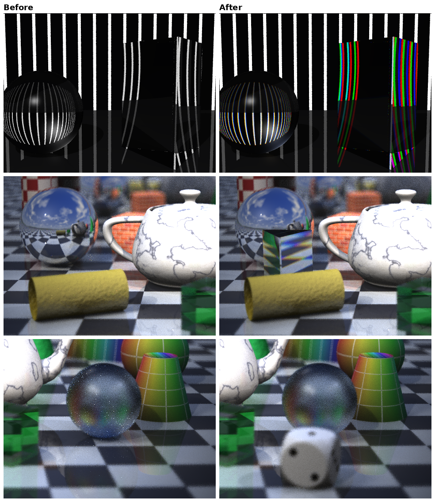
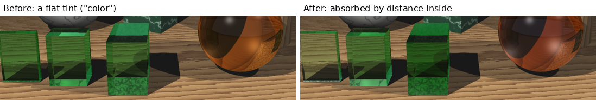
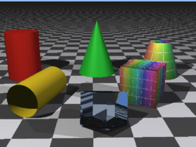
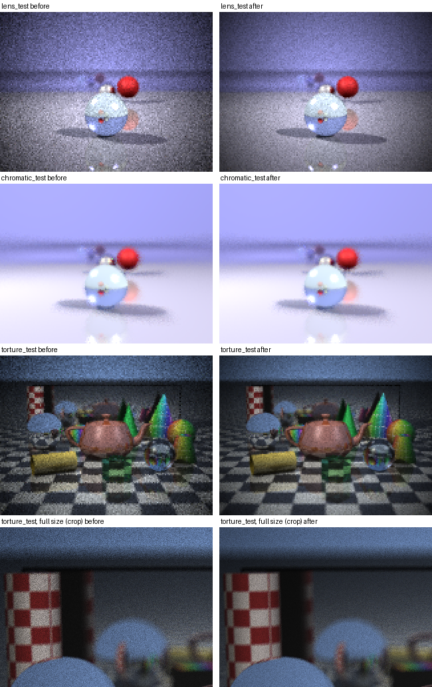
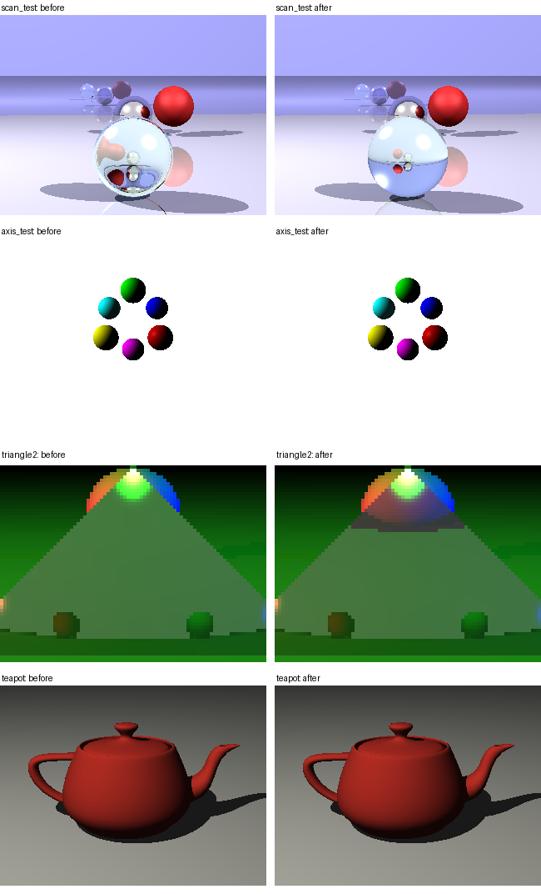
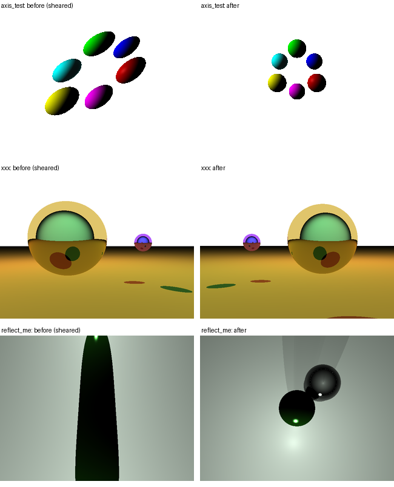

# Changelog

All notable changes to this project are documented in this file.

The format is based on [Keep a Changelog](https://keepachangelog.com/en/1.1.0/). Versions up to
0.2.0 followed [Semantic Versioning](https://semver.org/spec/v2.0.0.html); from 2026 they are named
for the year, the stage and a number (`2026-alpha-0.3`).

Every change that alters rendered output shows its before and after images here.

## [Unreleased]

## [2026-alpha-0.10] - 2026-11-20

Solids and spectra: constructive solid geometry, which makes lens blanks, bowls and drilled dice
from spheres, boxes, cylinders, cones and meshes, and glass that splits light into colors by its
Abbe number. Plus a sample clamp on the camera that takes the bright specks out of rough glass and
area lights. Scenes without the new fields render byte for byte as before.

### Added

- **Constructive solid geometry** (`"type": "csg"`): a solid made from two or more closed shapes,
  its `objects`, by `operation`: `"union"` (inside any of them), `"intersection"` (inside all of
  them) or `"difference"` (inside the first and none of the rest). The shapes can be spheres, boxes,
  capped cylinders and cones, meshes (which must be closed) and other csgs; planes, triangles and
  open cylinders and cones are refused.
  - Along a ray the csg asks each shape for every crossing, from just past the one before, so an
    odd number ahead means the ray starts inside it. Walking the crossings in order, the first
    where the solid's inside changes is the hit, and the normal there is the crossed shape's,
    turned inside out on a subtracted shape. A shape's last hit part (a mesh's face, an inner
    csg's shape) is kept with each crossing, so nested csgs and meshes shade with the right
    normal.
  - It shades as one object with its own `materials` and `bump`, so glass made of parts is entered
    and left as one piece. With `"childMaterials": true` each surface is shaded with the materials
    of the shape it comes from (`CObjects` gained a list of materials to shade with, used by the
    csg only). Its surface coordinates are those of the shape each surface comes from, so image
    textures and normal maps work on it.
  - A ray leaving its surface (a shadow or a reflection) skips only that surface, so a bowl shades
    and reflects its own inside. Its bounding box (all its shapes' for a union, their overlap for an
    intersection, the first shape's for a difference) puts it in the scene's tree.
  - Each object can now give its outward normal at a point (`CObjects::SurfaceNormal`), the part
    its last hit was on (`HitPart`), and whether it is closed (`IsClosed`); shading is unchanged.
- **Glass that splits light into colors.** A `transparent` material takes an `abbe` number
  (default 0, no dispersion; otherwise at least 5). A ray traced in every color splits into three
  where it first meets such glass, red, green and blue, each bent by its own index from the same
  Cauchy curve the lens uses (now `CLens::DispersedIndex`, through `indexOfRefraction` at the
  d line and the Abbe number), and each keeping only its own color of what it sees. After that each
  stays in its color (rays now carry their channel, `CRay::GetChannel`, and rays made from them
  keep it), so further glass bends it by that color's index, and rays from a chromatic lens, which
  are already in one color, don't split again. A flint prism or ball fringes the edges of what is
  seen through it with color. Ray traces from the eye, so a prism casts no rainbow on the floor.
- **The sample clamp.** The camera's `clamp` (default 0, off) is the brightest any one sample's
  red, green or blue may be before the sampler averages it in. A rare ray that finds a light
  through rough glass, off a rough mirror or from an area light can be many times brighter than
  its pixel's other rays and show as a lone speck (a "firefly"); a clamp of 1.5 to 2 removes them,
  at the cost of a little of the brightest highlights.
- **`scenes/csg_test.ray`:** a glass lens blank, a bowl (blue outside, white inside, clay at the
  cut rim, by `childMaterials`), a die with drilled black pips (a rounded cube that is itself a
  csg) and a hammered gold capsule. **`scenes/prism_test.ray`:** a flint glass prism (an
  intersection of three turned boxes) and ball (index 1.62, Abbe number 20) before white bars.
  New tests: `render_csg`, `render_prism` (with reference renders and README previews),
  `roundtrip_csg_test`, `roundtrip_prism_test`, and `network_csg` and `network_prism`, which must
  match threads byte for byte. `format_test` checks where rays hit a union, an intersection, a
  difference and a nested csg, and the normals there, from outside, from inside and leaving the
  surface while ignoring the csg; the bounding boxes; that `childMaterials` shades each surface with
  its own shape's materials and that otherwise the csg's own shade it all; that a csg round-trips
  with its bump map, and that bad operations, too few shapes, open shapes and unknown types are
  reported. It checks that dispersed indices follow the Abbe number and match the lens's, that blue
  bends more than red, that a ray in every color sees exactly, channel by channel, what rays traced
  in each color alone see, that straight through the middle nothing changes, that glass without an
  Abbe number treats every color alike, and that the clamp caps each channel, is saved, and is
  copied with the camera.

### Changed

- **The torture test has a flint glass prism, a die with drilled pips, and a clamp.** A flint
  glass prism (a csg, Abbe number 20) stands before the mirror ball and splits what is seen through
  it into colors, a die (a csg with `childMaterials`) sits in front of the frosted ball, and each
  sample is clamped at 1.5, which takes the bright specks out of the frosted ball and the brushed
  tube. Its reference render, README preview and full-size image are regenerated. A full-size
  Release render does about 16% more work than 0.9's (25.5 against 22.0 CPU minutes here), a
  little under two minutes on an idle 16-core machine.

  

  Top, the new prism test with its glass's Abbe number taken out, and as it is: the white bars seen
  through the prism and the ball break into red, green and blue. Middle, the torture test before
  and after: the new flint prism before the mirror ball, full of color. Bottom, the frosted ball
  without and with the clamp: the white specks are gone, and the die with its drilled pips sits in
  front.

## [2026-alpha-0.9] - 2026-11-20

Light and sky: spot lights with soft edges, directional sunlight whose shadows blur with distance,
and environment maps, a sky gradient or an HDR picture of the surroundings that shows behind the
scene, in mirrors and through glass, and can light it too. Scenes without the new fields render
byte for byte as before.

### Added

- **Spot lights** (`"type": "spot"`): a `position`, a `direction` and a `color`, shining in a cone
  out to `angle` degrees from its axis (default 30, under 90). The edge of the pool fades over the
  last `falloff` degrees inside it (default 5) along a smoothstep, so a falloff of 0 is a hard edge.
  With a `radius` (default 0) it is a glowing disc rather than a point, shaded from `samples` points
  on the disc it shows each surface, as a sphere light is, so its shadows are soft; without one it
  is exactly a point light inside its cone.
- **Directional lights** (`"type": "directional"`): sunlight, from so far away that it arrives
  everywhere along the same `direction` (the way the light travels) with the same `color`, casting
  shadows the size of what casts them. It has no position: a shadow ray toward it goes
  `RAY_FAR_AWAY` (10⁶) scene units. With an `angle`, its angular diameter in degrees (the sun is
  about 0.53), it is a disc in the sky shaded from `samples` directions, so its shadows are sharp
  near what casts them and blur farther away.
  - `CLight::ToLight` gives the vector a shadow ray follows: to the light's position, or back along
    a sun's direction. Point lights work it out exactly as before.
- **Environment maps** (a scene's `environment`): what a ray that leaves the scene sees, instead of
  the flat `background`, whether it is a camera ray that missed everything or a reflected or
  refracted ray that escaped (`CScene::Escaped`). Two kinds:
  - `"sky"`: a gradient by height from `horizon` to `zenith` above and to `ground` below, blended by
    the height raised to `exponent` (default 0.5).
  - `"image"`: an equirectangular (latitude-longitude) picture of the surroundings in a Radiance
    HDR file (`.hdr`, RGBE, flat or run-length encoded: `CEnvironment::ParseHdr`) or any image a
    texture can be (PNG, PPM, Ray raw), turned about +y by `rotation` degrees, looked up bilinearly
    and wrapped around its sides. HDR colors are linear and may be far brighter than white, so a
    sun in the sky stays bright in a mirror. The file goes into a saved scene's archive, and a
    scene copy sent to a task carries its bytes (`data`), so networked engines need no files and
    match threads byte for byte.
  - Both take an `intensity` (default 1).
- **Image-based lighting.** With `samples` (default 0, off), the environment lights diffuse
  surfaces too. The light a surface would get from the whole sky in front of it, for every way it
  could face, is worked out once when the scene loads (the sky averaged over a 64 × 32 grid, so a
  small bright sun counts in full, then weighed by solid angle and cosine into a 32 × 16 map), so
  it is smooth, with no grain. Each point a ray hits then sends `samples` shadow rays toward the
  sky, spread by the cosine and stratified like area lights' samples, and the share that get out
  scales that light, so corners, crevices and the ground under things are darker. Shiny materials
  (specular, reflective, transparent) take the sky as their reflections, not as light
  (`CMaterial::LitBySky`). It costs `samples` shadow rays at every point a ray hits.
- **`scenes/lights_test.ray`**: three spot lights (a warm one with a hard edge, a white one with a
  soft edge, and a blue soft-edged disc with soft shadows) and a low sun with an angle of 4°, on a
  box, a ball, a cone and two posts. **`scenes/environment_test.ray`**: the HDR sky behind a mirror
  ball, a glass ball, a white ball and a red one on a checkered floor, lit by the sky (`samples` 8)
  and by a sun along the sky's own. New tests `render_lights`, `render_environment` (with
  reference renders and README previews), `roundtrip_lights_test`, `roundtrip_environment_test`,
  `network_lights` and `network_environment`. `format_test` checks that a spot light's cone is full
  inside its falloff, empty outside it and a smoothstep between, on the floor too; that half a
  spot's disc hidden gives half its light; that sunlight is the same everywhere, falls along its
  direction and casts a shadow the size of what casts it, with a soft edge when it has an angle;
  that HDR files decode exactly, flat or run-length encoded, and that damaged ones are refused; that
  an environment shows each pixel along its own direction, wraps across its seam, turns with its
  rotation and scales with its intensity; that a sky blends as it should; that a uniform sky lights
  a surface facing any way the same, a half sky by how much of it a surface faces, and the foot of a
  wall with about half; that a specular material isn't lit by the sky; that the new fields read
  back the same; and that bad settings are reported.
- **`tools/make_textures.py`** also makes `scenes/textures/sky.hdr`: a 512 × 256 afternoon sky,
  run-length encoded, with clouds on a flat layer, low hazy hills, sandy ground and a sun 60 times
  brighter than white.

  

  Top, the lights test with each spot light as a point light at the same place and the sun as a
  far point light, and as it is: pools of light with hard and soft edges, the blue spot's soft
  shadows, and the sun's long shadows blurring away from the posts. Middle, the environment test
  with the flat background, and with the sky: clouds in the mirror ball, the sky bent through the
  glass, and the floor lit by the sky and darker under each ball. Bottom, a full-size crop of the
  torture test: the sky over the mirror wall and in the mirror ball, and the spot light's pool.

### Changed

- **The torture test uses the new features:** it is under `textures/sky.hdr`, turned so the sun
  stands over the key light, which shows in the mirrors and glass and lights the diffuse surfaces
  (`samples` 1), with a soft-edged spot light with a radius on the teapot and a low sun with an
  angle of 1.5° along the sky's. The other lights are dimmed to keep its brightness. Its reference
  render, README preview and full-size image are regenerated. Each new light, and the sky's light,
  adds a shadow ray at every point a ray hits, so a full-size Release render takes about 1.7 times
  as long as at 2026-alpha-0.8: about a minute and a half on an idle 16-core machine.

## [2026-alpha-0.8] - 2026-11-20

Surface detail: bump and normal maps that tilt the shading normal so surfaces look dented, grooved
or rough while their shapes stay smooth, and PNG image textures of every kind, read by Ray's own
decoder. Scenes without the new fields render byte for byte as before.

### Added

- **Bump and normal maps.** Any object takes a `bump`: a `texture` and a `mode`. In `"height"`
  mode (the default) the texture is read as heights (the average of its red, green and blue, times
  `depth`, default 0.05 scene units) and the normal tilts down their slope, found by looking the
  texture up `step` (default 0.001) either side of the point along the surface. Solid textures need
  no surface coordinates, so `noise` makes hammered metal or orange peel on anything, and an
  object's own wood or marble texture makes its grain stand out. In `"normal"` mode the texture is a
  tangent-space normal map (OpenGL convention: flat is (0.5, 0.5, 1), green toward increasing v),
  tilted by `strength` (default 1); the surface's u and v directions are worked out from its
  surface coordinates, so it works on every object that has them, across a sphere's seam too.
  - The bump map belongs to the object, not to one of its materials, so the diffuse shading, the
    highlight, and reflected and refracted rays all follow the same bumps; a mesh's faces share the
    mesh's, as they share its materials (`CObjects::BaseShade` tilts the normal once, before any
    material sees it).
  - A tilted normal that would face away from the ray, as at the rim of a sphere, is passed over
    for the smooth one, so a surface is never lit from behind.
  - Nothing new crosses the wire beyond the scene's own fields: images in a bump map travel inside
    the scene like any texture's, so networked engines match threads byte for byte.
- **PNG image textures.** An `image` texture (and so a normal map) can be a PNG of any kind:
  grayscale, RGB, palette, grayscale with alpha or RGBA, at 1, 2, 4, 8 or 16 bits a channel,
  interlaced or not (`CPngImage`). Low bit depths are scaled to the full range, 16-bit channels
  rounded to 8 bits, and alpha is ignored. The data is inflated by a small decoder of our own, so
  nothing new is needed to build; chunk CRCs and the zlib checksum are checked, and a damaged or
  truncated file is reported when the scene loads, never read past. A saved scene keeps the PNG
  file itself in its archive.
- **`scenes/bump_test.ray`**: a brick wall (a PNG color texture and an interlaced PNG normal map)
  lit from the side, a hammered copper ball and an orange-peel ball, a box embossed with bricks by a
  16-bit grayscale PNG height map, and a wood floor bumped by its own grain. New tests
  `render_bump` (with a reference render and a README preview), `roundtrip_bump_test` and
  `network_bump`. `format_test` decodes PNGs of every color type and bit depth, interlaced and
  not, with every filter type, exactly; refuses damaged CRCs, every truncation, palette indices past
  the palette and unknown critical chunks; inflates stored and dynamic Huffman blocks (one made by
  zlib) and catches a wrong checksum and damaged data; checks that a height ramp tilts the normal
  by exactly depth times its slope, that a normal map tilts it toward u by its red and toward v by
  its green times `strength`, that a flat map changes nothing on a sphere, that a normal facing away
  from the ray is passed over, that every object type saves and reads back its `bump` and a mesh's
  faces share it, and that bad settings are reported.
- **`tools/make_textures.py`** makes the three brick PNGs in `scenes/textures/` (color, normal map
  and 16-bit height map) with only the Python standard library.

  

  Above, the new test scene with its bump maps taken out, and as it is: the copper ball is
  hammered, the orange has its peel, the plain box is embossed with bricks, the floor's grain
  stands out, and the bricks' edges catch the side light. Below, the torture test: the gold tube is
  hammered, and the box behind the teapot is now bricks, a PNG texture with a PNG normal map.

### Changed

- **The torture test uses the new features:** the textured box is bricks (`bricks.png` with the
  `bricks_normal.png` normal map), the gold tube and the green cone are hammered by `noise` height
  maps, and the mirror's wooden frame is bumped by its own grain. Its reference render, README
  preview and full-size image are regenerated.

## [2026-alpha-0.7] - 2026-11-20

Softness: frosted glass and brushed mirrors, and area lights that cast soft shadows, all picking
their directions and points from where each ray falls in its pixel, so a stratified sampler
smooths them and every render is the same each time. Scenes without the new fields render byte
for byte as before.

### Added

- **Rough glass and mirrors.** `transparent` and `reflective` take a `roughness` (default `0`, up
  to `1`). Each ray bends or reflects about a microfacet normal drawn from a GGX
  (Trowbridge–Reitz) distribution of that roughness about the surface's normal, so frosted glass
  blurs what is behind it and a brushed or satin mirror blurs its reflection; a microfacet that
  would send the ray the wrong way through the surface is passed over for the smooth direction.
  Smooth materials don't write a `roughness`, so existing scenes save as before.
- **Area lights: `sphereLight` and `rectangleLight`.** A glowing ball (`radius`) or panel (sides
  `edge1` and `edge2`, shining only to the side `edge1` × `edge2` points to), each with `samples`
  (default `1`, up to 256). Each point is shaded from that many points of the light, each with its
  own shadow ray and an even share of its color, so shadows are dark where none of the light can be
  seen and fade through a penumbra where some can. Like point lights they don't fall off with
  distance and the camera doesn't see them; point lights are unchanged.
- **Where the samples come from.** Each ray carries a sample point (where its primary ray fell in
  its pixel) and a key (from its pixel and the bounces since). A rough surface or an area light uses
  that point, shifted, turned and mirrored by a hash of the key, its depth and what it's for, so a
  sampler that spreads its rays evenly over a pixel (`stratified`, `adaptive`) spreads them evenly
  over the blur and the light. A ray made at a surface picks again from a point hashed from its
  parent's: reusing the same point there tied each bounce to the one before in a way fixed for the
  pixel, and frosted glass came out with a speckle that more rays never smoothed. Nothing is random,
  so networked engines match threads byte for byte; nothing new crosses the wire.
- **`scenes/soft_test.ray`**: three glass panes before a striped poster (clear, roughness 0.08 and
  0.3), a mirror ball and a brushed gold one, and soft shadows from a rectangle light and a sphere
  light, with a 6×6 stratified sampler. New tests `render_soft` (with a reference render and a
  README preview), `roundtrip_soft_test` and `network_soft`. `format_test` checks that the new
  fields read, save and read back, that bad values are reported, that GGX microfacets tilt as the
  distribution says (half within atan of the roughness), that a sphere light's points lie on the
  disc it shows, that a rectangle light shines only to its front, that hiding half of one gives half
  its light, and that rough glass is the same every time for the same ray.

  

  Above, the new test scene drawn with what the renderer had before (smooth surfaces, point lights
  at the area lights' centers) and as it is now: the middle and right panes blur the stripes behind
  them, the gold ball's reflection is brushed, and the shadows of the post and the red ball are soft
  at their edges. Below, the torture test: the glass ball is frosted, the gold tube brushed, and the
  shadows soften under the new sphere and rectangle lights.

### Changed

- **The torture test uses the new features:** the glass sphere is frosted (roughness 0.12), the
  gold tube brushed (0.15), the key light a sphere light of radius 3 and the overhead fill a 3 × 3
  rectangle light. Its reference render, README preview and full-size image are regenerated; its
  description in `scenes/README.md`, which still had the copper teapot and black frame, is brought
  up to date.
- **`CLAUDE.md`: every new feature goes into the torture test** in the same change, with its
  reference render, README preview and full-size image regenerated; and every release updates the
  release gallery.

## [2026-alpha-0.6] - 2026-11-20

Solid noise textures (marble, wood, and noise for granite and stone) and glass that absorbs light
by how far it travels inside, shown in a new test scene and worked into the torture test.

### Added

- **Solid noise textures: `marble`, `wood` and `noise`.** They fill space rather than lie on a
  surface, so an object looks carved from a block of the material and needs no surface
  coordinates. Each works out a value from Perlin gradient noise (his 2002 form, with a shuffle
  picked by `seed`) and looks it up in a ramp of `colors`. `marble` draws thin veins where bands
  across `axis` meet, bent by `turbulence`. `wood` draws rings about an axis, wobbled by noise.
  `noise` gives smooth layered noise, or sharp-creased turbulence for granite and stone. All take
  `scale`, `origin`, `turbulence`, `octaves` and `seed`; see `scenes/README.md`.
- **Glass that absorbs by the distance light travels inside it.** A `transparent` material's new
  `attenuationColor` and `attenuationDistance` give the color light is left after going that far
  through the object. Twice as far gives that color squared (Beer–Lambert). Thick glass is deeper
  in color than thin, and a glass ball is darker through its middle than at its rim. Each ray
  carries the transparent object it is inside (`CRay::GetInside`), so the surface where it comes
  out knows how far it went. A ray turned back inside past the critical angle keeps absorbing.
  Without the new fields nothing changes, and every existing render is byte for byte the same.

  

  On the left, the old way: a flat tint at each surface, so all three slabs are the same green. On
  the right, absorption: the thin slab is pale and the thick one dark. The amber ball is deepest
  through its middle and lightens toward its rim.
- **The torture test uses them too.** The teapot is polished white marble instead of copper, the
  mirror's frame is wood (and a little wider, 16.2 by 5.6, so the grain shows round the mirror),
  and the glass cube is clear glass that turns green by the distance light goes through it. The
  `torture_test` reference render, its README preview and the full-size README image are
  regenerated.

  

  Look at the teapot's gray veins, the wood grain round the mirror, and the cube: deeper green
  where light crosses more glass.
- **`scenes/solid_textures_test.ray`** shows both: a white marble sphere, a green marble cube, a
  wooden log and floor, a granite wall, the three slabs and the amber ball. New tests:
  `render_solid_textures` (with a reference render and a README preview),
  `roundtrip_solid_textures_test`, and `network_solid_textures`, which must match threads byte for
  byte. `format_test` checks that the noise is smooth, within about −1 to 1 and 0 on its lattice;
  that each seed gives its own noise and always the same one; that the color ramp blends evenly;
  that every texture round-trips through JSON; and that bad settings are reported. It also checks
  that a ray through a glass ball keeps exactly `attenuationColor` to the power of its chord over
  `attenuationDistance`.

## [2026-alpha-0.5] - 2026-11-20

Faster: plain value types for vectors and colors, a bounding volume hierarchy over the scene,
shadow rays that stop at the first hit, and lens tables worked out once and saved with the scene.
Every render is byte for byte what it was; the full-size torture test takes about a minute on a
Release build. Plus the `adaptive` sampler.

### Added

- **The `adaptive` sampler** (`--aa adaptive`, or `{ "type": "adaptive" }` in a scene): each
  pixel gets at least `min` rays (default 9), then more, one at a time, until the standard error of
  its brightness is under `threshold` (default 0.01) or it has `max` (default 64). Rays follow the
  R2 low-discrepancy sequence, shifted for each pixel by a hash, so any number of them is spread
  evenly over the pixel and over a real lens, and the image is reproducible and the same in every
  task. On the torture test at 320×240, measured against a 144-ray render: the scene's 5×5
  stratified sampler (75 rays a pixel with the three channels) has an RMS error of 2.54 levels;
  `adaptive` has 2.23 with 18% fewer rays, and with `min` 16, 1.84 with the same rays. New tests:
  `render_sampler_adaptive` (with a reference render and a README preview) and
  `network_sampler_adaptive`, which must match threads byte for byte. Samplers now get each ray's
  color before making the next, which `CTileTracer` always did.
- **A lens's exit pupil tables are worked out before the scene is sent, and saved with it.** The
  master works them out once, on every core, when the scene is loaded; they go into the lens's
  record (`exitPupil`: the tables as exact base64 doubles, and a fingerprint of the setup they are
  for), so tasks and engines use them instead of working them out each, and a saved scene loads
  without working them out. If the lens, focus, aperture or sensor changes, the fingerprint no
  longer matches and they are worked out again. `lens_test`, `chromatic_test` and `torture_test`
  are re-saved with theirs; renders are byte for byte the same.

### Changed

- **Faster tracing, with every render byte for byte the same.** On a Release build, the torture
  test at 320×240 went from about 13.0 s to 6.7 s, and `scan_test` with 9 random rays a pixel at
  1280×960 from 7.3 s to 5.4 s:
  - `CVector` and `CColor` are plain value types: no virtual functions, and their small members
    are inline, so the compiler can keep them in registers. The biggest single gain.
  - The scene keeps its objects in a bounding volume hierarchy: each object reports a bounding box
    (`CObjects::GetBounds`; planes have none and are tested every time), and a ray tests only the
    objects in boxes it passes through. Of objects hit at exactly the same distance, the first in
    the scene wins, as when every object was tested in order; `format_test` checks that the tree
    and the plain loop find exactly the same hits and shadows.
  - Shadow rays stop at the first thing in the way: a mesh stops at the first face it finds in its
    tree (`CObjects::Occludes`), and the object that blocked the last shadow ray is tried first.
  - A chromatic lens no longer traces the sampler's own ray through the glass, which was only used
    for where the sample falls; it is made again for each color anyway (`CCamera::SetAimOnly`).
  - A lens works out the index of each glass in each color once, instead of in every step of every
    ray.
- `scenes/README.md` no longer says reflected rays keep their parent's influence: they carry it
  times their material's share, so rays off weakly reflective surfaces stop after a few bounces.
- `CLAUDE.md`: time renders with a Release build; bounded objects override `GetBounds`, and objects
  made of parts `Occludes`.

### Fixed

- Release builds warned that parts of a task's events and inbox messages might be used
  uninitialized when copied; they now start at defaults.

## [2026-alpha-0.4.1] - 2026-11-20

Real lenses cast blocked rays again, so lens renders have almost no grain from the lens.

### Changed

- **A real lens casts a blocked ray again instead of letting it go black, so lens renders have
  almost no grain from the lens.** Whether a ray gets through the lens depends only on the lens
  and where it starts on the sensor, never on the scene. So the lens now works out, once, the share
  of rays aimed at its rear element that get through, at each ring of the sensor and in each color.
  A ray the lens blocks is cast again at another point in the exit pupil (up to 64 times, at
  points hashed from the first, so every run and every task makes the same ones) until one gets
  through, and that ray counts for the share. Brightness and vignetting are as before, but how
  many of a pixel's rays happened to be blocked no longer shows as grain.
  - On a plain grey background through the double Gauss, the difference between neighboring
    pixels falls from 0.022 (2026-alpha-0.4) and 0.038 (2026-alpha-0.3) to 0.002. Brightness
    matches a 1,024-ray render of the old sampling within 0.3% (1.2% in the corners, within that
    render's own noise).
  - The share is measured on the same grid as the exposure, so the center of the image is exactly
    as bright as through a pinhole.
  - The `lens_test` and `torture_test` references are regenerated, with their previews in the
    README; `chromatic_test`, whose lens blocks nothing in its frame, is unchanged, as is every
    render without a lens. What grain is left comes from the scene: out-of-focus edges and
    textures blending.

    

## [2026-alpha-0.4] - 2026-11-19

New shapes and a new way to share out the work: cylinders, cones and boxes; meshes with a bounding
volume hierarchy; a torture test of everything through a real lens; PNG and high dynamic range
output; and tasks that pull tiles of the image, so camera rays are made in parallel and engines can
come and go.

### Added

- **Cylinders, cones and boxes.** Three new object types for scene files (documented in
  `scenes/README.md`):
  - `cylinder`: `base`, `top` and `radius`.
  - `cone`: `base`, `top`, `baseRadius` and `topRadius` (default 0, a point). A cone with a
    `topRadius` is truncated.
  - `box`: `center`, `size` (one number for a cube, or `[x, y, z]`) and `rotation` (degrees about
    x, then y, then z).

  Cylinders and cones point any way, from `base` to `top`. They are capped by default; with
  `"capped": false` they are open shells that can be seen into and shadow and reflect themselves
  inside. All three have their own surface coordinates for textures.

  The new sample scene `scenes/primitives_test.ray` has its own reference render and tests:
  `render_primitives`, `roundtrip_primitives_test`, and `network_primitives`, which must match the
  threaded render byte for byte. Its preview is in the README's expected-output table. Look for:
  - the inside of the open yellow tube, dark except where light falls through its open end;
  - the image texture upright on each face of the cube and wrapped around the truncated cone, with
    the grid filling its top cap;
  - the floor seen through the turned glass box, bent by refraction.

  

  `format_test` checks where rays hit each shape and the normals there, open and capped ends, rays
  from inside, surface coordinates, and the errors for bad sizes and radii. No existing render
  changes. The scene editor shows the new objects in its tree but has no dialogs to add or edit
  them yet.

- **Torture test.** `scenes/torture_test.ray` uses everything at once: every kind of object (sphere,
  plane, cylinder, cone, box, triangle, and the teapot mesh), mirrors, glass, image and checker
  textures, a reflective floor and a black-framed mirror wall, seen through the double Gauss lens with a 5×5
  stratified sampler (25 rays a pixel, each traced in red, green and blue) at 1024×768. The
  `render_torture` test renders it at 160×120 and compares it with a new reference render, which is
  in the README's expected-output table; `roundtrip_torture_test` loads and saves it. The lens
  focuses on the teapot at f/2 with a scene unit of 5 cm, so the depth of field is shallow. Look
  for the teapot and the scene behind the camera in the mirror wall, blurred because their light
  travels farther than the teapot's; the floor bent through the glass sphere and the green glass cube; and the
  nearest checks of the floor out of focus. The grain is the lens's: each of the
  25 rays takes a different path through the glass.

  

- **PNG and high dynamic range output.** `raythrower --png <file>` writes the image as a PNG, and
  `--hdr <file>` writes every pixel's linear, unclipped color as a Radiance HDR (`.hdr`, RGBE)
  file, so highlights brighter than white survive for image editors, Blender and HDR viewers. Both
  are written by the new `CImageExport`, with a small deflate encoder of its own for PNG, so no
  zlib is needed. The raw format is still what the trace writes.
- **The `hdr` color model** (`--color hdr`, or `{ "type": "hdr", "exposure": 1 }` in a scene):
  colors scaled by `exposure` go unclipped into `--hdr` files, and 8-bit files get them clipped
  and sRGB-encoded. Color models now give the linear color for HDR files (`ToLinear`); `reinhard`'s
  is scaled by its exposure, and the others' is the traced color as it is.
- New tests: `render_color_hdr` (with a reference render, the same as `srgb` at exposure 1), unit
  checks of RGBE encoding and the `hdr` model, and `image_output`, which renders `scan_test` with
  `--png` and `--hdr` and decodes both with `tools/check_image.py`. The PNG must match the raw
  image exactly, and the HDR file within RGBE's precision, with colors above 1. It runs when CMake
  finds Python 3.

### Changed

- **Real lenses aim their rays at the exit pupil, so lens renders are less grainy.** A ray from the
  sensor used to go toward any point of the lens's rear element, and many were blocked by the
  aperture stop, especially toward the edges where the lens vignettes: blocked rays come back
  black, and how many varied from pixel to pixel. Now, for each of 64 rings of the sensor out from
  the center, the lens works out the exit pupil: an ellipse on the rear element around everywhere
  light gets through, found by tracing a grid of rays (in every color, for a chromatic lens). Rays
  are aimed only inside it, and each counts for the ellipse's share of the rear element
  (`CRay::GetWeight`), so the image is exactly as bright as before on average.
  - On a plain grey background through the double Gauss, the pixel-to-pixel noise falls by about a
    quarter at the center and nearly 40% at the edges and corners. `lens_test` is about 37%
    smoother, and the torture test about 27%. Average brightness is unchanged (within 0.3%).
  - When light gets through the whole rear element (as in `chromatic_test`, whose last surface is
    the stop), the lens aims at all of it, as before.
  - The rings are worked out the first time a ray needs them, and shared by every copy of the lens
    in the program, so the worker threads split the work and the master does none.
  - The `lens_test`, `chromatic_test` and `torture_test` references are regenerated, with their
    previews in the README; no other render changes. Look for the finer grain across the frame and
    the cleaner edges:

    
- **Tasks pull tiles of the image instead of being dealt batches of rays.** The master splits the
  image into tiles (32×32 pixels, `raythrower --tile` to change it) and keeps them in a queue. Each
  task, a thread or a networked `rayengine`, asks for a tile and traces it with the new
  `CTileTracer`: it runs the camera's pixel sampler for the tile, makes the camera rays itself
  (through the lens, once a channel for a chromatic one), traces them, and sends back the tile's
  linear pixels, then asks for the next. Faster tasks take more tiles.
  - Making camera rays was the master's job, on one thread. With a real lens that held the torture
    test to about 3 of 16 cores. Now it takes 3 min 46 s at 1024×768 instead of 13 min 44 s,
    using about 10 cores.
  - Renders are byte for byte what they were: all 36 reference renders, and the full-size torture
    test, match. Samplers sum in fixed point, and a ray two tiles share (a corner of the `corners`
    sampler) is traced by both and comes out the same.
  - **Engines can come and go.** With `--listen`, `-N` engines must connect before tracing starts,
    but more can connect at any time, even mid-render: they get the scene and start asking for
    tiles. An engine that drops out has its unfinished tiles handed to the others. A trace fails
    only if every engine is gone and none connects within the `--timeout`. The new `engine_churn`
    test runs one engine that quits after its first tile and another that joins mid-trace, and the
    image must match threads exactly.
  - The wire protocol is version 4: `MESSAGE_REQUEST`, `MESSAGE_TILE`, `MESSAGE_PIXELS` (the
    pixels as doubles) and `MESSAGE_STOP` replace the ray and color batches. Engines and masters
    must come from the same release.
  - `CPixelSampler::Begin` takes a tile (`left, top, width, height`), in image coordinates;
    `BeginImage( width, height )` samples a whole image. `CPixelWriter` is now an interface:
    `CImageWriter` writes the image through the color model, and `CTileTracer` keeps a tile's
    pixels.
- **Meshes are much faster.** A mesh keeps its faces in a bounding volume hierarchy, so a ray tests
  only the faces in boxes it passes through instead of every face. The teapot renders about 30
  times faster (41 s to 1.4 s at 320×240 on 16 cores). Renders are byte for byte the same: of faces
  hit at exactly the same distance, the tree picks the first in the mesh, as testing every face in
  order did. `format_test` checks that the tree and the plain loop find exactly the same hits.
- `.gitignore` ignores `nohup.out`.

### Removed

- `raythrower --batch` (rays per batch), and `CRayArray` and `CColorArray`, which carried the
  batches; `--tile` sets the work unit's size instead.

### Fixed

- `texture_checks` failed on Windows: it wrote the texture's absolute path into the test scene
  with backslashes, which JSON reads as escapes. It now writes the path with forward slashes.

## [2026-alpha-0.3] - 2026-11-19

The ray tracing has resumed: a corrected camera, anti-aliasing, color models, real lenses with
chromatic aberration, meshes and the Utah teapot, textures, corrected materials, and scenes saved
as JSON inside IASLib resource archives.

### Added

- **JSON scene files.** Scenes are saved as human-readable JSON (version 3 of the `.ray` format,
  same extension) that can be written and edited by hand. Only the camera is required; anything
  left out takes its default. Unknown fields are errors, so misspellings are caught, and every error
  says where it is (`objects[0].materials[1]: unknown field "colour"`). The format is documented in
  `scenes/README.md`. It adds the background color, the camera's sampler and color model, and
  triangle and mesh options to what the binary format held, and keeps every 1997 setting, the
  never-implemented ones under `settings.reserved1997`. Saved numbers are rounded to six decimal
  places, and angles are in degrees. Built on IASLib's JSON support, which the build now turns on.
  - Each scene class reads and writes its own fields (`ToJson`/`FromJson`); the object and material
    registries give each class a JSON `type` name and can create one empty.
  - `CScene::GetLoadError` says why a load failed; a binary scene from 1996–1999 is recognized and
    reported as no longer readable.
- **Pixel samplers.** A camera owns a `CPixelSampler` that makes its primary rays and turns their
  colors into pixels, so new anti-aliasing or ray generation schemes are new subclasses attached
  with `CCamera::SetSampler` or named in the scene. `CTaskMaster::TraceScene` just runs the camera's
  sampler. Samplers are listed by name in `PixelSampler.cpp`.
  - `none` (`CCenterSampler`, the default): one ray through each pixel's center, as before.
  - `corners` (`CCornerSampler`): the first anti-aliasing mode. It traces five rays for each pixel,
    one at each corner and one at the center, and averages them. Each corner is traced once and
    shared by the four pixels around it, so it costs about two rays per pixel instead of five.
    Rays are tagged with their position on a doubled sample grid, so `rayengine` needs no change,
    and samples are summed in fixed point, so threads and networked engines produce identical
    images.
  - `box` (`CBoxSampler`): four rays per pixel, each halfway from the center to one of its corners,
    averaged equally.
  - `random` (`CRandomSampler`): a ray through the center worth half the pixel, and N rays at random
    points in the pixel sharing the other half (`samples`, N, from 1 to 1024, default 4). The points
    come from a hash of the pixel, ray number and `seed`, so images are reproducible and threads and
    engines agree.
  - `CPixelAccumulator`: the weighted, fixed-point, order-independent averaging the samplers share.
- **Texture mapping** (`CTexture`): any material can have a `texture` that gives its color at each
  point. Textures: `checker` (two colors, in surface coordinates or `solid` in the scene) and
  `image` (PPM P6/P3 or Ray raw files, bilinear, with `scale`, `offset`, `repeat` and `srgb`).
  Objects give surface coordinates (`CObjects::SurfaceCoords`): spheres by longitude and latitude,
  planes along two axes across them, triangles and meshes from new optional `uvs`. Image pixels
  travel inside the scene when it is copied to a task (`RayJson::CEmbedData`, base64 `pixels`),
  so networked engines need no files and still match threads exactly. Image files are read
  relative to the scene file, and saved relative to wherever the scene is saved (absolute when
  the two share only the root). New `scenes/texture_test.ray` and `scenes/textures/uv_grid.ppm`.
  - UV mapper: a mesh without `uvs` can have a `uvMap` (`planar`, `cylindrical`, `spherical` or
    `box`, about an `axis`, with an optional `center` and `scale`) that works out each face's
    corner coordinates when the mesh is built. Faces across a cylindrical or spherical seam are
    unwrapped, and pole corners take their face's angle. New `scenes/teapot_textured.ray`.
- **Real camera lenses** (`CLens`): a camera can have a lens prescription, spherical glass surfaces
  listed front to back as in lens patents, and rays are traced from the sensor back through each
  surface out into the scene. Rays the barrel or the aperture stop blocks go dark, so depth of
  field, vignetting, and the lens's aberrations and distortion come from the optics. The lens's
  focal length and widest f-number are worked out, the sensor is placed to focus at
  `focusDistance` (default: the look-at point), and exposure is set so the image center is as bright
  as through a pinhole (`CPixelWriter` now takes an exposure). The ray's position in its pixel picks
  where it crosses the lens, with a per-pixel shift, so evenly spread rays sample the lens evenly.
  Built in: `double-gauss-50mm` (50 mm f/2, US 2,673,491, as tabulated by Kolb et al. 1995). The
  example prescription in the design brief this started from turned out to be a diverging lens
  (focal length −16 mm), which can't form an image; such lenses are rejected with that message.
  A camera without a lens is the same pinhole as before, byte for byte. New `scenes/lens_test.ray`.
  - Chromatic aberration: surfaces take an `abbe` number for the glass that follows. Each glass's
    index is fitted to a Cauchy curve through its d-line index and Abbe number, and each sample is
    traced three times, red at the C line (656.3 nm), green at the d line (587.6 nm) and blue at
    the F line (486.1 nm), each keeping only its channel; the task master recombines them. The
    channel travels in the top bits of the ray's tag, so engines and the wire format are
    unchanged and networked images still match threads. Green uses the index as given, so focus
    and exposure are unchanged. `"chromatic": false` turns it off. The built-in double Gauss has
    its Abbe numbers (from Kolb's table; three of its glasses match catalogue SF15, F5 and LaF3),
    and is corrected for color (red and blue focal lengths within 0.06 mm), so its fringes are
    faint; new `scenes/chromatic_test.ray` uses an uncorrected BK7 singlet, whose color focus
    shift (0.75 mm) matches the textbook f/V.
  - `stratified` sampler (`CStratifiedSampler`): an n×n grid of equally weighted rays per pixel,
    each at a random point in its cell (`grid`, n, default 4; `seed`). Equal weights matter with a
    lens, where the `random` sampler's half-weight center ray makes every blocked ray a dark speck.
- **Triangles work out their own normals** from their corners, instead of storing them, by the
  edge traversal in the 1997 code (which had been commented out) with its order reversed:
  (V2 − V1) × (V3 − V2). The 1997 order made faces of standard models such as OBJ files face
  inward. The corner order decides the front; the two 1997 triangle scenes had their corners
  reordered to keep facing the camera, and are double-sided. New `doubleSided` (a single-sided
  triangle can't be hit from behind; a double-sided one is shaded from the side it is seen from)
  and `smooth` flags. Optional `normals` override the corner normals smooth shading blends (and
  make the triangle smooth); `triangle2.ray` keeps its 1997 tilted normals this way, which are what
  light it.
- **Meshes** (`"type": "mesh"`, `CMesh`): a vertex list and faces given as vertex indices. The
  faces are `CTriangle`s that share the mesh's materials. In a smooth mesh each vertex's normal is
  the sum of the normals of the faces around it, and faces blend their corner normals by barycentric
  weights, so shared edges show no seam; optional `normals`, one per vertex, replace the summed
  ones. Rays that miss the mesh's bounding box skip all its faces,
  and rays leaving a face skip only that face (`CObjects::Intersect` now takes the object to
  ignore), so a mesh shadows and reflects itself.
- **The Utah teapot** (`scenes/teapot.ray`, 6,320 triangles), and `tools/obj_to_ray.py`, which turns
  OBJ models into meshes (with options to smooth, weld repeated vertices, and flip the odd model
  wound the other way).
- **Color models.** A camera owns a `CColorModel` that turns each pixel's linear color, of any
  brightness, into the image's bytes; samplers now hand over unclipped colors through a
  `CPixelWriter`. Color models are listed by name in `ColorModel.cpp`:
  - `clip` (the default): clip at 1 and truncate, exactly as the 1997 image writer did;
  - `gamma`: gamma encoding, with a `gamma` setting (default 2.2);
  - `srgb`: the sRGB curve;
  - `reinhard`: Reinhard tone mapping on luminance, with `exposure` and `white` settings, then sRGB.
- `raythrower` options: `--aa <sampler>`, `--color <model>` and `--size <w>x<h>` override the
  scene's choices, and `--aa`/`--color` take settings after a colon (`--aa random:samples=9`); `--save <file>` saves the scene and exits; `--help` lists the samplers and color
  models. It prints the rays traced and the rays per pixel, and says why a scene couldn't be read.
  The scene editor does not offer a sampler or color model yet.
- An "Expected output" section in the README showing every reference render the tests compare
  against, labelled with its test, and `tools/render_previews.py`, which makes those previews
  (`docs/images/tests/`) from `tests/reference/renders.tar.gz`.
- `CRay::CreateRayAt`, which casts a primary ray through any point on the image,
  `CImageFile::PutRGB`, `CVector::Cross`, and `CScene::GetObjectAt`.
- Tests: material checks (Snell's law in and out, total internal reflection, specular edge
  cases and default index, and that shading a plane leaves it unchanged); UV mapper checks (each projection, seam unwrapping, poles, errors) and a textured teapot
  render; a texture render and a networked one (the image must reach the engines), texture checks
  (embedding, loading a copy without the files, errors); lens and chromatic renders (and a networked chromatic render, which must match threads),
  checks of each lens's color focus shifts, a lens render and lens checks (the double Gauss's focal length, f-number and focus, and
  the errors for unusable lenses), the stratified sampler, four scenes rendered with corner
  anti-aliasing, one with `box` and with `random` at 2, 4
  and 9 rays (and networked `random`, which must match threads exactly), one with each color
  model, and the teapot
  (new references in `tests/reference/renders.tar.gz`); networked engines must match threads with
  anti-aliasing on; rays and colors must cross the wire exactly; JSON scenes with mistakes must
  fail with the right message and leave the scene untouched; triangles must cull back faces only
  when single-sided, and smooth mesh faces must agree on the normal along a shared edge.

### Changed

- **Saved scenes are IASLib resource archives** (`CResourceFile`): `scene.json` and every file the
  scene uses (texture images), under the names the scene gives them, so one `.ray` file carries
  the whole scene. Saving writes beside the file and renames it into place, so a failed save
  leaves the old file. Plain JSON `.ray` files still load (the sample scenes stay JSON), and new
  `CScene::SaveJson` / `raythrower --save-json` writes JSON for editing by hand, extracting the
  files beside it. Files a scene names are read from its archive first (`RayJson::ReadSceneFile`)
  and collected into it when saving (`RayJson::SceneFileName`); names outside the scene's
  directory are stored under `files/`. The round-trip tests compare scenes rather than bytes,
  since archives record when they were written.
- The default trace depth is 16 levels (`settings.maximumDepth`; the camera ray is level 1, so 15
  reflections or refractions), up from the 1997 default of 15, and every sample scene uses it.
  The deepest bounces in `reflection_test`, `reflect_me` and `reflect_test2` change their renders;
  their references and the README gallery were regenerated.
- The sample scenes in `scenes/` are now JSON, converted from the 1997 originals and rounded to six
  decimal places. Rounding moves a few pixels by one level, and `triangle2` now blends its corner
  normals by barycentric weights instead of the 1997 inverse-distance weighting; the reference
  renders were regenerated.
- The wire protocol (version 3): the scene is sent as SJSON, IASLib's compact binary JSON; ray
  and color batches are fixed-layout big-endian IEEE-754 doubles (72 bytes a ray, 32 a color),
  which `RayWire::ToReadable` can show as JSON. SJSON was tried for the batches too, in stream,
  stateless and schema modes, but it costs 30–45 µs a ray to encode, more than tracing it.
  Engines and masters must be from the same release.
- IASLib is pinned to commit `de038c0`, which added SJSON, until it tags a release with it. SJSON's
  optional LZ4 and zstd support is left off, so every build is the same.
- `CTaskMaster::ColorsFromTasks` no longer takes the image; colors go to the camera's sampler.
- `CImageFile::PutPoint` writes through the `clip` color model, which also treats negative
  channels as 0 (the 1997 code converted them to a byte without a check, which is undefined).
- `CRay::CreateRay( CScene &, ... )` takes pixel coordinates instead of angles, and the camera
  works out the direction (`CCamera::RayDirection`). `CTaskMaster::TraceScene` and the GUI preview
  loop no longer do their own angle stepping.

### Removed

- The binary scene format of 1996–1999 and `CRayStream`, with every class's stream operators,
  stream constructors and `Serialize`, and the registries' stream factories. The 1997 binary
  sample scenes are gone too (they are in the history); two of them could never be read anyway.

### Fixed

- **Material math** (`CTransparentMaterial`, `CSpecularMaterial`, `CReflectiveMaterial`,
  `CObjects::BaseShade`):
  - Refraction had the wrong sign on the cos θ₁ term of Snell's law in vector form, entering and
    leaving glass, so rays bent far too much (45° into glass of index 1.5 came out at 14.5°
    instead of 28.1°), and past the critical angle it took the square root of a negative number.
    It now follows T = ηV + (η cos θ₁ − cos θ₂)N with the normal facing the ray, and reflects
    inside on total internal reflection (`CTransparentMaterial::Refract`).
  - Materials were handed the surface normal by reference, and the diffuse material turned it
    toward the viewer in place. For a plane that was the plane's own normal, so shading changed
    the scene (and could flip a plane's texture), depending on which side the last ray came from.
    Each material now works on its own copies.
  - The specular (Cook–Torrance) material didn't turn the normal toward the viewer, and divided
    0 by 0 (a NaN, a black pixel) on the shadow line; it now has no highlight for lights behind or
    surfaces edge on. Its default index of refraction was 1.0, which makes the Fresnel term 0 and
    the highlight vanish; it is 1.5 now (the teapot shows its highlight). An index below 1 is
    treated as total reflection rather than a NaN.
  - Reflected and refracted rays now carry their parent's influence times the material's, so
    `depthThreshold` prunes rays that no longer matter; `BaseShade` no longer also multiplies its
    result by the ray's influence, which would have counted it again at every bounce.
  - The reflection direction is computed directly as V − 2(N·V)N (it was right, by way of a
    detour).
  - `scan_test`'s glass sphere had index 1.0, which looked like glass only because of the
    refraction bug; it, `lens_test`, `chromatic_test` and `axis_test`'s partly transparent sphere
    now use 1.5. Every reference render, preview and README image was regenerated.

    

    Before: the 1997 refraction, and (teapot) the old default specular index of 1.0, which left no
    highlight. After: Snell's law, glass at 1.5, and the highlight.

- Camera rays were distorted. The camera was aimed by adding the difference between its view
  direction and +Z to every ray instead of rotating the rays, which sheared the image: spheres came
  out as tilted ellipses, horizons curved, a camera looking straight down saw a smear, and a camera
  turned to face -Z rendered a mirror image. Pixels were also spaced by equal angles rather than
  evenly across a flat image plane, and were not square unless the scene's two angles happened to
  match the image's shape.
  Primary rays now come from a proper camera basis (view direction, right, and up, from the stored
  up vector, with a fallback when looking straight up or down) through the center of each pixel on
  a flat image plane. The vertical angle sets the field of view and the horizontal one follows from
  the image's width and height, so pixels are square.
  The reference renders in `tests/reference/renders.tar.gz` and the README images were regenerated.

  

  Before: the six spheres of `axis_test` sheared into ellipses, `xxx` mirrored, and `reflect_me`
  (a camera looking straight down) smeared. After: round spheres, the right way round, and the
  view down onto two spheres.

## [0.2.0] - 2026-11-19

The code builds again, on Windows, Linux, and macOS, on top of
[IASLib v3.0](https://github.com/jnaujok/IASLib). The ray tracing logic is unchanged.

### Added

- `core/`: one ray tracing library shared by every program. It replaces the separate, drifted
  copies in the MFC application and in `rayengine/`.
- A TCP transport built on IASLib sockets (`CSocketTaskMaster`, `CSocketTaskSlave`, and a framed
  wire protocol in `WireProtocol.h`). It takes the place of PVM.
- `raythrower` options: `--listen [port]` to trace with networked engines, `--spawn` to start
  local `rayengine` processes, `-o` to choose the image file, `--ppm` to also write a viewable
  PPM image, `--batch`, `--timeout`, and `--tasks` (the original `-Nxxx` still works).
  Without `--listen` it traces with threads.
- `CScene::Load` and `CScene::Save`. `Load` reads version-1 and transitional scene files with the
  pre-April-1997 number format, which the 1997 code itself could no longer read.
- Regression tests (`ctest`): every readable sample scene is rendered and compared with a reference
  render, networked engines must produce exactly what threads produce, scene files must survive a
  load and save, and the serialization format is checked byte for byte.
- GitHub Actions CI: Linux (GCC and Clang), macOS, and Windows builds with tests, a Linux
  AddressSanitizer/UBSan job, and a Windows build of the MFC scene editor.
- `scenes/README.md`, describing the sample scenes and the file format history.

### Changed

- Uses IASLib's `CString`, streams, threads, mutexes, semaphores, sockets, and `TArray` instead of
  the project's own early versions of them. `CStream` is now `CRayStream`, a reader and writer of the
  original binary format on top of any IASLib stream.
- `CRayArray`, `CColorArray`, `CObjectsArray`, `CLightArray`, and `CMaterialList` are built on
  IASLib's `TArray`, with the same interfaces and ownership rules.
- `CThreadTaskMaster` uses IASLib threads and in-memory queues instead of named pipes and Win32
  semaphores. It is portable and part of the core.
- `raythrower` reuses `CTaskMaster::TraceScene` instead of its own copy of the ray loop.
- Built with CMake as C++17. IASLib is fetched by CMake at `v3.0.0`.
- The core's GUI code is keyed on `RAY_GUI` instead of `_WINDOWS`, which CMake defines for every
  MSVC build.
- The Visual C++ 6 project files moved to `legacy/msvc6/`; they cannot build the new code.

### Removed

- PVM: the bundled PVM 3 headers and libraries, `CPVMStream`, `CPVMTaskMaster`, `CPVMTaskSlave`.
- `CFileStream`, `CPipeStream`, `CSem`, and the engine's own `CString`, all replaced by IASLib.
- The Unix Makefiles, replaced by CMake.
- Stubs that were never compiled: `TraceEngine.h`, `TraceThread`, `ImageStream.h`, `DynMaterial.h`.

### Fixed

- `CRay` never initialized or copied its reflection depth, so every ray started with a garbage depth.
  Traces were not repeatable, and the reflection scenes overflowed the stack.
- The object class registry existed only in the GUI; every other program crashed on its first object.
- Loading a scene leaked the camera object. An unknown object class now fails the load instead of
  reading the rest of the file as garbage.
- `CObjectsArray::Delete` and `CLightArray::Delete` never reduced the count, leaving a duplicate
  pointer that was later deleted twice. `SetX`, `SetY`, and `SetInfluence` tested their index with
  `||`, so they wrote out of bounds. The arrays freed `new[]` memory with `delete`.
- `CMaterial` had no virtual destructor, though materials are deleted through it.
- `CColorArray( int )` and the other array constructors were implicit, so
  `oStream << COLOR_ARRAY_VERSION` called the array serializer.
- `CImageFile` called `setvbuf` on a file that failed to open, and wrote pixels at any coordinates
  it was given; out-of-range pixels are now refused.
- The ray thrower never sent the last partial batch of rays (so it waited forever), never told the
  engines to stop, dropped pixels after the first reply from each engine, and could divide by zero.
- `CTaskMaster::TraceScene` overflowed its progress value on images over about 200,000 pixels and
  left `IsTracing()` true after a trace.
- Scene files saved over a larger file kept the old file's tail. The GUI ignored load failures, and
  its display thread opened the image for writing while the tracer was writing it.
- Long values are written as 4 bytes on every platform, so scene files from 64-bit Linux and macOS
  match those from Windows.

## [0.1.0] - 2026-11-19

The first public import of the 1997 code base, reorganized into a modern project layout.
The ray tracing code itself is unchanged.

### Added

- `CMakeLists.txt` that builds the MFC scene editor with MSVC, plus the Unix PVM engine and thrower
  behind the `RAY_BUILD_PVM_TOOLS` option.
- Project documentation: `README.md`, `rayengine/README.md`, `raythrower/README.md`,
  `CHANGELOG.md`, `CONTRIBUTING.md`, `CLAUDE.md`.
- Apache License 2.0 (`LICENSE`) and `NOTICE`.
- `.gitignore`, `.gitattributes`, and a pull request template saying outside contributions
  aren't accepted.

### Changed

- Renamed every file from DOS upper case to modern names. Sources and headers are PascalCase after
  their class name (`ADDPLANEDLG.CPP` → `AddPlaneDlg.cpp`, `TRANSFRM.H` → `Transform.h`), and data
  files are snake_case (`INSIDE SPHERE.RAY` → `inside_sphere.ray`).
- Moved the code into `src/` and `include/` directories:
  - the MFC application went to the root `src/` and `include/`,
  - `RAYENGINE/` → `rayengine/{src,include}`,
  - `RAYTHROWER/` → `raythrower/{src,include}`.
- Renamed `.CC` sources to `.cpp`. RayThrower's Unix entry point is now `main_unix.cpp`.
- Moved resources to `res/`, WinHelp sources to `help/`, scenes to `scenes/`, PVM headers and
  libraries to `third_party/pvm3/`, and Visual C++ 4/5 project files to `legacy/`.
- Rewrote `#include` directives to match the new file names exactly, so they work on
  case-sensitive file systems. Replaced the path-relative includes
  (`"rayengine\cstring.h"`, `"..\globals.h"`, `"../pvm3/include/pvm3.h"`) with include paths.
- Pointed `Ray.dsp`, `Ray.clw`, `Ray.rc`, `makehelp.bat`, and the Unix Makefiles at the new paths.
- Converted sources, headers, resource scripts, and docs from CRLF to LF line endings. The Visual
  C++ 6 project files and batch files stay CRLF.

### Known issues

- The Unix sources don't compile cleanly with a modern GCC or Clang, mainly because `TRUE` and
  `FALSE` are expected to come from the platform headers.
- `rayengine/Makefile` doesn't list `src/PVMStream.cpp`. The original Makefile left it out too.
- The project files under `legacy/` still contain the pre-reorganization paths.

## [Historical] - 1996-1999

Original development of the distributed ray tracer: the MFC scene editor, the PVM ray engine, and
the ray thrower, built with Visual C++ 4–6 on Windows and with `make` on Unix.

[Unreleased]: https://github.com/jnaujok/Ray/compare/2026-alpha-0.10...HEAD
[2026-alpha-0.10]: https://github.com/jnaujok/Ray/compare/2026-alpha-0.9...2026-alpha-0.10
[2026-alpha-0.9]: https://github.com/jnaujok/Ray/compare/2026-alpha-0.8...2026-alpha-0.9
[2026-alpha-0.8]: https://github.com/jnaujok/Ray/compare/2026-alpha-0.7...2026-alpha-0.8
[2026-alpha-0.7]: https://github.com/jnaujok/Ray/compare/2026-alpha-0.6...2026-alpha-0.7
[2026-alpha-0.6]: https://github.com/jnaujok/Ray/compare/2026-alpha-0.5...2026-alpha-0.6
[2026-alpha-0.5]: https://github.com/jnaujok/Ray/compare/2026-alpha-0.4.1...2026-alpha-0.5
[2026-alpha-0.4.1]: https://github.com/jnaujok/Ray/compare/2026-alpha-0.4...2026-alpha-0.4.1
[2026-alpha-0.4]: https://github.com/jnaujok/Ray/compare/2026-alpha-0.3...2026-alpha-0.4
[2026-alpha-0.3]: https://github.com/jnaujok/Ray/compare/v0.2.0...2026-alpha-0.3
[0.2.0]: https://github.com/jnaujok/Ray/compare/v0.1.0...v0.2.0
[0.1.0]: https://github.com/jnaujok/Ray/releases/tag/v0.1.0
