# Changelog

All notable changes to this project are documented in this file.

The format is based on [Keep a Changelog](https://keepachangelog.com/en/1.1.0/). Versions up to
0.2.0 followed [Semantic Versioning](https://semver.org/spec/v2.0.0.html); from 2026 they are named
for the year, the stage and a number (`2026-alpha-0.3`).

Every change that alters rendered output shows its before and after images here.

## [Unreleased]

## [2026-alpha-0.21] - 2026-11-21

Faster where it showed: frames no longer wait on their last few tiles, copies of a scene share the
files they carry instead of each decoding them, networked engines get one encoding of the scene
between them, and lathes answer shadow rays sooner. Every image is byte for byte what it was, but
for one deliberate change to bounce light that takes the speckles out of objects-method scenes.
The profiles and measurements are in [`docs/performance.md`](docs/performance.md).

### Changed

- **The last tiles of a frame are split.** Once fewer tiles are waiting than twice the tasks, each
  tile handed out is first cut into quarters, down to 8 pixels, so the end of a frame no longer
  waits on one or two threads finishing a big tile while the rest sit idle. A pixel comes out the
  same in any tile. The torture test at 240×180 with its full-size settings went from 153 s to
  108 s of wall time on 16 threads.
- **Scene copies share the files they carry.** Each worker thread reads its own copy of the scene,
  with the model files, images and fonts it uses in it as base64, and each decoded them again. Now
  the last few decoded (up to 128 MB) are kept, by a hash of their text, and shared
  (`RayJson::BinaryValue`), and the model and file caches hash their contents a word at a time
  instead of a byte (`RayJson::HashBytes`). The chessboard renders with 21% less CPU.
- **Networked engines share one encoding of the scene.** A scene packet now starts its SJSON
  stream afresh (sequence 0), so it depends only on the scene, and the master encodes it once a
  trace for every engine instead of once an engine; tiles and pixels aren't SJSON, so nothing else
  on the stream depends on it. `RAY_WIRE_VERSION` is 5. Benchy over three engines takes a third
  less wall time.
- **Lathes answer shadow rays at their first hit** (`CLathe::Occludes`, as Bézier patches do),
  except for a ray leaving the lathe itself, where the nearest hit decides whether it's past the
  surface; and a lathe's nearest-point search remembers its last answer (shading asks twice for the
  same point) and skips pieces whose box is farther than the best so far.
- **The polynomial root finder does less work for the same roots.** It first checks, in the
  Bernstein basis, whether a polynomial is certainly clear of zero over the range, with room for
  rounding (then it has no root there, and none could be found by mistake). And once a bracket is
  small, it certifies which way most of the remaining bisection steps go (the derivative keeps one
  sign, and the polynomial is well clear of zero just either side of the root), so only the last
  dozen steps evaluate it. The roots are exactly the ones plain bisection finds. Evaluations fell
  from about 52 a root to 18, but the function only got 8% faster: bisection is bound by its chain
  of dependent steps.
- **Objects-method bounce light gathers four times the rays from an object around the point.** An
  object whose bounds hold the shading point is gathered over the whole half above it, not a cone,
  so its `samples` rays were spread far thinner, and with one sample a bright patch caught or missed
  showed as a speckle (the AS11 suit's, before 0.20.2 moved that scene to the hemisphere method).
  It now gets four times `samples`. The torture test and `bounce_test` change (their references and
  previews are regenerated, and the full-size torture image), and the torture test costs about 22%
  more CPU, since its long boxes' bounding spheres hold much of the scene.

  

  The shadowed arm and legs lose most of their dark speckles.

  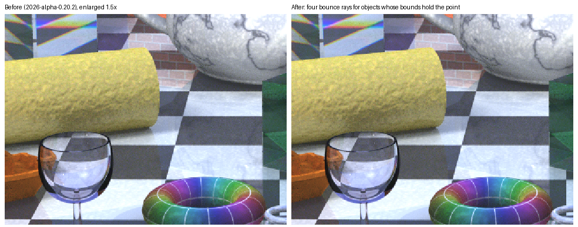

  In the torture test the change is slight: shadowed floor and the tube's underside a little
  smoother.

### Added

- **`tools/bench.py`** times six fixed cases (the torture test, Benchy, the chessboard, the fractals,
  the AS11 recreation and three networked engines) and reports wall and CPU time, peak memory and an
  MD5 of each image, so a change can be checked for speed and for exactly the same bytes.
- **`docs/performance.md`**: where the time goes, what was changed and measured, and what's left.

### Measured, not kept

- Link-time optimization: 2–3% less CPU, within the noise of the shared machine, for longer builds.

| Case (16 threads) | Wall 0.20.2 | Wall 0.21 | CPU 0.20.2 | CPU 0.21 |
|---|---|---|---|---|
| Torture test, 240×180, adaptive | 153.4 s | 108.0 s | 1,134 s | 1,387 s (1,113–1,125 s before the bounce change) |
| Benchy, 320×240 | 2.16 s | 2.11 s | 19.0 s | 18.8 s |
| Chessboard, 480×360 | 10.05 s | 8.04 s | 121.7 s | 95.7 s |
| Fractals, 320×240 | 0.49 s | 0.51 s | 3.05 s | 3.08 s |
| AS11-40-5903, 256×256 | 4.72 s | 4.38 s | 48.5 s | 47.9 s |
| Benchy over 3 engines, 160×120 | 8.47 s | 5.64 s | 12.5 s | 8.0 s |

The full-size torture image took 24,137 CPU seconds (34½ minutes on the shared machine).

## [2026-alpha-0.20.2] - 2026-11-21

Model files from more places: Ray decodes Draco-compressed glTF itself, as most of NASA's 3D
Resources are, and reads Blender `.blend` files from 2.8 to 4.x directly, gzip- or
Zstandard-compressed or not. And the AS11-40-5903 recreation loses its speckles. Every other render
is byte for byte as before.

### Added

- **Draco decoding in the glTF reader** (`core/src/DracoDecoder.cpp`): a primitive with
  `KHR_draco_mesh_compression` is decoded in Ray instead of refused. Written from the Draco bitstream
  specification (version 2.2, the one glTF files carry) and, where the 2017 specification and
  Google's decoder disagree, after the decoder: bits read least significant first, values decoded
  even without prediction, the octahedron transforms' center value, the valence traversal's mode
  byte, and a vertex on a boundary when its left-most corner can't swing left.
  - Connectivity: sequential (raw or entropy-coded indices) and EdgeBreaker, with the standard and
    the valence traversals, topology splits and attribute seams (UV and normal seams split a
    position vertex into attribute vertices).
  - Attributes: the depth-first and prediction-degree traversals; integer, quantized and
    octahedral-normal values, raw or rANS-coded (raw and tagged symbols); the difference,
    parallelogram, constrained multi-parallelogram, portable texture coordinate and geometric
    normal predictions with the wrap and both octahedron transforms.
  - Checked against Google's decoder: NASA's Lunar Module decodes to exactly the triangles, normals
    and colors DracoPy gives (all 97,588 triangles, at 1e-3), and the astronaut matches DracoPy's
    copy in every vertex its pose script didn't move, positions, normals and texture coordinates
    alike. Fourteen other NASA models picked at random decode without error and look right.
  - `format_test` holds the Lunar Module to Google's counts, bounds and sums, and refuses data that
    isn't Draco, an older bitstream (by its version) and Draco data cut short anywhere.
  - Point clouds, bitstreams before 2.2 and Draco's deprecated predictions are refused with a reason.
- **A Blender `.blend` reader** (`core/src/BlendFile.cpp`): a mesh's `file` can be a `.blend` file
  saved by Blender 2.80 to 4.x. The reader finds every field by name in the file's own structure
  catalog (SDNA), so it doesn't depend on any one version's layout.
  - Both of Blender's mesh layouts: MVert, MPoly, MLoop and MLoopUV arrays up to 3.x; the `position`
    attribute, face offsets, `.corner_vert`, float2 UV maps and `material_index` from 3.5 on.
  - Every mesh object in the file, or the one a mesh's `node` names, at its world placement: the
    stored matrix, or for files from 4.2 on (which store none) the matrix built from location,
    rotation (every Euler order, quaternions, axis-angle), scale, deltas and the parent.
  - The active UV map, and each material slot's viewport color through `faceColors`, an object's
    own material overriding its mesh's slot where it says so.
  - Checked on 29 real Blender files from glTF-Blender-IO's test scenes (Apache-2.0; read for
    checking, not committed), saved by Blender 2.78 to 5: the 27 that hold their own meshes read
    (2.78 to 4.02), the one that links its meshes from another `.blend` file and the Blender 5 one
    are refused with the reason, and the matrices built from location, rotation, scale and parent
    match the stored ones everywhere but 24 of `A.blend`'s 2,132 triangles, placed by something Ray
    doesn't evaluate (a constraint or bone parent).
- **gzip and Zstandard decompression** (`core/src/Decompress.cpp`), for compressed `.blend` files:
  gzip through the PNG decoder's inflate (now also offered raw, `CPngImage::InflateRaw`), and a
  Zstandard decoder of Ray's own after RFC 8878: frames and skippable frames (Blender's seek table),
  raw, RLE and compressed blocks, literals raw, RLE or Huffman-coded in one or four streams (or with
  the last table), and sequences with predefined, RLE, FSE-described or repeated tables and the
  three repeat offsets. Files packed at levels from -5 to 22, and Blender's several-frame files, unpack byte
  for byte.
- **`tools/make_blend_fixtures.py`** writes `scenes/models/blend_legacy.blend` and
  `blend_modern.blend` (one in each mesh layout) and their gzip and Zstandard copies, the way
  Blender writes them, the same every time.
- **Tests:** `render_blend`, `roundtrip_blend_test` and `network_blend` for `scenes/blend_test.ray`
  (both fixtures, compressed), with a reference render, a README preview and a place in the
  Expected output table; and `DracoChecks` and `BlendChecks` in `format_test --textures`: the Lunar
  Module against Google's decoder; each layout's positions, world placement (moved, turned, scaled,
  parented), z up turned to y up, faces' outward side, material colors and overrides, the active UV
  map; one object by name; gzip and Zstandard unpacking byte for byte; and the errors (not a
  `.blend`, Blender 5, a missing object, files and compressed data cut short, a size limit).

  

  The new test scene; Suzanne read from a Blender 2.93 file (glTF-Blender-IO's `A.blend`, for
  checking only); and NASA's Lunar Module straight from its original Draco-compressed `.glb`.

### Changed

- **NASA's Lunar Module is committed as NASA ships it**, Draco-compressed (717 KB instead of the
  4.0 MB plain copy). The astronaut stays the copy with its arms lowered, since posing it is a change
  to its vertices; `tools/gltf_decompress.py` stays for that. A glTF that requires
  `KHR_draco_mesh_compression` is no longer refused.

### Fixed

- **The speckles on the AS11-40-5903 astronaut.** They weren't a geometry bug or a shadow
  offset: they were the noise of the `"objects"` indirect-light method at one ray an object. The
  suit's own mesh holds every point on it, so it was gathered over the whole half-sphere by a single
  ray, and a leg in shadow found the other, sunlit leg in only a few of its rays, each counting
  heavily; the ground's disc lost half its rays below the suit's horizon. The scene now uses the
  `"hemisphere"` method with four rays, as 2026-alpha-0.20.1's studies recommend for ordinary
  scenes (at 256×256, 52 CPU-seconds against 38). Only this scene's reference changes.

  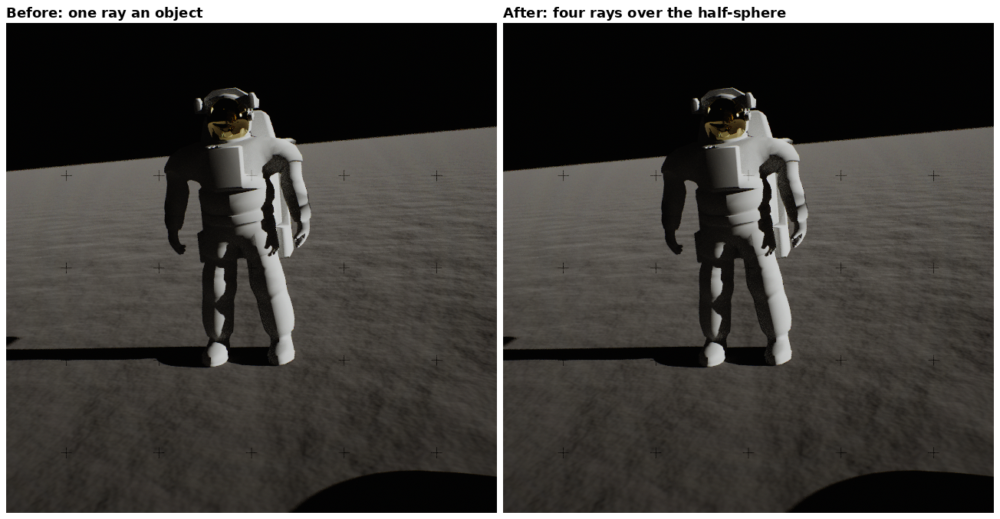

  Look at the shadowed side of the suit: the white specks are gone and the shadows fill in
  smoothly.

  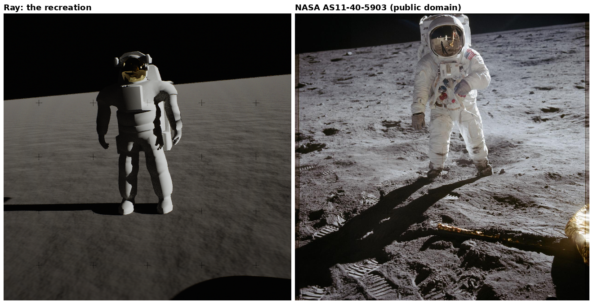

## [2026-alpha-0.20.1] - 2026-11-21

Studies and showcases: the torture test sharpened and out of CI, the adaptive sampler able to trust
a few rays only when they really agree, a glTF 2.0 reader, a `metal` material, two showcase scenes
(a chessboard in depth of field and a recreation of NASA photograph AS11-40-5903), and studies of
which indirect-light method works where. Scenes without the new fields render byte for byte as
before; only the torture test changes.

### Added

- **A glTF 2.0 reader** (`core/src/GltfFile.cpp`): a mesh's `file` can be a `.gltf` (JSON, its
  buffers in `data:` URIs or in files beside it) or a `.glb`, read through `RayJson::ReadSceneFile`
  like the other model files, so it goes into a saved archive (a `.gltf`'s buffers and PNG images
  beside it, under their own names) and to networked engines (as `files`). It reads every mesh of
  the default scene with the node hierarchy's matrices or translation, rotation and scale flattened
  in; triangles, strips and fans; accessors of every component type with `byteStride`, normalized
  integers and sparse substitution; `POSITION`, `NORMAL` and `TEXCOORD_0`; and each material's
  `baseColorFactor`, times its `baseColorTexture` at each face's middle when that image is a PNG,
  as per-face colors for the `faceColors` texture. JPEG and WebP images fall back to the factor (a
  texture's plain `source`, often a PNG beside a WebP, is used when there is one); the rest of a
  material, cameras, lights, skins and animation are ignored. glTF is right-handed, so z is negated
  and faces turned back round. A mesh's `node` reads one named node in its own frame (a chess piece
  from a whole set) and `gltfMaterial` only one material's primitives (a visor apart from its suit).
  Draco- and meshopt-compressed files are refused with the extension's name. Of the 257 `.glb` files
  in NASA's 3D Resources, 221 are Draco-compressed, 100 have WebP images, 83 PNG and 31 JPEG (one
  only JPEG), so most need `tools/gltf_decompress.py` (DracoPy) first, which writes them back out
  plain; their colors mostly survive through the PNG fallbacks.
- **The `metal` material:** a conductor's exact Fresnel reflectance from its complex index n + ik in
  red, green and blue, with presets for gold, silver, copper, aluminum, iron, chromium, titanium and
  platinum, your own `n` and `k`, `roughness` and `tint`. The torture test's torus is true gold now,
  and the AS11-40-5903 visor gold over tinted polycarbonate.
- **Adaptive sampling that trusts a few rays only when they agree** (opt-in; existing `adaptive`
  settings sample exactly as before): `confidence` stops once Student's t for that confidence times
  the standard error is under `threshold`, so four rays that happen to agree must agree about three
  times more closely than the plain rule asks before they are believed (though `min` should stay
  near 16, below);
  `"channels": "rgb"` measures red, green and blue apart. `raythrower --ray-count heat.png` writes a
  heat map of each pixel's rays (threads only). Measured with the new `tools/adaptive_sweep.py` at
  240×180 against 256 rays a pixel (CPU seconds on a machine running other work):

  | Sampler | Rays a pixel | CPU (s) | RMS, whole | RMS, worst tenth |
  |---|---|---|---|---|
  | `min=25,max=256,threshold=0.004` (the 0.20 command) | 25.1 | 466 | 9.78 | 20.95 |
  | `min=4,max=256,threshold=0.004,confidence=0.95,channels=rgb` | 85.4 | 1,529 | 6.21 | 14.56 |
  | `min=4,max=100,threshold=0.004,confidence=0.95,channels=rgb` | 71.1 | 1,061 | 5.70 | 14.76 |
  | **`min=16,max=100,threshold=0.004,confidence=0.95,channels=rgb`** | **71.8** | **1,273** | **4.94** | **12.07** |
  | `min=4,max=100,threshold=0.006,confidence=0.95,channels=rgb` | 38.9 | 545 | 9.28 | 22.24 |
  | `min=4,max=64,threshold=0.006,confidence=0.9,channels=rgb` | 27.3 | 399 | 11.14 | 27.01 |
  | `min=9,max=100,threshold=0.004` (the plain rule) | 9.4 | 148 | 15.92 | 33.89 |

  On the sharpened torture test the plain rule believes nearly every pixel at its first 25 rays
  (25.1 on average) though they are still noisy (9.78), which is the trap the confidence factor is
  for: with it, pixels whose rays only seem to agree keep going. The bold row is the new full-size
  torture command: half the error of the 0.20 command (4.94 against 9.78) for 2.9 times its rays.
  A cap of 100 measured better than 256 at fewer rays, since a pixel's wavelength strata are
  counted out of the cap and a pixel that stops early covers more of them when the cap is near what
  it uses. **Starting at 4 rays is not safe, though:** on the soft test (frosted glass and area
  lights) and the chessboard, `min=4` gave about twice the error of the plain rule at similar rays,
  because four rays that happen to agree have no spread at all, and no confidence factor can widen
  a zero. Minimum 16 with the confidence factor fixed both:

  | Scene, sampler | Rays a pixel | RMS, whole | RMS, worst tenth |
  |---|---|---|---|
  | soft, `min=25,max=256,threshold=0.004` (plain) | 114.2 | 2.49 | 7.19 |
  | soft, `min=9,max=100,threshold=0.004` (plain) | 44.7 | 3.71 | 10.79 |
  | soft, `min=4,max=100,threshold=0.004,confidence=0.95,channels=rgb` | 48.3 | 5.52 | 16.76 |
  | soft, `min=16,max=100,threshold=0.004,confidence=0.95,channels=rgb` | 56.6 | 3.28 | 9.57 |
  | chess, `min=25,max=256,threshold=0.004` (plain) | 89.7 | 2.17 | 6.22 |
  | chess, `min=9,max=100,threshold=0.004` (plain) | 39.0 | 4.21 | 12.68 |
  | chess, `min=4,max=100,threshold=0.004,confidence=0.95,channels=rgb` | 56.3 | 4.67 | 14.43 |

  So the confidence factor and per-channel errors earn their keep, but `min` stays at 16.

  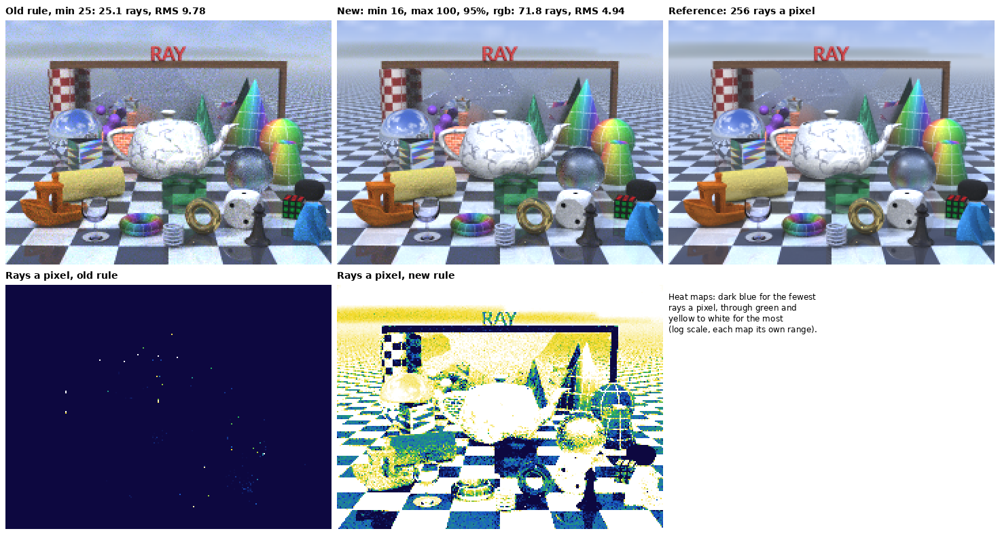

  Top: the old command, the new one and the 256-ray reference. Below: their rays a pixel. The old
  rule stops almost everywhere at its minimum; the new one spends its rays on the teapot, the frosted
  mirror, the glass and the haze, and leaves the plain floor squares with few.
- **A depth-of-field showcase** (`chess_dof_test.ray`): the Najdorf Sicilian, English Attack, after
  1.e4 c5 2.Nf3 d6 3.d4 cxd4 4.Nxd4 Nf6 5.Nc3 a6 6.Be3 e5 7.Nb3 Be6 8.f3 Be7 9.Qd2 O-O 10.O-O-O
  Nbd7 11.g4 b5, played out by python-chess in the new `tools/make_showcase_scenes.py`, on a full
  board with Poly Haven's Chess Set (CC0, its glTF committed unmodified), through the double Gauss
  wide open and focused on Black's e5 pawn, with lights behind the board blurring into bokeh discs.
  The README's lens section shows it at 1024×768 (with `--aa adaptive:min=16,max=100,threshold=0.004,confidence=0.95,channels=rgb`: 3,131 CPU-seconds).

  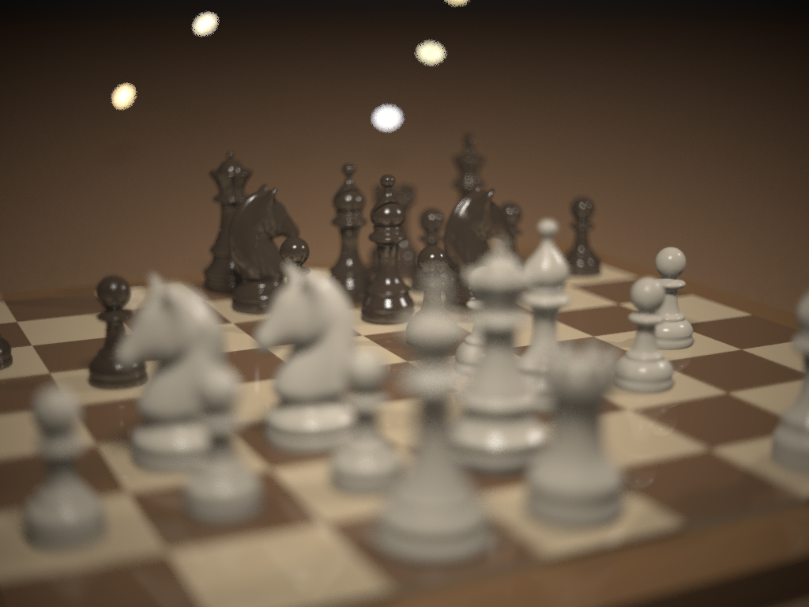
- **A recreation of NASA photograph AS11-40-5903** (`as11_40_5903_test.ray`): Aldrin in a white
  suit with a gold visor in which Armstrong (a second astronaut behind the camera) and the lunar
  module are reflected, the Solar Wind Composition foil and the flag from ALSJ dimensions, Earth
  small and high, on regolith under a 15° sun, on the Data Camera with the 60 mm Biogon, Réseau
  plate and Ektachrome MS. The astronaut and lunar module are NASA's own models (free and without
  copyright; decompressed, and the astronaut's arms lowered from a T-pose by the new
  `tools/pose_astronaut.py`).

  

  Left, the render; right, NASA's frame (public domain). The camera was placed by eye, not from a
  recovered station; NASA's astronaut is a generic suited figure (no chest pack, flag patch or arm
  pose of Aldrin's), and the ground is noise, not the footprinted soil.
- **Indirect light studies** (`scenes/studies/`): six scenes comparing the `"objects"` and
  `"hemisphere"` methods at the same rays a point, measured with `tools/bounce_sweep.py` (RMS on a
  0–255 scale over the pixels only bounced light lights, against the objects method at 64 rays an
  object):

  | Scene | Objects in reach | Objects, 4 rays an object | Hemisphere, same rays | Objects, 16 | Hemisphere, same rays |
  |---|---|---|---|---|---|
  | open floor | 2 | 4.49 | 2.38 | 1.20 | 1.13 |
  | sparse balls | 5 | 3.90 | 1.70 | 1.17 | 0.73 |
  | cluttered room | 8 | 7.16 | 2.69 | 3.42 | 1.48 |
  | large wall close by | 3 | 4.64 | 2.13 | 1.45 | 0.94 |
  | small bright object | 3 | 2.41 | 4.34 | 0.92 | 1.70 |
  | distance cutoff | 3 | 4.39 | 2.67 | 1.19 | 1.18 |

  

  At the same rays a point the hemisphere is smoother in five of the six, by about two to one at a
  few rays, and the gap closes as rays grow; the objects method wins clearly only where a small,
  bright object does most of the lighting (half the hemisphere's noise), since it aims every ray at
  it while the hemisphere finds it by chance (the speckles in the middle column). So the hemisphere
  is the better default for ordinary scenes, and `"objects"` for small bright sources, such as the
  glowing objects planned for 0.22. (Both are measured against the objects method's reference, as in
  2026-alpha-0.14.1.)

### Changed

- **The torture test is out of CI:** `render_torture` is labelled `torture` (and still `slow`), and
  every CI job runs `ctest -LE torture`; the `full` preset runs it locally before every merge.
- **The torture test is sharper:** its double Gauss is stopped down to f/8 and focused at 18 units
  with 200 mm a unit (the scene stands for a set four times larger), so everything from the front
  row to the mirror is sharp, where at f/2 the front row was a blur. Its gold torus is the `metal`
  material. The reference render, README preview and full-size image are regenerated; the
  full-size image now uses `--aa adaptive:min=16,max=100,threshold=0.004,confidence=0.95,channels=rgb` (19,329 CPU-seconds, 69.4 rays a pixel on average; 43 minutes on a machine busy with other work, about 20 idle on 16 cores; against 67,301 CPU-seconds for 0.20).

  

  Look at the front row (the goblet, queen, star, spring and torus), which is sharp now, and the
  gold torus, which reflects as gold does. The frame is brighter at the edges too: stopped down,
  the lens vignettes far less.
- **Tests:** `render_`, `roundtrip_` and `network_` tests for the two showcase scenes, and
  `ShowcaseChecks` in `format_test`: a hand-built `.glb` (a padded stride, unsigned short indices,
  a parent's translation and a child's rotation, a base color), the same as a `.gltf` with its
  buffer beside it and in a `data:` URI, a named node in its own frame, the material filter, a
  sparse accessor, and the refusals (Draco, glTF 1.0, a cut-short file, an index out of range, a
  URI leaving the folder); metal reflectance face on, toward grazing and as a dielectric with k 0;
  Student's t against its tables; the adaptive sampler's new fields and their errors; and the ray
  count map.

## [2026-alpha-0.20] - 2026-11-21

The Apollo cameras: the Hasselblads flown to the Moon as camera bodies, seven of their Carl Zeiss
lenses, Kodak film with its curve, grain and spread of light, the Data Camera's Réseau plate whose
crosses bloom away behind bright subjects, and lunar regolith, shown together at Tranquility Base.
Scenes without the new fields render byte for byte as before.

### Added

- **Seven Apollo lenses**, built-in `prescription`s at their nominal focal lengths, written into
  `core/src/Lens.cpp` by the new `tools/apollo_lenses.py`, which holds each lens's data and source,
  traces it, and reports what it measures (Ray's own `Describe` agrees to the micron):

  | Prescription | Source | Focal length | Opens to | Distortion at the corner | RMS spot |
  |---|---|---|---|---|---|
  | `biogon-38mm` | US 2,721,499 (L. Bertele), Example 2: 8 elements in 5 groups, f/4.5, the SWC's Biogon | 38.0 mm | f/4.55 | +0.21% | 35 µm |
  | `biogon-60mm` | reconstruction: the same Biogon at the 61.1 mm Zeiss gave for the flight lens | 61.1 mm | f/5.64 | −0.23% | 35 µm |
  | `biogon-60mm-reseau` | the same with the Data Camera's Réseau plate (3 mm, BK7-like glass: an assumption) | 61.1 mm | f/5.64 | −0.51% | 30 µm |
  | `planar-80mm` | US 2,724,994 (G. Lange, Zeiss), Example I: 5 elements in 4 groups, f/2.8 | 80.0 mm | f/2.75 | −0.19% | 89 µm |
  | `planar-100mm` | family member: Example II of US 2,724,994 at 100 mm, stopped to f/3.5 | 100.0 mm | f/3.47 | −0.10% | 34 µm |
  | `uv-sonnar-105mm` | reconstruction: 7 air-spaced singlets of fused silica and calcium fluoride | 105.0 mm | f/4.33 | +2.97% | 55 µm |
  | `sonnar-250mm` | reconstruction: 4 elements in 3 groups, telephoto ratio 0.94 | 250.0 mm | f/5.66 | +0.66% | 109 µm |
  | `tele-tessar-500mm` | reconstruction: 5 elements in 3 groups, telephoto ratio 0.80 | 500.0 mm | f/8.06 | +0.47% | 45 µm |

  (Spots are RMS over the field at C, d and F light at full aperture, vignetted rays left out.) The
  patents' tables were read from the scanned PDFs; the patent numbers the planning notes gave were
  checked, and not all held: US 2,724,994 is a 5-element Planar of the Rolleiflex kind (the
  Hasselblad 80 mm was a later 7-element version), US 3,038,380 is an f/4 long-back-focus design,
  US 2,720,140 an f/2 five-element Sonnar, and DE 1,447,278 a Voigtländer telephoto, so none of the
  last three is used. Where Zeiss published no prescription (the 60 mm Biogon, the UV-Sonnar, the
  Sonnar 250 and the Tele-Tessar 500), the script builds a layout matching the lens's published
  construction and optimizes it (gradient descent, then Levenberg–Marquardt on the spot, with edge
  thickness, back focus and length as constraints). Ray traces visible light only, so the UV-Sonnar
  is modeled in the visible band.

  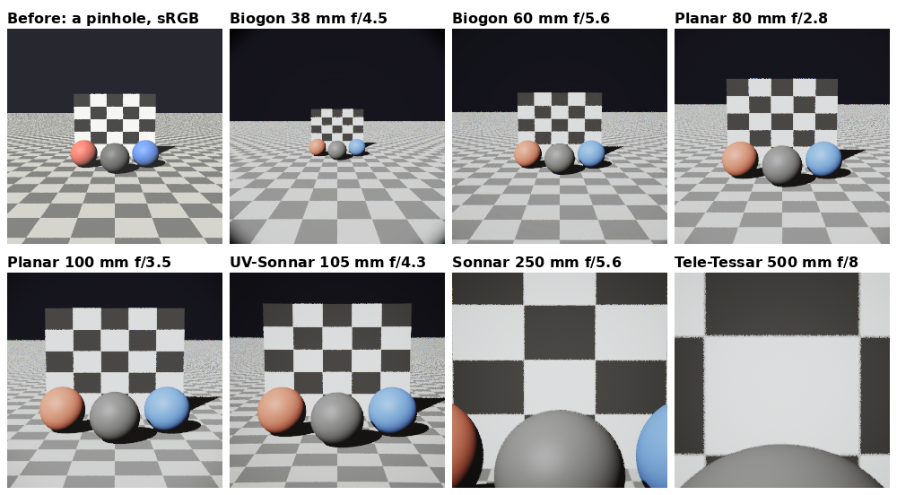

  The test subject from one place through each lens: the Biogons' wide fields (with the 38 mm's
  vignetting in the corners) through to the Tele-Tessar's few degrees.
- **Sellmeier glasses.** A lens surface can name `"glass": "fused-silica"` or `"calcium-fluoride"`
  instead of an `ior` and `abbe`; it is traced with Malitson's Sellmeier formula in every channel
  and at every wavelength, since these crystals disperse too little, and too unevenly, for the
  Cauchy fit. (`CLens::SellmeierIndex`.)
- **The `film` color model**, Kodak stocks: `ektachrome-ms` (SO-368, ISO 64), `ektachrome-ef`
  (SO-168, ISO 160), `panatomic-x` (3400, ISO 80) and `high-speed-2485` (ISO 6000). Each layer is
  exposed by a mix of red, green and blue, follows the stock's characteristic curve (a positive),
  and the slide is shown sRGB-encoded. Exposure is v × 256 × `shutter` × ISO / `fStop`², so sunny 16
  puts 0.18 on mid gray. Once the image is traced it is developed again with grain (the same every
  run, Selwyn-scaled to the pixel) and the spread of light in the emulsion (irradiation and
  halation, Gaussians carrying a share of the light, halation reddest in color film). That needs
  the whole image, so color models can now say `NeedsWholeImage` and do it in `Finish`, which
  `CTaskMaster::TraceScene` calls on the master: threads and networked engines get the same bytes.
  The stocks' curves, color response, grain and spread are representative values, not measured
  data.

  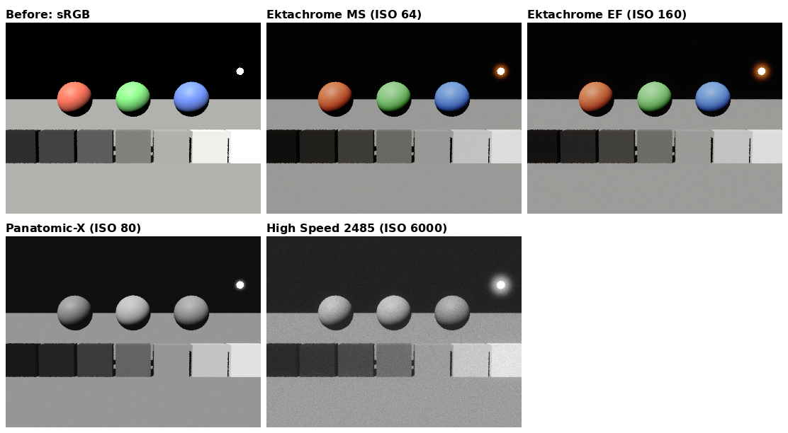

  Gray steps a stop apart, colored balls and an overexposed lamp: each stock's curve and contrast,
  the red-orange halation around the lamp on Ektachrome, Panatomic-X's fine grain and 2485's coarse
  grain and wide glow.
- **Camera bodies and the Réseau plate.** A camera's `body` (`"hasselblad-hec"`,
  `"hasselblad-hdc"`, `"hasselblad-lswc"`) fills in the lens, its format, a film and, for the Data
  Camera, the Réseau plate; a `lens` without a prescription keeps the body's. `reseau` (`count` 5,
  `spacing` 10 mm, `size` 1.2 mm, `lineWidth` 0.05 mm) prints the plate's crosses: no light reaches
  the film under a cross, so the plate draws them, and the film's spread fills them in where the
  picture is overexposed, as on the Apollo frames. The plate's glass is in the
  `biogon-60mm-reseau` prescription; a lens now aims its rays at its last curved surface (or its
  stop), so a flat plate before the film is traced through but not aimed at, which leaves every
  existing lens unchanged.

  

  On the right, the crosses print black on the soil and the gray ball, and fade away on the bright
  white ball, where its light spreads into them.
- **The `regolith` material**: lunar soil after Hapke, the Lommel–Seeliger law times an opposition
  surge (`surge` 1, `width` 0.06), so the soil brightens toward the point opposite the sun.
- **Tranquility Base** (`tranquility_test.ray`, written with the other new scenes by
  `tools/make_apollo_scenes.py`): a lunar module built from primitives beside a flag on regolith in
  low sun (a 0.53° sun under a black sky), shot with the Data Camera, its Biogon, Réseau plate and
  Ektachrome MS. It imitates the Apollo 11 views of the LM; it is not a recovered camera station,
  and uses no NASA model.

  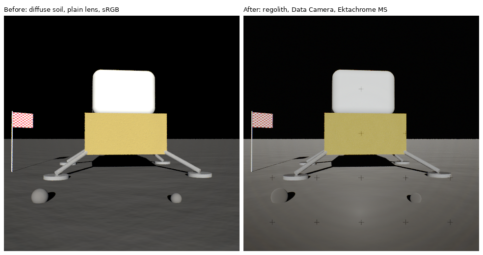

  On the right the regolith glows toward the bottom of the frame, opposite the sun (the opposition
  surge), the Réseau crosses print over the scene, and the film's curve keeps the bright ascent
  stage from clipping.
- **Tests:** `render_`, `roundtrip_` and `network_` tests for `apollo_lenses_test`, `film_test`,
  `reseau_test` and `tranquility_test`, with reference renders, README previews and places in the
  Expected output table, and `ApolloChecks` in `format_test`: each lens's focal length, f-number and
  back focus, the Réseau plate against the film, Sellmeier indices and Abbe numbers, glass naming
  and its errors, the film curve through mid gray and its slope, sunny 16, the spread's kernel and
  the light it keeps, grain the same every time, halation around a bright point, the Data Camera
  body and how it saves, where the Réseau crosses are and aren't, the regolith law at known angles,
  and the errors for each.

### Changed

- **Torture test:** a lump of regolith (a superquadric with a noise bump) at the front right. The camera stays a 5×5 lens camera with the clip color model: a body, film or Réseau plate would change every frame of the test. The
  reference, preview and full-size image are regenerated; the full-size adaptive render took
  67,301 CPU-seconds (1 h 35 min wall on a busy machine), 1% more than 0.19's 66,659.

  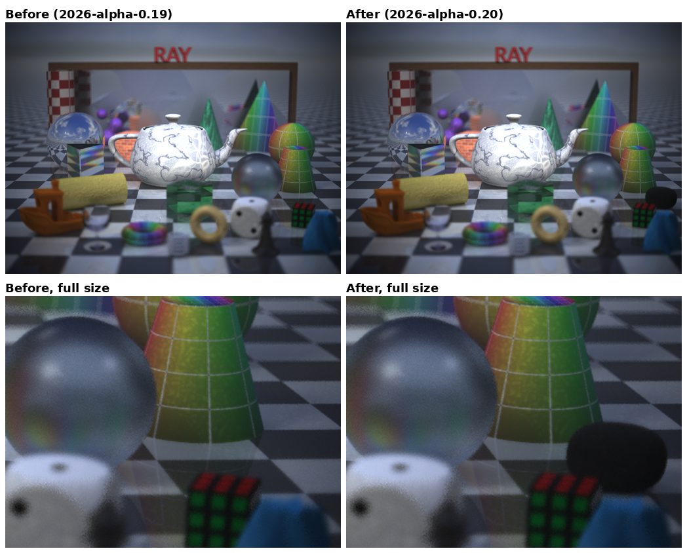

  The regolith lump at the front right, behind the puzzle cube: dark, as lunar soil is (an albedo of 0.13), with the bump of its noise.

## [2026-alpha-0.19] - 2026-11-21

Solids from mathematics: implicit surfaces given by a formula in a small built-in language with
exact gradients, metaballs found exactly as polynomials along each ray, and fractals (a mandelbulb,
the Menger sponge and the Sierpinski tetrahedron) found by sphere tracing a distance estimate.
Scenes without the new objects render byte for byte as before.

### Added

- **Implicit surfaces (`implicit`).** A surface given by a formula in x, y and z: where it is zero,
  inside where it is negative, within a box of half-sizes `bounds` around `center`, scaled by
  `scale` and turned by `rotation`.
  - **A small formula language** (`CExpression`), compiled to a program for a stack machine, so it
    is quick and every thread can use it at once: numbers, `x`, `y`, `z`, `pi`, `e`, named
    `parameters`, `+ - * /`, `^` (grouped from the right; `-x^2` is −(x²); `2^-1` works),
    parentheses, and `sin cos tan asin acos atan atan2 sqrt abs exp log pow min max floor clamp mix
    smoothstep`. A mistake is reported with its column, as in `formula: column 5: the formula ends
    too soon`.
  - **Exact normals.** The formula's gradient is worked out alongside its value, carrying the
    derivatives through every operation (forward-mode automatic differentiation), not by
    differences.
  - **Finding it.** A ray steps through the box (the diagonal over `steps`, default 256) and the
    surface is where the formula changes sign between two steps, pinned down by bisection to
    rounding. With `lipschitz`, the most the formula changes per unit of distance, a step is
    |f| / lipschitz where that is longer. Features thinner than a step can be missed, and so can a
    place where the formula only touches zero; the cost is up to `steps` evaluations a ray through
    the box.
  - **A solid,** so a csg can use it.
- **Metaballs (`blob`).** `balls`, each a center, a radius and a strength (negative dents the
  others), add Wyvill's falloff, strength × (1 − d²/r²)³ within the radius, and the surface is where
  the sum is `threshold` (default 0.5). Along a ray each ball's field is a polynomial of degree 6, so
  between the places the ray enters and leaves balls the sum is one polynomial and its roots are
  found exactly, with the same root finder as the torus. Normals from the field's gradient. A solid.
- **Fractals (`fractal`).** Found by sphere tracing a distance estimate, stepping as far as the
  estimate says is safe until within `epsilon` (0.0001) of the surface, for at most `maxSteps`
  (256) steps of `stepFactor` (1) times the estimate. `kind` is `mandelbulb` (`power` 8,
  `iterations` 10, `bailout` 2), `menger` (the Menger sponge, `iterations` 3; 0 is the cube) or
  `sierpinski` (the tetrahedron, `iterations` 6; 0 is the solid tetrahedron). Normals by
  differences of the estimate. Sphere tracing can't start inside, so fractals aren't csg solids.
- **Shared by all three** (`CFieldShape`): a uniform `scale`; surface coordinates projected onto a
  sphere around the center, so textures, bump maps and maps work; and triangles for `ray-editor`'s
  preview by marching tetrahedra through the bounds. All three are in the editor's *Add* menu.
- **`scenes/implicit_test.ray`** (a sphere from its formula beside the sphere itself, a gyroid's
  labyrinth cut to a ball by a csg, and Taubin's heart), **`scenes/blob_test.ray`** (five balls
  melted together, and a ball dented by two of negative strength) and **`scenes/fractal_test.ray`**
  (a mandelbulb, a Menger sponge and a Sierpinski tetrahedron), written by the new
  `tools/make_math_scenes.py`, each with render, round-trip and network tests, a reference render,
  a README preview and a place in the Expected output table.
- **`format_test` checks:** the language's precedence, grouping and every function, exact
  gradients, seven error messages with their columns; an implicit sphere agreeing with the sphere on
  300 rays (hits within 1e-9, normals within 1e-6), from inside and scaled; a Lipschitz bound with 8
  steps; a gyroid hit at the first sign change a 200,000-step march finds, on the surface; an
  implicit ball cut out of a box by a csg; a lone metaball as the sphere of the right radius, two
  merged with a level bridge, a dent; a Menger sponge of 0 iterations as the cube and of 1 drilled
  through; a Sierpinski tetrahedron of 0 iterations; a power-2 mandelbulb; the same trace every
  time; round-trips (parameters keep their order); and nine error messages.

  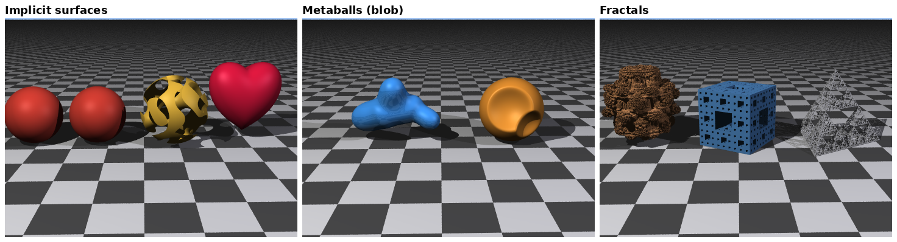

  Left, a sphere from its formula is the same as the sphere beside it; the gyroid ball and the heart
  are formulas too. Middle, metaballs melting together, and a ball dented by two of negative
  strength. Right, a mandelbulb, a Menger sponge and a Sierpinski tetrahedron.

### Changed

- **The torture test** gains a purple cluster of four metaballs behind the mirror sphere, glossy and
  a little reflective. Its reference render, README preview and full-size image are regenerated.

  

  The metaballs stand to the right of the mirror sphere, in front of the frosted mirror wall (the
  crop below is the full-size image, enlarged). The full-size adaptive render took 66,659 CPU-seconds,
  2% more than 0.18's 65,259 (94 minutes on this machine while it ran tests too).

## [2026-alpha-0.18] - 2026-11-21

Turned and pushed solids: lathes that spin a profile of lines and curves around an axis, traced
exactly, and extrusions and sweeps that push outlines back into solids or carry them along a path,
built into meshes the way text is. Scenes without the new objects render byte for byte as before.

### Added

- **Lathes (`lathe`).** A profile in r and y (r the distance from the axis) spun around the shape's
  own +y, for vases, goblets, bottles, chess pieces and table legs. The profile is a path of points
  and curves, or with `smooth` a curve through its points (see Paths below); `center` and `rotation`
  place it.
  - **Traced exactly, not as triangles.** Each piece of the profile, spun around the axis, meets a
    ray where a polynomial in the piece's own parameter is zero: degree 2 for a line (a cone, a
    cylinder or a flat ring), up to 6 for a cubic. Its roots are found by bisection between their
    turning points, searched a hair past each piece's ends so nothing slips through where pieces
    join, then polished with Newton's method on the surface itself. A ray along the axis, which
    the squared form would only touch at a pole, is solved by the radius instead. Each piece is
    skipped unless the ray comes within its height and reach.
  - **Solid or shell.** A profile that starts and ends on the axis encloses a solid, and so does any
    profile with `capped`, whose open ends are closed by flat discs in to the axis. Its normals
    point out of the solid whichever way the profile runs. An open profile is a shell shaded on
    the side a ray sees.
  - **Part way round.** `sweep` (degrees, default 360) turns the profile only part way, from +x
    toward +z; a solid is closed by flat faces at both ends of the cut. A solid lathe works in a csg.
  - **Surface coordinates:** u around (0 to 1 over the sweep), v along the profile by length.
- **Extrusions (`extrusion`).** One `outline` or several `outlines` (holes found from how they nest)
  pushed `depth` back into a closed mesh, as text's letters are, with `bevel` and `backBevel`
  cutting the front and back edges at 45°, or `taper` (the scale at the back) and `twist` (degrees),
  both about the outline's origin. A twisted extrusion's sides are cut into slices, one each 2° of
  twist, with normals worked out from the twisted surface. `position` and `rotation` place it.
  Built when loaded (curves flattened to within 0.1% of the outline's size); it works in a csg.
- **Sweeps (`sweep`).** A tube: a circle of `radius`, or any `outline`, carried along a `path` of
  points through the scene, smooth (a Catmull-Rom curve through them, the default) or straight
  from point to point, open or `closed`. The cross-section is turned as little as it can be (a
  rotation-minimizing frame, by double reflection), so the tube doesn't twist; a closed path's
  frame is evened out so the tube meets itself. Built into a smooth mesh when loaded (`steps` along
  each span, `segments` around), its open ends capped unless `capped` is false. For springs, pipes,
  rails and, in 0.21, neon tubes.
- **Paths**, shared by all three: arrays of points `[x, y]` and curves `{ "quadratic": [...] }` and
  `{ "cubic": [...] }`, saved back as they were given (`core/src/Profile.cpp`).
- **Scenes and tests.** `scenes/lathe_test.ray` (a pawn, a rook and a queen, a glass goblet, an
  open terracotta vase and an orange with a quarter cut away) and `scenes/extrusion_test.ray` (a
  tapered star, a twisted column, a beveled frame with a hole, a spring, a closed loop of tube and
  a square rail), written by the new `tools/make_shape_scenes.py`, each with render, round-trip and
  network tests, reference renders, README previews and places in the Expected output table.
  `format_test` checks:
  - a straight profile against the cylinder and cone it makes, hits and normals, from outside and
    inside, down the axis and onto the rim where two pieces join;
  - normals pointing out whichever way a profile runs; open shells and `capped` solids;
  - a curved profile: 400 rays aimed along the normal at points of its surface, both pieces' ends
    and the poles included, all hit exactly there, and every hit lies on the surface (within
    1e-8 of the profile);
  - a partial lathe's end faces, its side within the sweep, and a miss through the cut;
  - a lathe and an extrusion each in a csg; saving a lathe's curves and sweep as given;
  - extrusions: faces and square corners, a hole, beveled front and back, a taper's leaning sides
    where they should be, a twist turned halfway at half the depth, and each watertight (every
    edge joining exactly two faces);
  - sweeps: a straight tube's radius and capped end, a capped spring and a tube round a closed path
    watertight (so the frame meets itself);
  - error messages for bad profiles, sweeps, outlines, paths and conflicting fields.

### Changed

- `.gitignore` ignores Python's `__pycache__/`.
- **Text shares the extrusion code.** Text's letters are now built by the same `Extruder` code as
  extrusions (moved out of `Text.cpp`, with a back bevel and tapered and twisted extrusions added).
  Text renders byte for byte as before.
- **The torture test** gains a glass goblet and a black queen turned on a lathe, a blue star tapered
  and twisted, and a steel spring, at the front. Its reference render, README preview and
  full-size image are regenerated; the full-size render (the adaptive command in `CLAUDE.md`) took
  65,259 CPU-seconds (1 h 32 min on a busy machine, about 68 minutes idle), 52% more than 0.17's
  42,865; the scene's own 5×5 sampler takes 8,123 CPU-seconds (about eight and a half minutes
  idle). The lens focuses farther back, so the new pieces at the front are soft.

  

  Look along the front: the goblet left of the ring, the spring between the ring and the gold
  torus, the queen beside the die, and the star at the right.

  

## [2026-alpha-0.17] - 2026-11-21

Curved surfaces: Bézier patches and B-spline and NURBS surfaces, traced exactly rather than cut into
triangles, and the Utah teapot as Martin Newell's own 32 patches, now the teapot in the torture
test. Scenes without the new objects render byte for byte as before.

### Added

- **Bézier patches (`bezier`).** A surface of Bézier patches of any degree from 1 to 15 each way
  (bicubic is the usual), rational ones too: a control point may carry a weight, `[x, y, z, w]`.
  Patches are listed in the scene, each with its own `points` or with `indices` into the shape's
  own `points` (the way the teapot is usually written), or read from a `.bpt` file (`file`), which
  goes into a saved scene's archive and to networked engines inside the scene (as `data`), like a
  model file. `degree` is needed only when a patch's points aren't a square number; `uv`
  (`[u0, v0, u1, v1]`, default the unit square) lets a texture run across several patches; `scale`
  (a number or `[x, y, z]`), `center` (default the origin) and `rotation` place it; `closed`
  (default false) says the patches enclose a volume, normals outward, so a csg can use them.
  - **How a ray finds it.** Each patch is split by de Casteljau's algorithm until every piece is
    within 0.02% of the shape's size of flat, and the pieces' boxes (a patch lies inside the box of
    its control points) go in a tree. For each piece a ray reaches, the ray is crossed with the
    triangles of the piece's corners, which gives a starting (u, v, t) close to the surface, and
    Newton's method solves where it meets the patch itself (from the piece's middle too, if that
    start fails). A solution anywhere on the patch counts, not only inside the piece that found
    it, so no ray slips through the seams between pieces or between patches; the tree is walked
    nearer box first, and shadow rays stop at the first hit.
  - **Normals** are the cross product of the surface's slopes. Where it vanishes, at an edge that
    shrinks to a point (the teapot's knob and base), it is taken a hair inside the patch.
    Patches are open and shaded on the side a ray sees, unless `closed`.
  - **Cost.** The patch teapot alone takes about 28% more CPU than the 6,320-triangle mesh teapot
    (14.2 s against 11.1 s for 640×480 at 16 rays a pixel, one thread).
- **B-spline and NURBS surfaces (`bspline`).** A control net (`points`: rows along v, each an
  array along u, with weights for a NURBS surface), a `degree` each way (default `[3, 3]`) and knot
  vectors (`knotsU`, `knotsV`; default clamped and evenly spaced). It is traced as Bézier patches:
  knots are inserted by Boehm's algorithm, in homogeneous coordinates so the weights carry through,
  until every knot in the surface's range repeats as often as the degree, which cuts it into
  rational Bézier patches that are exactly the same surface, traced as above. Unclamped knot
  vectors work too. Surface coordinates run from 0 to 1 across the whole surface.
- **The Utah teapot as patches.** `scenes/models/teapot.bpt` holds Martin Newell's 1975 data, 32
  bicubic patches, public domain, without Blinn's later vertical squash: z up, the spout along +x,
  so `"rotation": [-90, 0, 0]` stands it like the mesh teapot. `tools/make_teapot_bpt.py` writes it
  from the copy of the data in three.js (credited in `NOTICE` and `scenes/models/README.md`).

  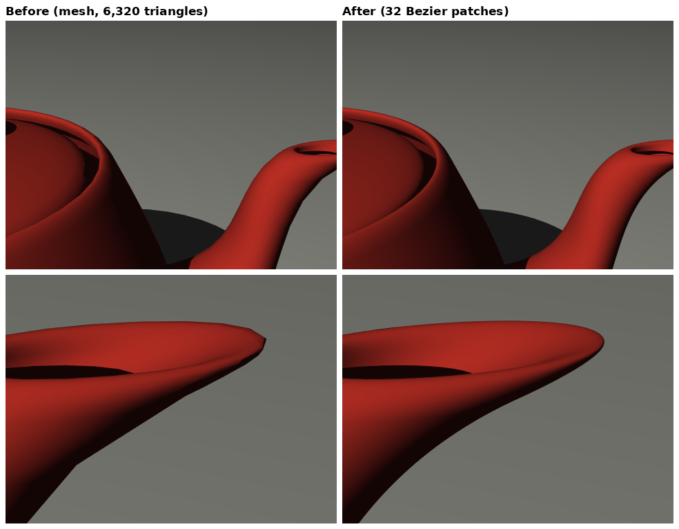

  The same views of the mesh teapot and the patch teapot, lit the same way: the lid's rim and the
  spout, and, below, the spout's lip enlarged. The mesh's silhouette is a chain of straight edges;
  the patches' is the curve itself, at any size.
- **`scenes/patches_test.ray`** (the mesh teapot beside the patch teapot) and
  **`scenes/nurbs_test.ray`** (a NURBS torus made of rational quadratic circles in front of the
  analytic `torus` of the same size, and a waved bicubic sheet with `textures/uv_grid.ppm` running
  across all its patches and a noise bump), each with render, round-trip and network tests,
  references, README previews and places in the README's Expected output table.
- **New `format_test` checks:** rays down the seam between two patches, corners included, all hit;
  rays just past a patch's edge miss; 400 rays aimed at points worked out straight from a curved,
  turned patch meet it there with its own normal; surface coordinates are a patch's (u, v) for a
  point it didn't just hit; a finite unit normal where an edge shrinks to a point; a closed box of
  six patches is hit with outward normals and works in a csg with a sphere; a B-spline with uneven
  knots and a rational one with unclamped knots become patches that match the B-spline point for
  point (de Boor's algorithm) within 1e-12; every point of a NURBS torus is exactly the tube's
  radius from its center circle; shared points, indices, weights, degrees, `uv` and `scale` round
  trip; eleven error messages; `.bpt` reading and its mistakes. With `--textures`: the teapot's 32
  patches read and every corner has a unit normal, knob and base included; 600 rays from all round
  agree with a fine mesh of the patches; rays aimed at points on every patch's seams all hit.
- **Editors.** `ray-editor` draws patches in its preview and picks them with the ray tracer's own
  test; they are added through the JSON tab (the *Add* menu has no patch entry). The MFC editor
  lists them in its tree.

### Changed

- **The torture test's teapot is the patch teapot,** in the same polished marble under the same
  spot light and caustics, instead of the inline mesh. The scene file shrinks from 10,759 lines to
  1,195. Its reference render, README preview and full-size image are regenerated.

  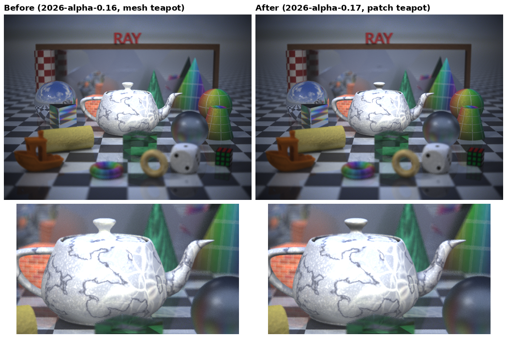

  Look at the teapot's silhouette, its spout and its lid in the crop below: smooth now, where the
  mesh's edges showed. The knob's flared underside is darker: the exact surface faces down there,
  away from the lights, which the mesh's averaged normals didn't show.
  - The test render (160×120, 5×5 stratified) takes about 12% more CPU (90 s against 80 s on a
    busy machine). The full-size image, rendered as `CLAUDE.md` says with the adaptive sampler, took
    42,865 CPU-seconds (58.7 minutes wall on a busy machine, about 44 minutes idle), 20% more than
    0.16's 35,724.
- A local shape can make `center` optional (`CLocalShape::CenterRequired`); patches whose points
  are already where they belong need none.

## [2026-alpha-0.16] - 2026-11-21

More shapes, and letters: tori, discs and annuli, paraboloids, hyperboloids, superquadrics and
rounded boxes, each worked out exactly (or, for pinched superquadrics, by careful stepping), and a
`text` object that sets a string in a TrueType font and extrudes it into a closed, beveled solid.
Plus a lint test that catches the Windows `min`/`max` macro mistake on every platform, and the
README's full-size torture image rendered with the adaptive sampler. Scenes without the new objects
render byte for byte as before.

### Added

- **Seven new shapes.** Each stands on its own +y before a `rotation` (degrees about x, then y,
  then z, as a box's) and is centered on `center`; each has surface coordinates, takes bump maps,
  textures and maps, and shows in `ray-editor`'s preview and *Add* menu (and the MFC editor's tree):
  - `torus` (`majorRadius`, `minorRadius`): a ring around +y. The quartic it solves is set up from
    where the ray enters its bounding sphere, so a torus a million units from the camera, or
    hundreds of thousands from the origin, is still hit to about 1e-9; each root is found by
    bisection between the turning points (`CLocalShape::PolynomialRoots`, roots of any degree,
    exact to rounding).
  - `disc` (`radius`, `innerRadius` default 0) and `annulus` (a disc whose `innerRadius` is
    required): flat, shaded on whichever side a ray sees.
  - `paraboloid` (`radius`, `height`, `capped` default false): a bowl from its lowest point up to
    its rim. `hyperboloid` (`radius` at the waist, `topRadius` at both ends, `height`, `capped`):
    one sheet, like a cooling tower.
  - `superquadric` (`radius`, one number or `[x, y, z]`; `e1`, `e2` default 1): from an ellipsoid
    through a rounded cube to a double cone and a pinched star. With both exponents at most 2 it is
    convex, so the lowest point of its field along a ray is found by golden-section search and the
    surface by bisection on either side: grazing rays are found, and both exponents 1 is exactly a
    sphere. Above 2 it is found by 256 steps through its box.
  - `roundedBox` (`size`, `radius` up to half the smallest size): exactly a smaller box grown by
    the radius, the union of three slabs, twelve edge cylinders and eight corner spheres; being
    convex, a ray is inside from the earliest of them it enters to the latest it leaves, so it is
    found with no stepping. Half every size is a sphere.

  The torus, superquadric, rounded box, and capped paraboloid and hyperboloid are solids, so a csg
  can use them. They share a new base class, `CLocalShape`, that turns rays into each shape's own
  frame and reads the fields every shape has.
- **Text from TrueType fonts.** A `text` object (`string`, `font`, `size` the em in scene units,
  `depth`, `bevel`, `align` left, center or right, `lineSpacing`, `kerning`, `position`,
  `rotation`) sets its string, `\n` for new lines, and extrudes it into a closed, double-sided mesh,
  so it takes any material, casts shadows and works in a csg:
  - `CFontFile` reads TrueType outlines (`.ttf`, or `.otf` with TrueType outlines): the cmap
    (formats 4 and 12), advance widths, simple and composite glyphs, line metrics, and kerning from
    the `kern` table (format 0) or OpenType GPOS pair adjustment (formats 1 and 2, through extension
    lookups). Fonts with CFF outlines and font collections are refused, saying why.
  - Curves are flattened to within 0.15% of the em; which outlines are holes comes from how they
    nest, not which way they run; each hole is joined to the outline around it by a cut to a vertex
    it can see (Eberly's method) and the face is cut into triangles by clipping ears (`Outline`).
  - The sides are smooth around curves and sharp at corners of more than 35°; `bevel` cuts the
    front edges at 45°. Surface coordinates are x and y in the text's plane, one unit per em.
  - The font file goes into a saved scene's archive and to networked engines inside the scene, like
    a model file. The sample font is Lato Bold (`scenes/fonts/Lato-Bold.ttf`), from the Google
    Fonts repository, unmodified, under the SIL Open Font License 1.1 (credited in `NOTICE` and
    `scenes/fonts/README.md`).

  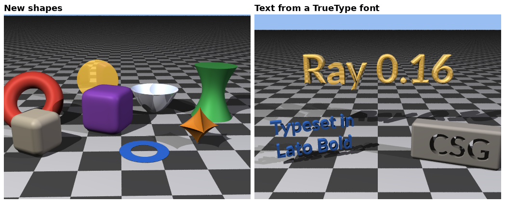

  Left, every new shape: the red torus, the gold disc standing up, the blue annulus, the
  mirror-polished paraboloid dish, the green hyperboloid, the purple superquadric that is nearly a
  rounded cube, the orange pinched star and the rounded box. Right, the bevel's highlight along the
  gold letters' front edges, the kerned "Ra", the counters of the a, 0, 6 and o left open, and "CSG"
  cut through the slab.
- **`scenes/shapes_test.ray` and `scenes/text_test.ray`,** with `render_shapes`, `render_text`,
  their round-trip and network tests, references, README previews and places in the Expected
  output table. New `format_test` checks: the root finder; hits and normals for every shape against
  worked-out answers, from outside and inside, including a torus 300,000 units from the origin seen
  from a million units away, a superquadric grazed and one with both exponents 1 as a sphere, a
  rounded box's faces, edges and corners and one rounded to half its size as a sphere; each closed
  shape in a csg hit exactly where it is hit alone; every shape saved and read back; and the errors.
  With `--textures`: the font's metrics, glyphs (an o is two outlines, a B three), GPOS kerning of
  A and V; thirteen glyphs whose triangles cover exactly the area their outlines enclose; extruded
  text watertight (every edge shared by exactly two faces); a letter carved through a slab by a csg;
  text saved and read back; CFF, cut-off and non-font files refused; and the errors.
- **`lint_minmax` test.** Windows headers make `min` and `max` macros, which broke the MFC build in
  0.14 and 0.15. This fast-tier test scans `core/`, `src/`, `include/` and `editor/` for
  `std::min(`, `std::max(` and `numeric_limits<…>::max()` not wrapped in parentheses and fails,
  listing each file and line, so the mistake shows up on Linux before CI. Five editor files had such
  calls; they are wrapped now. `CLAUDE.md` has the rule.

### Changed

- **The torture test** gains a polished gold torus standing on its rim in front, and the word
  "RAY" in beveled red letters standing on top of the mirror frame. Its reference render, README
  preview and full-size image are regenerated.
- **The README's full-size torture image is rendered with the adaptive sampler** (at least 25 rays
  a pixel, up to 256 where they disagree, until the standard error is under 0.004):
  `raythrower scenes/torture_test.ray --aa adaptive:min=25,max=256,threshold=0.004 --png torture.png`.
  The full-size render took 35,724 CPU-seconds (44.5 minutes on this 16-core machine while it was
  busy with other work; about 37 minutes idle), about seven and a half times what the 5×5 stratified
  sampler costs on the same scene (measured at 256×192: 2,398 CPU-seconds against 314). The
  `render_torture` test still uses the scene's own 5×5 stratified
  sampler at 160×120, so the test costs what it did. `CLAUDE.md`'s torture rule gives the command.

  

  Above, the whole frame: the gold torus in front and the red "RAY" on the frame are new. Below, a
  full-size crop: the frosted ball, the marble teapot, the glass cube and the floor are far smoother,
  because the adaptive sampler spends up to 256 rays on pixels whose rays disagree.

## [2026-alpha-0.15] - 2026-11-21

Textures everywhere: every number and color of a material, a bump map's depth and strength, and a
light's new `tint` and `intensity` can be a texture instead of a constant, read where it shades, so
glass can be frosted in places, a mirror polished in patches and sunlight broken by cloud shadows;
and glass whose absorption is a texture adds it up along the path inside, so solid textures color it
from within. Scenes without the new forms render byte for byte as before.

### Added

- **Texture maps for every setting.** A material's `color`, `influence`, a specular's `power` and
  `indexOfRefraction`, a reflective's `roughness` and `diffuseReflectivity`, a transparent's
  `indexOfRefraction`, `roughness`, `attenuationColor` and `attenuationDistance`, and a bump map's
  `depth` and `strength` each take a number (or color) as before, or a texture:
  - any texture or preset as it is (`"roughness": { "type": "cells", ... }`), or
  - one wrapped with `scale` (default 1), `offset` (default 0) and, for numbers, `channel`
    (`"average"` of red, green and blue, the default, `"luminance"`, `"red"`, `"green"` or `"blue"`):
    a number is offset + scale × the channel, a color the texture's color × scale + offset.

  The texture is read at the point being shaded, as a material's texture is, and what it gives is
  kept within the setting's range (roughness 0 to 1, an index 0.001 to 50); a constant is checked
  when read, as before. Constants are saved exactly as before. In the code each setting is a
  `CScalarMap` or `CColorMap` (`core/include/Maps.h`): constants cost nothing extra (the point to
  read a texture at, a `CMapPoint`, is worked out only when a texture asks), and they convert to and
  from plain numbers and colors, so the MFC editor's dialogs work unchanged.
- **Lights driven by a 3D texture.** Every light takes `tint` (a color, default white) and
  `intensity` (a number of 0 or more, default 1), constants or texture maps read **at the point the
  light falls on**, so what light arrives depends on where it arrives. They are in addition to
  0.14's `filter`, which colors the light by the direction it leaves in. Use solid textures: a lit
  point has no surface coordinates. A light without them shines exactly as before.
- **Textures inside glass.** A `transparent` material whose `attenuationColor` or
  `attenuationDistance` is a texture absorbs by the texture along the ray's path inside: from where
  the ray went in to where it comes out, `attenuationStep` (new, default 0.05 scene units) at a time,
  each step taking away −ln(color) × step / distance per channel, read at a point shifted within the
  step by the ray's sample (`PURPOSE_VOLUME`), so a pixel's rays read between each other's and the
  result is the same every run. A texture the same everywhere gives exactly the closed form
  (Beer–Lambert). That makes art glass (`marble` swirls), smoky quartz (`noise`), amber with dark
  inclusions (`cells`) and veins floating in a clear block. It works with rough glass, CSG and
  meshes; spectral dispersion uses the same absorption for every wavelength. Cost: one texture
  lookup per step, about 25 to 50 per ray through a ball in the test scene.
- **`scenes/maps_test.ray`** (a ball frosted in patches, a mirror polished in patches, glass whose
  index wanders from 1.1 to 1.9, a lace panel of glass and paint by `influence`, a floor whose bumps'
  depth varies, a spot light tinted by `marble` with a `cells` intensity) and
  **`scenes/volume_test.ray`** (art glass, smoky quartz, amber, a veined block), each with render,
  round-trip and network tests, references, README previews and Expected output entries.
  `format_test`'s new `MapChecks`: a map's scale, offset, range and channel; every material setting
  read as a texture, round-tripped, and saved as given; a varying influence; plain settings saved as
  plain numbers; a constant texture inside glass equal to Beer–Lambert to 1e-9; a checker inside
  glass converging to the exact absorption as the step shrinks, and the same every time; a light's
  tint and intensity read at the lit point; and the errors.

  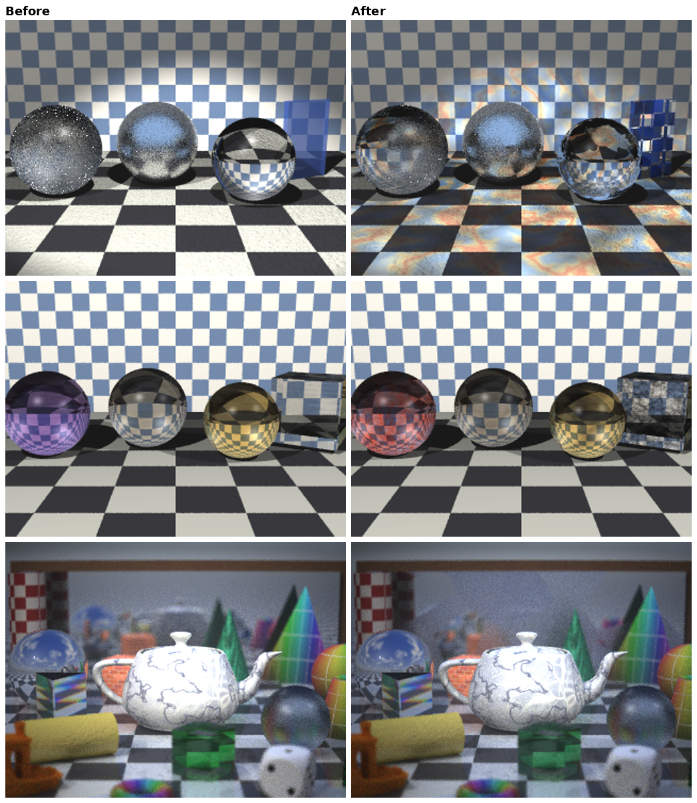

  Top: on the left every map replaced by a constant; on the right the ball is clear in some cells
  and frosted in others, the mirror is polished in patches, the third ball's refraction wanders,
  the panel is a lace of glass and blue paint, and the spot light's color and strength come from a
  marble and a cells texture where it lands. Middle: flat absorption against textures inside: the
  first ball swirls blue and red, the quartz is smoky in clouds, the amber has dark flecks and the
  clear block has gray veins inside. Bottom: the torture test, its mirror now frosted in patches,
  the green cube swirled inside, and cloud shadows from the sun across the floor.

### Changed

- **The torture test uses them.** The mirror wall's `roughness` is a `cells` texture (frosted in a
  third of its cells), the glass cube's `attenuationColor` is a green `marble` (swirls instead of an
  even tint), and the low sun's `intensity` is a `noise` texture read where it lands (cloud shadows).
  Its reference render, README preview and full-size `docs/images/torture_test.png` are
  regenerated. The full-size Release render took 4,695 CPU-seconds, against 4,210 for 0.14 (12% more; 6 min 20 s wall on a busy 16-core machine).
- `CLAUDE.md`: a convention that new material and light settings are `CScalarMap`/`CColorMap`.

### Fixed

- **`CMakePresets.json` loads.** 2026-alpha-0.14.1 wrote it as version 2, where every configure
  preset must name a generator, so CMake 3.28 refused it (`Preset "asan" missing field
  "generator"`). It is now version 3, where the generator is optional (CMake 3.21 or newer).

## [2026-alpha-0.14.1] - 2026-11-20

Faster tests and measured bounce light: the whole suite runs in about 45 seconds on a Release
build, where the releases had been running it for four to six minutes on Debug, the bounce test gathers 9 rays an object, chosen from a sweep of 1 to 64, and a
new test shows the `"hemisphere"` method beside it. Only `bounce_test`'s render changes; the
references of four tests are smaller images of the same scenes.

### Changed

- **The tests take under a minute.** The 2026-alpha-0.14 release ran the full suite on Debug, 8 at
  a time, in 6 min 20 s on a busy machine; it now takes about 45 s, and the fast tier about 30 s.
  Measured here, before (118 tests) and after (121), on 16 cores:

  | Run | Before | After |
  |---|---|---|
  | Every test, Release (`ctest --preset full`) | 89 s | 42 s |
  | Every test, Debug | 263 s | 139 s |
  | Every test but the slow ones, Release (`ctest --preset fast`) | — | 31 s |
  | The fast tier under the sanitizers, optimized (`ctest --preset asan-fast`) | 289 s | 173 s |
  | The same, unoptimized, as the releases ran it | over 17 min | — |

  What made the difference:
  - **Test optimized builds, as CI does.** The releases ran the suite on Debug and unoptimized
    sanitizer builds, three to six times slower than CI's Release and RelWithDebInfo ones. The new
    `CMakePresets.json` builds the same way CI does (`release`, `asan`, and `debug` for the
    debugger) and runs 8 tests at a time (`ctest --preset fast`, `full`, `asan-fast`,
    `asan-full`). `CLAUDE.md` has the new workflow: the touched tests and the fast tier while
    working, every test once before merging, every test under the sanitizers on CI.
  - **Networked tests render small and run side by side.** They checked that engines match threads
    byte for byte by rendering each scene at full size, one at a time (they shared a lock), after
    the full-size threaded render. That holds at any size, so each now renders its scene at 96×72
    in 16-pixel tiles, with threads and then with three engines, compares the two, and runs
    alongside the others (each has its own port). `ray_network_test()` in `tests/CMakeLists.txt`
    defines them; `RenderTest.cmake` has a `SELF_CHECK` mode and a `TILE` option. Every scene a
    networked test covered is still covered, and `bounce_hemisphere` is added.
  - **Three slow feature tests render at 160×120:** `render_soft`, `render_lights` and
    `render_environment`, the slowest under the sanitizers (111 s for `render_soft`). Their
    references are the same scenes, smaller; the README's feature images keep the 320×240 renders
    (`docs/images/soft.png`, `lights.png`, `environment.png`).
  - **ccache:** CMake compiles through `ccache` when it's installed (`-DRAY_USE_CCACHE=OFF` to stop it).
  - Only `render_torture`, `render_benchy` and `render_prism` are labelled `slow` now; the
    networked Benchy and prism tests are small enough to drop it.
  - Found but left alone: the master encodes the scene once for each engine, since each connection
    is its own SJSON stream, so a scene carrying a large model (Benchy's 11 MB) costs about a second
    of the master's time per engine before that engine can start.
- **The bounce test gathers 9 rays an object** (`samples` 9, was 2). `tools/bounce_sweep.py`
  (new) rendered `bounce_test` at 1 to 64 rays an object and measured each against a reference
  with 256, over the whole image and over the 2,727 pixels only bounced light lights (16 cores):

  | Rays an object | Rays a point | Wall | CPU | Noise, whole image | Noise, bounce-lit |
  |---|---|---|---|---|---|
  | 1 | 6 | 0.3 s | 2.3 s | 10.82 | 15.58 |
  | 2 (the old setting) | 12 | 0.4 s | 3.3 s | 7.26 | 10.47 |
  | 4 | 24 | 0.6 s | 5.5 s | 4.78 | 6.81 |
  | **9** | **54** | **1.0 s** | **10.6 s** | **2.68** | **3.74** |
  | 16 | 96 | 1.8 s | 17.8 s | 1.81 | 2.43 |
  | 25 | 150 | 2.8 s | 27.2 s | 1.40 | 1.83 |
  | 36 | 216 | 3.8 s | 37.6 s | 1.08 | 1.32 |
  | 49 | 294 | 5.5 s | 52.6 s | 0.83 | 0.99 |
  | 64 | 384 | 7.5 s | 69.4 s | 0.66 | 0.83 |

  Noise is the root mean square difference from the reference on a 0–255 scale. It falls about as
  one over the square root of the rays while the time grows with them: 9 rays costs 3.2 times the
  CPU of 2 for 2.7 times less noise, and is where the grain stops showing at the test's size; 16
  would cost 1.7 times more again for 1.5 times less.

  

  From top left, 1 to 64 rays an object: the grain over the white walls and in the shadows thins
  quickly up to 9 and slowly after.

  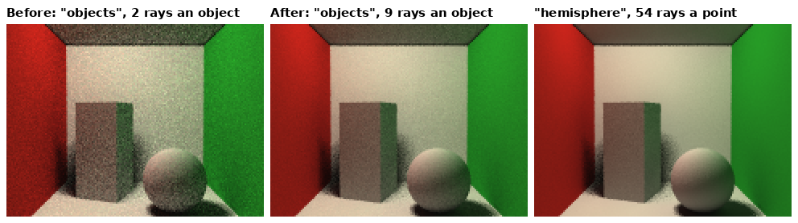

  Left, the old 2 rays an object; middle, the new 9; right, `"hemisphere"` at the same 54 rays a
  point. Look at the walls and the shadows under the block and the ball.
- **The torture test keeps 1 ray an object.** On it (160×120, against 49 rays an object) 1 ray has
  noise 2.23, 4 rays 0.95 for 1.85 times the CPU, and 9 rays 0.60 for 3.2 times: its 25 samples a
  pixel already average the bounce noise below what shows, and it is the slowest test and render.

### Added

- **`render_bounce_hemisphere`** (`scenes/bounce_hemisphere_test.ray`, with its round-trip and
  networked tests): `bounce_test` with the `"hemisphere"` method at 54 rays a point, the same as
  the `"objects"` method's 9 rays for each of the 6 objects in reach. In this closed room it is
  about three times smoother for the same rays, since every one of its rays hits something, and
  costs about twice the CPU (longer rays):

  | Rays a point | `"objects"` noise (bounce-lit) | `"hemisphere"` noise (bounce-lit) |
  |---|---|---|
  | 6 | 10.82 (15.58) | 3.23 (4.26) |
  | 24 | 4.78 (6.81) | 1.45 (1.93) |
  | 54 | 2.68 (3.74) | 0.79 (0.98) |
  | 96 | 1.81 (2.43) | 0.61 (0.74) |

  `"objects"` earns its keep in open scenes, where most hemisphere rays find nothing in reach.
  (Both measured against the same `"objects"` reference: the two methods estimate the same light.)
- **`tools/bounce_sweep.py`**, the measurement above, for any scene and counts.

### Decided against, after measuring

- **An even grid of bounce rays laid out by the sample's index** (one ray a cell, each of a pixel's
  samples taking a different place in every cell) was 10 to 20% noisier than the R2 sequence the
  rays already follow from each sample's point in its pixel (2.68 against 3.10 at 9 rays; 1.81
  against 2.26 at 16). That sample point already spreads a pixel's samples evenly over each
  object, as a rough mirror's does, so the rays were already "levelled".
- **A separate clamp on gathered rays** made no difference until it darkened the image (at 0.5,
  the bounce test lost 3% of its brightness and doubled its error; the torture test at 1.0 was
  unchanged at 2.25 against 2.23). The camera's `clamp` already limits every gathered ray.

## [2026-alpha-0.14] - 2026-11-20

Natural materials and shaped light: a library of thirty-one stones, woods, gems and metals that a
scene pulls in by name and then changes, two new solid textures (cellular flecks and underwater
caustics), beam profiles that shape a spot light like real fixtures with lenses, distance
attenuation, and filters a light shines through, projecting slides, gobos and caustics. Scenes
without the new fields render byte for byte as before.

### Added

- **A library of natural materials (presets).** `{ "preset": "carrara-marble" }` names one of 31
  presets, wherever a texture goes (a material's, a bump map's, a light's filter) or as an entry of
  an object's `materials`, where it stands for a whole finish: the preset's solid texture with
  ambient, diffuse, highlight and reflection set to suit it (polished, glossy, satin, matte, oiled
  wood or brushed metal). Fields given beside the name are laid over the preset's: as a texture,
  any texture field (`scale`, `colors`, `seed`, `axis`...); as a finish, `"texture"` over its
  texture and a material type (`"specular": { "power": 0.3 }`) over that material, added if it has
  none, or taken out with `null`. A scene saved again keeps the preset's name and only what was
  given beside it, as long as that still gives exactly what it did; once changed some other way
  (in an editor) the full texture or materials are saved, so nothing is lost.
  - Stones: `carrara-marble`, `black-marquina`, `verde-marble`, `rosso-marble`, `travertine`,
    `granite`, `black-granite`, `slate`, `sandstone`, `basalt`, `sand`, `concrete`, `terrazzo`.
  - Woods: `oak`, `pine`, `walnut`, `cherry`, `mahogany`, `ebony`, `birch`.
  - Gems: `jade`, `amber`, `obsidian`, `malachite`, `lapis-lazuli`.
  - Metals: `brushed-steel`, `brushed-gold`, `brushed-copper`, `rust`.
  - Other: `terracotta`, and `caustics` (a texture only, for a light's filter).
  - They follow the classic procedural recipes (Perlin 1985 and 2002; Worley 1996; Ebert et al.,
    *Texturing and Modeling*), with colors of our own. They live in `core/src/Presets.cpp`, so a
    scene that names one needs no file, and networked engines have them too.
  - `ray-editor`'s property grid offers the list for any `preset` field.
- **`cells` and `caustics` textures.** `cells` is Worley's cellular noise: `"flecks"` (one ramp
  color a cell, for granite and terrazzo), `"distance"` (spots) or `"edges"` (cracks), with
  turbulence bending the cells' sides. `caustics` draws the web of bright lines light makes under
  water (Worley cell edges bent by noise, in `layers` turned against each other, `width` wide),
  with a ramp that rises above white so the lines add light. Every solid texture also takes a
  `stretch` (`[40, 1, 1]` draws features forty times longer along x, for brushed metal), written
  only when it isn't `[1, 1, 1]`.
- **Beam profiles.** A spot light, and a rectangle light given a new `angle` (a softbox with a
  grid), take a `profile`: `"smoothstep"` (the default, exactly as before), `"linear"`,
  `"cosine"` (cos^`exponent`), `"gaussian"` (`spread`), `"fresnel"` (a full center out to
  `hotspot`, falling to `rim`: a stage Fresnel), or `"table"`, brightnesses from the axis to the
  edge like a photometric (IES) table. The shape multiplies the fading edge.
- **Attenuation.** Point, sphere, rectangle and spot lights take `attenuation`: `"none"` (the
  default, as before), `"inverse"` or `"inverseSquare"`, full strength at `distance`.
- **Filters a light shines through.** Every light takes a `filter`: `{ "texture": ..., "size": 1 }`,
  any texture or preset, that colors the light it sends each way. A spot projects it across its
  cone (a slide projector or a gobo), sunlight straight along its direction (the same all along
  it), a rectangle light along its facing, and a point or sphere light all around. With haze and
  the `caustics` preset, sunlight gives the rippling light seen under water.
- **`CLight::ShadeAt`** applies attenuation and the filter on top of `GetShade`; the tracer's lit
  shading and area-light shading call it.
- **New test scenes**, each with render, round-trip and network tests, a reference render, a README
  preview and a place in the Expected output table:
  - `materials_test.ray`: thirty spheres, one of each finish in the library.
  - `projector_test.ray`: six spots on a wall, one of each profile, a slide projected onto the
    floor, and a warm light that falls off with the square of distance.
  - `underwater_test.ray`: haze, sand, a few stones and caustics from the sun.
- **`format_test` checks** that every preset's texture and finish loads; that fields beside a preset
  replace its own; that presets are saved as written and read back the same, and saved in full once
  changed; the finish overlays (a type added, changed, or taken out with null) and their errors;
  that cells and caustics stay in their ramps, are the same every time, and that flecks are one
  color a cell; the exact value of every beam profile, and that the default is the smoothstep edge
  it always was; the three attenuations; that a spot projects its filter across its cone and that
  sunlight's filter is the same all along it; and the errors for bad profiles, tables, rims,
  attenuations and filters.

  

  Top, the projector scene with every spot's default edge and no filter or attenuation (so the warm
  light near the floor lights the whole wall), then as it is: from the left smoothstep, linear, cosine, gaussian, fresnel and a table with rings, the
  `uv_grid` slide projected onto the floor around the marble ball, and a warm pool from a light
  that falls off with distance. Middle, the underwater scene without and with the sun's `caustics`
  filter. Bottom, a full-size crop of the torture test: the mirror frame is now the `walnut` preset
  and the cone behind the teapot `malachite`, and the spot on the teapot has a `fresnel` beam and
  throws a dappled `caustics` pattern.

### Changed

- **Torture test:** the mirror frame uses the `walnut` preset (its grain turned along the frame),
  the hammered cone the `malachite` preset, and the spot light on the teapot a `fresnel` profile
  and a `caustics` filter. Its reference render, README preview and full-size image are
  regenerated; a full-size Release render took 4,210 CPU-seconds against 3,751 for 0.13 (12% more;
  432 s wall on a busy 16-core machine, about four and a half minutes idle).
- Material, bump-map and light-filter textures are all read and written by `CTexture::Read` and
  `CTexture::Write`, which handle presets; a texture without one is written exactly as before.
- A light's filter is looked up along the direction to the light's middle (its position, or along
  sunlight), not to the point of an area light a sample comes from, so a spot with a radius
  projects a sharp picture, as a projector's slide does, instead of grain.

## [2026-alpha-0.13] - 2026-11-20

Light between surfaces, and air: matte surfaces gather the light bounced off the surfaces near
them, so colors bleed and shadows get fill light, and a haze that far things fade into dims light
on its way to a surface, the same everywhere or lying low as ground mist. Scenes without the new
fields render byte for byte as before.

### Added

- **Indirect light, a "poor man's radiosity"** (`settings.indirect`: `method`, `bounces`,
  `samples`, `objects`, `distance`, `strength`; off unless `bounces` is set). At every point a ray
  hits on a surface with a `diffuse` material, light bounced off nearby surfaces is gathered and
  lights the point's diffuse materials like a light along its normal. Whatever a gathering ray
  meets sends back only the light it scatters diffusely: its diffuse materials lit by the lights
  (point and area, with shadows) and the sky, what glows (`ambient`, the new `CMaterial::Glows`),
  and its own gathered light while bounces are left; no highlights, reflections or refraction (rays
  carry `CRay::IsGather` and their bounce count). Two methods:
  - **`"objects"`** (the default): the nearby objects are treated as lights. `CScene::Nearby` walks
    the scene's bounding volume hierarchy for the objects whose bounds come within `distance`; the
    `objects` (default 8) that fill the most of the point's view each get `samples` rays aimed
    evenly over the cone their bounding sphere fills (a plane: the cone of its disc within
    `distance`). Each ray is traced normally and counts only if that object is the first thing it
    meets, so no direction counts twice, weighted by the cosine at the point and the solid angle it
    stands for, so the estimate is right whatever the number of rays. An object whose bounds hold
    the point (its room, its own mesh) is gathered from over the half above it instead, and a
    closed object lights itself from inside. Cost: at most `objects` × `samples` rays a diffuse
    hit, each shading what it meets with direct light only unless `bounces` is above 1.
  - **`"hemisphere"`**: `samples` rays spread by the cosine over the half above the point, each
    reaching `distance`; a ray that reaches nothing brings nothing. Cost: `samples` rays a hit.

  Both take their directions from the ray's sample point (`CRay::SamplePoint`, a new purpose
  `PURPOSE_INDIRECT`), so a stratified sampler spreads them evenly over a pixel's samples; both
  gather with `samples` rays at the first bounce and one at each bounce after, so the cost grows
  with bounces instead of multiplying; both respect the camera's `clamp`. Averaged over many rays
  they agree within a few percent (`format_test` holds them to 5%).
  - **Why no cache:** an irradiance cache filled as pixels are traced depends on which pixel asks
    first, so threads and networked engines (which trace tiles in any order) would disagree.
    Everything here is worked out from the ray alone, so every task gives exactly the same image,
    and the network tests hold it to that.
- **Haze** (the scene's `haze`: `color`, `density`, `heightFalloff`, `baseHeight`). Every ray is
  blended toward the haze's color by the transmittance `exp( -∫ density )` along it, as far as its
  hit or 1,000,000 units for a ray that leaves the scene, and light from a light to a surface is
  dimmed by the same transmittance along its path. With a `heightFalloff` the haze thins with
  height, like ground mist; its integral has a closed form, so haze is exact and nearly free.
  Sunlight (a `directional` light) isn't dimmed by haze that is the same everywhere, since its path
  would never end there.
- `scenes/bounce_test.ray` (a box room with red and green walls, one bounce aimed at the nearby
  objects) and
  `scenes/haze_test.ray` (an avenue of columns fading into ground mist), each with render,
  round-trip and network tests, reference renders, README previews and places in the Expected
  output table. `format_test` checks that bounces 0 traces exactly what no indirect light does;
  that a closed room glowing g and scattering a gives exactly g (1 + a + … + aⁿ) for n bounces
  (every gathering ray sees the same light there, so the answer is exact at any sample count), by
  both methods; that nothing comes back from beyond `distance`, or from an object farther than it;
  that the two methods agree on the red a wall adds beside it; the method and `objects` fields; that a red wall adds red, and only red, to the floor
  beside it; that indirect light is the same every time and in every copy of the scene; haze
  transmittance for constant density and against a fine numerical integral of height-falloff
  density; that haze dims the light on its way to a surface and the view of it exactly; that
  sunlight isn't dimmed by constant haze; editing haze as a part of the scene; round-trips; and the
  errors for bad settings.
- The scene editor (`ray-editor`) lists the haze in its tree, can add (Edit > Add Haze) and delete
  it; `indirect` shows with the other settings in the property grid once a scene has it (the JSON
  tab adds it).

### Changed

- **The torture test** has one bounce of indirect light by the `"objects"` method (`samples` 1 and
  `objects` 2: one ray a sample aimed at each of the two objects within 4 units that fill the most
  of the view, so 50 a pixel from its 5×5 sampler) and a light haze that thins with height, which
  fades the far floor and the horizon band into it. Its reference render, README preview and the
  full-size image are regenerated. A full-size Release render takes 3,751 CPU-seconds against 2,229
  before (68% more; 486 s wall on a busy 16-core machine), about four minutes on an idle one.

  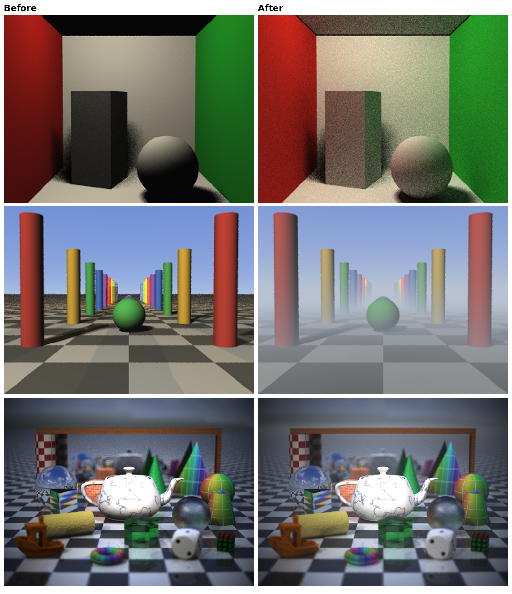

  Top, the bounce test without indirect light and with one bounce gathered from the nearby objects:
  the ceiling and the shadows are no longer black, and the block and ball pick up red and green from
  the walls. Middle, the haze test in clear air and in ground mist: the far columns fade, their
  bottoms more than their tops. Bottom, the torture test before and after: the horizon band and the
  far floor fade into the haze, and the floor and the shadows are a little lighter.

  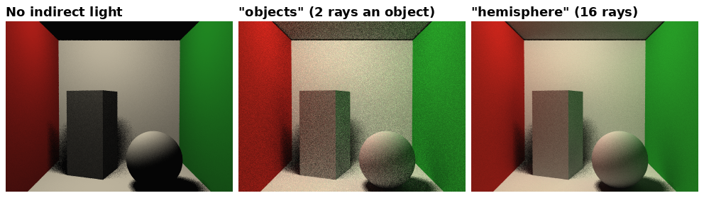

  The two methods side by side on the bounce test at 320×240: the same light (the objects method in
  about half the time here), with grain from their few rays a sample.

## [2026-alpha-0.12.1] - 2026-11-20

Smoother spectral dispersion: a pixel's samples now take one each of as many wavelength strata,
shuffled per pixel, instead of wavelengths tied to where each sample falls in the pixel. Scenes
with `"dispersion": "rgb"` (the default) render byte for byte as before. Plus the first screenshot
of `ray-editor`.

### Added

- A screenshot of `ray-editor` on Linux (`docs/images/editor.png`: the textured teapot after
  *Render*), in the README's editor section and in `editor/README.md`.

### Fixed

- **Spectral dispersion was grainier than it had to be, and patterned.** Each sample's four
  wavelengths (one in each quarter of 380–720 nm, all at the same place in their quarters, as in
  Wilkie et al.'s hero wavelength sampling) took that place from where the sample fell in its
  pixel. So wavelength and position moved together, and through strongly dispersive glass, where
  a wavelength's change moves the image as much as a step across the pixel does, the two
  cancelled out in places: a pixel's samples kept looking at the same few points of the wall
  behind, and the grain stayed in fixed streaks however many rays a pixel. Now the place comes
  from which of its pixel's samples the ray is (`CRay::WavelengthOffset`): the samples take one
  each of as many equal strata, in an order shuffled by a hash of the pixel (Kensler's
  permutation, `RaySampling::Permute`), with a hashed place inside each stratum. Wavelength no
  longer has anything to do with position, and a pixel's wavelengths still cover the range evenly.
  - The samplers that make a fixed number of rays a pixel (`stratified`, `box`, `random`, and
    `adaptive`, out of its maximum) say which each ray is (`CRay::SetSampleIndex`); rays made from
    a ray keep it. With `corners` and `none` the place is a hash of the sample point.
  - Error against a 256-ray render of `prism_test`, in the rainbow (root mean square, 0–255):

    | Rays a pixel | 0.11.1 | Hashed place per sample | Shuffled strata (now) |
    |---|---|---|---|
    | 4 (the test's 2×2) | 30.0 | 31.6 | **23.7** (21% less) |
    | 64 | 6.24 | 8.12 | **4.58** (27% less) |

    A hashed place alone, without strata, was worse than before; the shuffled strata are better
    at every count. Over the whole image the error falls from 15.2 to 12.7 (4 rays) and 2.97 to
    2.26 (64 rays).
  - The red, green and magenta bands in `prism_test` are real: the wall's white bars are closer
    together than the spectrum each fans out to, so neighboring bars' spectra overlap. The
    256-ray render shows them too; what changed is the grain in them.
  - `prism_test`, `chromatic_test` and `torture_test` are regenerated, with their README previews
    and the full-size `docs/images/torture_test.png` (2,229 CPU-seconds, about the same as
    before). No other render changes.

  

  Look at the bars through the prism: at 4 rays a pixel the speckle is finer and less streaked, at
  64 the bands are clean, and the torture test's prism fringes are smoother.
- `format_test` checks that the shuffle puts every index in a different place for counts up to
  300, that a pixel's 25 samples (and the rays made from them) take one each of 25 wavelength
  strata, that a ray's offset is the same every time and in its copies, that neighboring pixels
  shuffle differently, and that a ray without a sample index takes a hashed offset.

## [2026-alpha-0.12] - 2026-11-20

A scene editor for every platform: `ray-editor`, built on wxWidgets for Windows, Linux and macOS,
with a scene tree, a property grid and JSON editing for every part of a scene, a shaded OpenGL view
that you orbit, pan, zoom and click to select in, and a Render button that ray-traces the view
progressively over it. Rendering doesn't change: every reference render is byte for byte as before.

### Added

- **`ray-editor`, the cross-platform scene editor** (`editor/`, built with
  `-DRAY_BUILD_EDITOR=ON`; see [`editor/README.md`](editor/README.md)). It sits beside the MFC
  editor, which is unchanged.
  - **Scene tree** on the left: the settings, the camera, the environment, the objects (each with
    its materials under it) and the lights.
  - **Properties** on the right, two ways: a property grid of the selected part's fields (numbers,
    switches, text, x/y/z or red/green/blue for vectors and colors, and its materials, texture,
    bump map, sampler, lens and so on as sections), and a JSON page for anything else. Every change
    goes through the scene's own reader; if it refuses, the reason shows and nothing changes.
  - **Shaded view** in the middle (`wxGLCanvas`): every object tessellated and lit by the scene's
    lights (up to eight; a lamp at the eye if there are none), glass see-through, a csg's parts
    faint, icons for every light and the camera's frustum, the selection outlined, and a wireframe
    overlay to turn on. Drag to orbit, right-drag to pan, wheel to zoom; a click picks the object
    under it with the tracer's own hit test. *Look Through Scene Camera* shows what the camera
    sees, and *Set Scene Camera to This View* moves the camera there.
  - **Render** (F5) ray-traces the view at its size over it, with the tracer's own thread task
    master: a quick pass (a ray a pixel at a quarter of the size), then the scene's sampler. Moving
    the view or changing the scene stops it; the finished image saves as a PNG.
  - **Editing:** undo and redo (whole-scene snapshots, up to 100 steps or 256 MB), new objects
    (sphere, box, plane, cylinder, cone, triangle), lights (point, spot, directional, sphere,
    rectangle) and a sky from templates, duplicate, delete, and STL or OBJ import (a mesh fitted
    to two units, standing on the floor).
  - **Files:** new, open (scene archives and JSON), and save as a `.ray` archive or as `.json`.
  - **How it's built:** the logic (`editor/logic/`: the document, tessellation, the view's camera,
    picking and the progressive render) uses no window toolkit and is always built; only
    `editor/gui/` uses wxWidgets. CMake uses an installed wxWidgets 3.1+ or fetches 3.2.9 (pinned
    by SHA-256) and builds only `base`, `core`, `gl` and `propgrid`, as static libraries (about
    five minutes on a 16-core machine). The view uses OpenGL 1.x fixed-function calls only, so it
    runs on Windows' `opengl32`, macOS's legacy 2.1 profile and Mesa alike.
- **`editor_logic` test** (`tests/editor_test.cpp`, 151 checks, no display needed): every
  template is a part the scene accepts; bad edits are refused with a reason and change nothing;
  undo and redo walk edits, additions, duplicates and deletions back and forth; spheres, boxes
  (turned as the tracer turns them), planes, cones and csgs tessellate correctly, and every object
  in the torture test draws; the view aims rays exactly as `CCamera::RayDirection` does (within
  10⁻⁹) and its OpenGL matrices put a point where the ray through it lands; picking finds the ball,
  the floor and the sky; models import, scenes save as archives and JSON and read back; and the
  progressive render finishes, matches a render without the quick pass, and stops at once when
  asked.
- **CI** builds `ray-editor` on Linux, macOS and Windows (the `editor` job, with wxWidgets'
  build cached between runs) and uploads it.
- **`CImageFile` can keep an image in memory** (`CImageFile( nWidth, nHeight )`, `GetMemory`),
  and `PutRGB` is virtual, so a subclass sees each pixel as it arrives: the editor's progressive
  render uses it.

### Fixed

- **Loading a scene file that isn't there no longer crashes.** IASLib's `CFile` throws when a file
  can't be opened, and `CScene::Load` let the exception escape; it now returns `BAD_FILE` with
  "the file can't be opened", as it always meant to. (`raythrower` with a wrong file name crashed
  the same way.)

## [2026-alpha-0.11.1] - 2026-11-20

Rainbows and lean meshes: dispersion can be traced wavelength by wavelength, so glass and a
chromatic lens smear colors into a continuous rainbow instead of three bars, and meshes keep their
faces as indices in one geometry every thread shares, so a large model costs its memory once.
Scenes without the new field render byte for byte as before.

### Added

- **Spectral dispersion** (`"dispersion": "spectral"` on the camera; the default, `"rgb"`, is the
  red, green and blue split of 2026-alpha-0.10). Where white light would split into colors, at
  dispersive glass or through a chromatic lens, it splits instead into four single wavelengths, one
  from each quarter of 380 to 720 nm, all at the same place in their quarters. That place comes
  from where the ray's sample falls in its pixel (`RaySampling::PURPOSE_WAVELENGTH`), so a pixel's
  samples spread evenly over the range and every run, thread and engine picks the same ones. (Four
  give a quarter of three's grain in red and a fifth in green, for a third more rays; picking
  wavelengths in proportion to their weights was tried and was grainier in red.) Each wavelength is bent by
  the Cauchy index at that wavelength, through `indexOfRefraction` and the Abbe number, sharing the
  lens's arithmetic (`CLens::IndexAt`; `DispersedIndex` now uses it for the C and F lines too, with
  the same results). What each sees is weighed by how its wavelength looks: the CIE 1931 color
  matching functions (Wyman, Sloan and Shirley's 2013 fit) turned to linear sRGB, each scaled so an
  even spread of wavelengths adds up to exactly white (`RaySpectrum::Weights`, in the new
  `Spectrum.h`). The smear is a little grainier than red, green and blue, so it wants many rays a
  pixel. Rays carry their wavelength in their channel
  (`CLens::WavelengthChannel`, to a hundredth of a nanometer); a lens traces it at its own index,
  and takes its share of light from the nearest of the red, green and blue tables. Nothing crosses
  the wire differently.

  

  Top, the prism test at 64 rays a pixel: the flint prism and ball split each white bar into three
  colored copies before, and fan it into a spectrum after, overlapping its neighbors' into a smear
  of every hue; the ball's edges fringe yellow, orange and blue instead of red, green and blue.
  Middle, the chromatic lens test (an uncorrected BK7 singlet), enlarged: the same fringes, a
  little grainier. Bottom, the torture test's prism at full size.

### Changed

- **`torture_test`, `prism_test` and `chromatic_test` trace their dispersion spectrally.** Their
  reference renders and README previews and the full-size `docs/images/torture_test.png` are
  regenerated; no other render changes. The full-size torture test takes 2,112 CPU-seconds against
  1,733 before (its chromatic lens now traces four wavelengths a sample instead of three
  channels), about two and a half minutes on an idle 16-core machine.
- **Meshes are lean, and shared between threads.** A mesh no longer makes a `CTriangle` object for
  each face: it keeps its vertices, normals and surface coordinates in arrays with three vertex
  indices a face, and its tree, and intersects the faces itself (`CTriangle::HitFace`, the
  triangle's own test, shared so the arithmetic is the same). A face hit is shaded through a
  stand-in triangle made for it on the spot; a csg asking for a mesh's part gets one stand-in per
  face, kept. Rays leaving a face skip only that face (`CObjects::MeshFaceOf`), and glass knows a
  ray came out through the same face it went in by (`CObjects::SameSurface`). All of it, the
  geometry and its tree, is built once and held in a `CMesh::SGeometry` that every mesh given the
  same shape shares: each thread's copy of a scene finds the one already built (by a hash of what
  it was made from, checked bit for bit), and it goes when the last mesh using it does. A model
  file's bytes are shared the same way. Every render is byte for byte as before.

  On a Release build here (16 cores, other work running; the torture test with its red, green and
  blue camera, so only the mesh change differs), the test renders' peak memory and time:

  | Render | Threads | Peak memory before → after | Wall time before → after | CPU time before → after |
  |---|---|---|---|---|
  | `render_benchy` (320×240) | 4 | 1256 MB → 288 MB | 4.5 s → 3.5 s | 12.1 s → 10.5 s |
  | `render_benchy` (320×240) | 16 | 4274 MB → 793 MB | 6.3 s → 2.3 s | 39.5 s → 17.5 s |
  | `render_torture` (160×120) | 4 | 1328 MB → 357 MB | 9.8 s → 10.0 s | 31.0 s → 34.4 s |
  | `render_torture` (160×120) | 16 | 4517 MB → 933 MB | 11.8 s → 8.4 s | 66.9 s → 46.7 s |

  More threads now make the Benchy render faster instead of slower, since they no longer each
  build its 225,706 faces. What memory is left per thread is mostly each copy of the scene
  reading its JSON text (with the model file's bytes inside) while it loads.

### Fixed

- The Windows CI job runs the tests labelled `slow` again (the Benchy load that timed out there was
  fixed in 2026-alpha-0.11); `ctest -LE slow` still skips them for a quick local run.
- The known issue of a large model costing memory once per thread is gone from `CLAUDE.md`.

## [2026-alpha-0.11] - 2026-11-20

Models and prints: meshes load STL (binary, ASCII and colored) and OBJ files into the scene and its
archive, with 3DBenchy as the sample; a layer-lines texture makes them look 3D-printed; the mesh
tree is built by the surface area heuristic and walked nearest first; and the scene editor can
edit, add, delete and import anything as JSON. Scenes without the new fields render byte for byte
as before.

### Added

- **Model files.** A `mesh` can take a `file` instead of `vertices` and `faces`: an STL, binary
  or ASCII (a binary one told by its size, since many begin `solid` as ASCII ones do; corners at
  the same place joined), or an OBJ (`v`, `vt`, `vn`, `f`; faces of any number of corners split
  into fans; negative indices; texture coordinates and normals kept where every corner has them;
  objects, groups and materials ignored). `ModelFile` reads them.
  - Placed by `scale` (a number or `[x, y, z]`; a negative one mirrors the model, its faces turned
    back to face out) or `fitSize` (evenly, to that width at its widest), `rotation` (degrees about
    x, then y, then z, as a box), `align` (`"center"`, or `"bottom"`: centered in x and z on
    y = 0) and `translation`, in that order. Most printable models stand on z, so
    `"rotation": [-90, 0, 0]` stands them on y.
  - The file goes into a saved archive and out beside `--save-json`, and into each engine's copy
    of the scene as `data`, through `RayJson::ReadSceneFile` and `SceneFileName` like texture
    images. It is read once, however many copies of the scene a render makes (a cache by the
    file's contents); each copy still builds its own faces, so a large model costs memory per
    thread (a known issue).
  - Textures and bump maps on a model are looked up in its file's own coordinates (each object can
    now have a texture frame, `CObjects::TextureSpace`, and textures get their point through
    `CObjects::TextureAt`), so they move, turn and grow with it.
- **Colored STL files** in both informal conventions: Materialise Magics (`COLOR=` in the header,
  bit 15 clear for a face's own color, red in the low bits) and VisCAM/SolidView (bit 15 set, blue
  in the low bits). The new **`faceColors` texture** shows each face's color (`default` where it
  has none), on whichever materials should show it, so a highlight can stay white.
- **The `layers` texture**: the rounded layer lines of a 3D print, one each `scale` (default
  `0.1`) along `axis` (default `[0, 0, 1]`, a model file's print direction), 0 at the seams and
  rising along a parabola to 1 in each layer's middle. As a color it darkens the seams; as a bump
  map's texture it gives each layer its rounded edge. With a model's textures in its file's
  millimeters, 0.1 is 0.1 mm, along the print axis however the model is turned.

  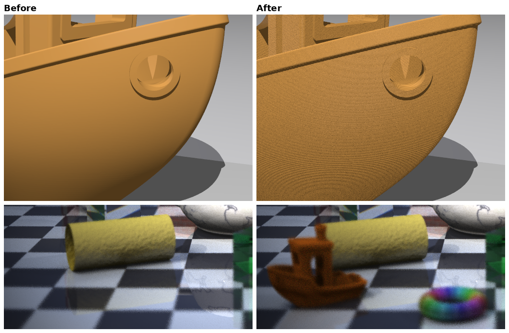

  Above, Benchy's bow and hawse hole in plain orange plastic, then printed: the layer lines run
  round the hull, catching the light on each rounded bead, and crowd together where the hull
  curves away. Below, a full-size crop of the torture test's foreground at 0.10 and 0.11: an
  orange Benchy and a ring from an OBJ file join the scene (a puzzle cube from a colored STL
  stands further to the right).
- **3DBenchy** (`scenes/models/3DBenchy.stl`): the 3D-printer test boat by Creative Tools, from its
  official repository, unmodified. It is dedicated to the public domain (CC0 1.0), which
  3dbenchy.com now states, so it can be included; `NOTICE` and `scenes/models/README.md` credit
  it. `tools/make_models.py` writes the other model files the tests use: a VisCAM-colored puzzle
  cube, a Magics-colored gem and an OBJ ring.
- **The scene editor edits anything as JSON.** `CScene::PartToJson` and `CScene::EditPart` give
  and replace one part of a scene (`settings`, `camera`, `environment`, `objects/N`, `lights/N`,
  or `objects/+` and `lights/+` to add one; empty text removes it), checked as a scene file is and
  leaving the scene as it was if the text is refused. In `Ray.exe` the tree's right-click menus
  use them through a new JSON dialog (`CJsonEditDlg`): *Edit as JSON* and *Delete* on any object
  or light, and on the scene *Edit Settings*, *Edit Camera* (sampler, color model, exposure,
  clamp, lens), *Edit Environment*, *Add Object*, *Add Light* and *Import Model (STL, OBJ)*. So
  every shape, light, texture, bump map and camera setting the core has gained can be added and
  edited, if not yet with a dialog of its own.
- **Tests.** `scenes/models_test.ray` (the cube, the gem and the ring) and
  `scenes/benchy_test.ray` (Benchy close up in orange plastic with layer lines), each with render,
  round-trip and network tests, reference renders, README previews and entries in the Expected
  output table. `format_test` checks binary, ASCII and colored STL (both conventions) and OBJ
  reading (quads, negative indices, mixed corners, every error), placement (scale, turn, move,
  `align`, `fitSize`, mirroring), that a placed model's textures are looked up at the point in
  its file, the `layers` and `faceColors` textures, editing parts of a scene, and every new error
  message; with `--textures` it loads Benchy and checks its size, that its tree finds exactly the
  hits testing every face does, the sample models' colors and texture coordinates, and that a
  scene's model files go into an archive and out beside a JSON file unchanged.

### Changed

- **A mesh's tree is built by the surface area heuristic and walked nearest first.** Each split is
  the one, of sixteen bins along each axis, that leaves a ray the fewest faces to test, weighing
  each side by its box's area; a node no split helps stays a leaf of up to sixteen faces, and past
  64 levels the tree splits at the median. The ray visits the nearer child first and skips a box
  it enters beyond the closest hit so far. The hit found is the same (the tests hold every ray to
  the face-by-face answer), and every render is byte for byte as before; on a Release build the
  teapot at 640×480 takes 22% less CPU time and the torture test 9% less.
- **The torture test** has a layer-lined orange 3DBenchy, a puzzle cube from a colored STL and a
  ring from an OBJ file on the floor in front. Its reference render, README preview and full-size
  image are regenerated.
- The slow render tests (`render_torture`, `render_benchy`, `network_benchy`, `render_prism`,
  `network_prism`) carry the CTest label `slow`, so `ctest -LE slow` runs only the quick ones. CI's Windows job
  skips them, as its runners are small; Linux, macOS and the sanitizer job still run them.
- `.gitignore` still ignores Visual C++ `.obj` files, but no longer OBJ models in `scenes/models/`;
  `.gitattributes` marks STL files binary and OBJ files text.

### Fixed

- `CMesh::Intersect` on a mesh with no faces read the first node of its empty tree; it now misses.
- Loading 3DBenchy took minutes on Windows: the hash that joins its corners left its low bits the
  same for every corner (a float made a double has 29 low bits of zeros), and MSVC's tables pick a
  bucket by the low bits, so all 225,706 went in one. The hash now mixes every bit. And each mesh
  holds the model it read, so the copies of a scene a render makes really do share one reading.

## [2026-alpha-0.10] - 2026-11-20

Solids and spectra: constructive solid geometry, which makes lens blanks, bowls and drilled dice
from spheres, boxes, cylinders, cones and meshes, and glass that splits light into colors by its
Abbe number. Plus a sample clamp on the camera that takes the bright specks out of rough glass and
area lights. Scenes without the new fields render byte for byte as before.

### Added

- **Constructive solid geometry** (`"type": "csg"`): a solid made from two or more closed shapes,
  its `objects`, by `operation`: `"union"` (inside any of them), `"intersection"` (inside all of
  them) or `"difference"` (inside the first and none of the rest). The shapes can be spheres, boxes,
  capped cylinders and cones, meshes (which must be closed) and other csgs; planes, triangles and
  open cylinders and cones are refused.
  - Along a ray the csg asks each shape for every crossing, from just past the one before, so an
    odd number ahead means the ray starts inside it. Walking the crossings in order, the first
    where the solid's inside changes is the hit, and the normal there is the crossed shape's,
    turned inside out on a subtracted shape. A shape's last hit part (a mesh's face, an inner
    csg's shape) is kept with each crossing, so nested csgs and meshes shade with the right
    normal.
  - It shades as one object with its own `materials` and `bump`, so glass made of parts is entered
    and left as one piece. With `"childMaterials": true` each surface is shaded with the materials
    of the shape it comes from (`CObjects` gained a list of materials to shade with, used by the
    csg only). Its surface coordinates are those of the shape each surface comes from, so image
    textures and normal maps work on it.
  - A ray leaving its surface (a shadow or a reflection) skips only that surface, so a bowl shades
    and reflects its own inside. Its bounding box (all its shapes' for a union, their overlap for an
    intersection, the first shape's for a difference) puts it in the scene's tree.
  - Each object can now give its outward normal at a point (`CObjects::SurfaceNormal`), the part
    its last hit was on (`HitPart`), and whether it is closed (`IsClosed`); shading is unchanged.
- **Glass that splits light into colors.** A `transparent` material takes an `abbe` number
  (default 0, no dispersion; otherwise at least 5). A ray traced in every color splits into three
  where it first meets such glass, red, green and blue, each bent by its own index from the same
  Cauchy curve the lens uses (now `CLens::DispersedIndex`, through `indexOfRefraction` at the
  d line and the Abbe number), and each keeping only its own color of what it sees. After that each
  stays in its color (rays now carry their channel, `CRay::GetChannel`, and rays made from them
  keep it), so further glass bends it by that color's index, and rays from a chromatic lens, which
  are already in one color, don't split again. A flint prism or ball fringes the edges of what is
  seen through it with color. Ray traces from the eye, so a prism casts no rainbow on the floor.
- **The sample clamp.** The camera's `clamp` (default 0, off) is the brightest any one sample's
  red, green or blue may be before the sampler averages it in. A rare ray that finds a light
  through rough glass, off a rough mirror or from an area light can be many times brighter than
  its pixel's other rays and show as a lone speck (a "firefly"); a clamp of 1.5 to 2 removes them,
  at the cost of a little of the brightest highlights.
- **`scenes/csg_test.ray`:** a glass lens blank, a bowl (blue outside, white inside, clay at the
  cut rim, by `childMaterials`), a die with drilled black pips (a rounded cube that is itself a
  csg) and a hammered gold capsule. **`scenes/prism_test.ray`:** a flint glass prism (an
  intersection of three turned boxes) and ball (index 1.62, Abbe number 20) before white bars.
  New tests: `render_csg`, `render_prism` (with reference renders and README previews),
  `roundtrip_csg_test`, `roundtrip_prism_test`, and `network_csg` and `network_prism`, which must
  match threads byte for byte. `format_test` checks where rays hit a union, an intersection, a
  difference and a nested csg, and the normals there, from outside, from inside and leaving the
  surface while ignoring the csg; the bounding boxes; that `childMaterials` shades each surface with
  its own shape's materials and that otherwise the csg's own shade it all; that a csg round-trips
  with its bump map, and that bad operations, too few shapes, open shapes and unknown types are
  reported. It checks that dispersed indices follow the Abbe number and match the lens's, that blue
  bends more than red, that a ray in every color sees exactly, channel by channel, what rays traced
  in each color alone see, that straight through the middle nothing changes, that glass without an
  Abbe number treats every color alike, and that the clamp caps each channel, is saved, and is
  copied with the camera.

### Changed

- **The torture test has a flint glass prism, a die with drilled pips, and a clamp.** A flint
  glass prism (a csg, Abbe number 20) stands before the mirror ball and splits what is seen through
  it into colors, a die (a csg with `childMaterials`) sits in front of the frosted ball, and each
  sample is clamped at 1.5, which takes the bright specks out of the frosted ball and the brushed
  tube. Its reference render, README preview and full-size image are regenerated. A full-size
  Release render does about 16% more work than 0.9's (25.5 against 22.0 CPU minutes here), a
  little under two minutes on an idle 16-core machine.

  

  Top, the new prism test with its glass's Abbe number taken out, and as it is: the white bars seen
  through the prism and the ball break into red, green and blue. Middle, the torture test before
  and after: the new flint prism before the mirror ball, full of color. Bottom, the frosted ball
  without and with the clamp: the white specks are gone, and the die with its drilled pips sits in
  front.

## [2026-alpha-0.9] - 2026-11-20

Light and sky: spot lights with soft edges, directional sunlight whose shadows blur with distance,
and environment maps, a sky gradient or an HDR picture of the surroundings that shows behind the
scene, in mirrors and through glass, and can light it too. Scenes without the new fields render
byte for byte as before.

### Added

- **Spot lights** (`"type": "spot"`): a `position`, a `direction` and a `color`, shining in a cone
  out to `angle` degrees from its axis (default 30, under 90). The edge of the pool fades over the
  last `falloff` degrees inside it (default 5) along a smoothstep, so a falloff of 0 is a hard edge.
  With a `radius` (default 0) it is a glowing disc rather than a point, shaded from `samples` points
  on the disc it shows each surface, as a sphere light is, so its shadows are soft; without one it
  is exactly a point light inside its cone.
- **Directional lights** (`"type": "directional"`): sunlight, from so far away that it arrives
  everywhere along the same `direction` (the way the light travels) with the same `color`, casting
  shadows the size of what casts them. It has no position: a shadow ray toward it goes
  `RAY_FAR_AWAY` (10⁶) scene units. With an `angle`, its angular diameter in degrees (the sun is
  about 0.53), it is a disc in the sky shaded from `samples` directions, so its shadows are sharp
  near what casts them and blur farther away.
  - `CLight::ToLight` gives the vector a shadow ray follows: to the light's position, or back along
    a sun's direction. Point lights work it out exactly as before.
- **Environment maps** (a scene's `environment`): what a ray that leaves the scene sees, instead of
  the flat `background`, whether it is a camera ray that missed everything or a reflected or
  refracted ray that escaped (`CScene::Escaped`). Two kinds:
  - `"sky"`: a gradient by height from `horizon` to `zenith` above and to `ground` below, blended by
    the height raised to `exponent` (default 0.5).
  - `"image"`: an equirectangular (latitude-longitude) picture of the surroundings in a Radiance
    HDR file (`.hdr`, RGBE, flat or run-length encoded: `CEnvironment::ParseHdr`) or any image a
    texture can be (PNG, PPM, Ray raw), turned about +y by `rotation` degrees, looked up bilinearly
    and wrapped around its sides. HDR colors are linear and may be far brighter than white, so a
    sun in the sky stays bright in a mirror. The file goes into a saved scene's archive, and a
    scene copy sent to a task carries its bytes (`data`), so networked engines need no files and
    match threads byte for byte.
  - Both take an `intensity` (default 1).
- **Image-based lighting.** With `samples` (default 0, off), the environment lights diffuse
  surfaces too. The light a surface would get from the whole sky in front of it, for every way it
  could face, is worked out once when the scene loads (the sky averaged over a 64 × 32 grid, so a
  small bright sun counts in full, then weighed by solid angle and cosine into a 32 × 16 map), so
  it is smooth, with no grain. Each point a ray hits then sends `samples` shadow rays toward the
  sky, spread by the cosine and stratified like area lights' samples, and the share that get out
  scales that light, so corners, crevices and the ground under things are darker. Shiny materials
  (specular, reflective, transparent) take the sky as their reflections, not as light
  (`CMaterial::LitBySky`). It costs `samples` shadow rays at every point a ray hits.
- **`scenes/lights_test.ray`**: three spot lights (a warm one with a hard edge, a white one with a
  soft edge, and a blue soft-edged disc with soft shadows) and a low sun with an angle of 4°, on a
  box, a ball, a cone and two posts. **`scenes/environment_test.ray`**: the HDR sky behind a mirror
  ball, a glass ball, a white ball and a red one on a checkered floor, lit by the sky (`samples` 8)
  and by a sun along the sky's own. New tests `render_lights`, `render_environment` (with
  reference renders and README previews), `roundtrip_lights_test`, `roundtrip_environment_test`,
  `network_lights` and `network_environment`. `format_test` checks that a spot light's cone is full
  inside its falloff, empty outside it and a smoothstep between, on the floor too; that half a
  spot's disc hidden gives half its light; that sunlight is the same everywhere, falls along its
  direction and casts a shadow the size of what casts it, with a soft edge when it has an angle;
  that HDR files decode exactly, flat or run-length encoded, and that damaged ones are refused; that
  an environment shows each pixel along its own direction, wraps across its seam, turns with its
  rotation and scales with its intensity; that a sky blends as it should; that a uniform sky lights
  a surface facing any way the same, a half sky by how much of it a surface faces, and the foot of a
  wall with about half; that a specular material isn't lit by the sky; that the new fields read
  back the same; and that bad settings are reported.
- **`tools/make_textures.py`** also makes `scenes/textures/sky.hdr`: a 512 × 256 afternoon sky,
  run-length encoded, with clouds on a flat layer, low hazy hills, sandy ground and a sun 60 times
  brighter than white.

  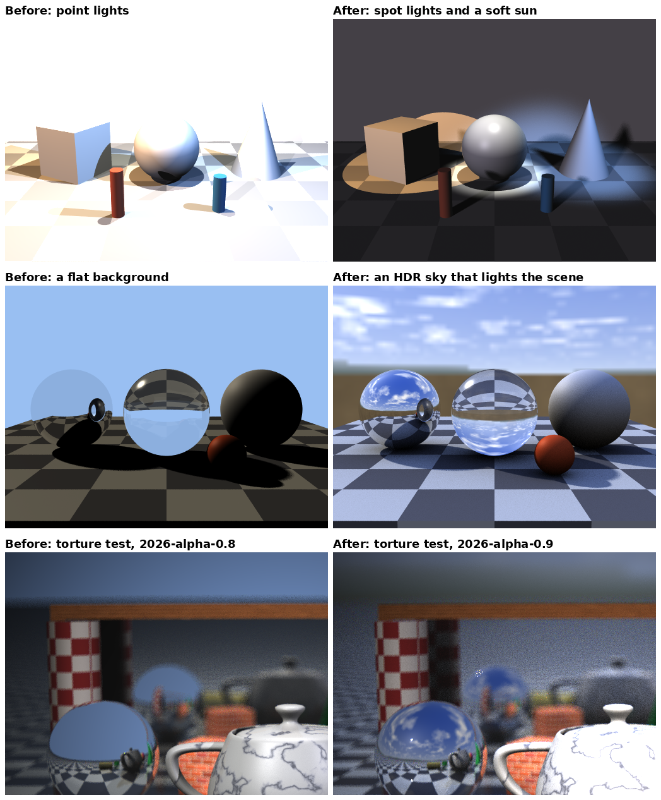

  Top, the lights test with each spot light as a point light at the same place and the sun as a
  far point light, and as it is: pools of light with hard and soft edges, the blue spot's soft
  shadows, and the sun's long shadows blurring away from the posts. Middle, the environment test
  with the flat background, and with the sky: clouds in the mirror ball, the sky bent through the
  glass, and the floor lit by the sky and darker under each ball. Bottom, a full-size crop of the
  torture test: the sky over the mirror wall and in the mirror ball, and the spot light's pool.

### Changed

- **The torture test uses the new features:** it is under `textures/sky.hdr`, turned so the sun
  stands over the key light, which shows in the mirrors and glass and lights the diffuse surfaces
  (`samples` 1), with a soft-edged spot light with a radius on the teapot and a low sun with an
  angle of 1.5° along the sky's. The other lights are dimmed to keep its brightness. Its reference
  render, README preview and full-size image are regenerated. Each new light, and the sky's light,
  adds a shadow ray at every point a ray hits, so a full-size Release render takes about 1.7 times
  as long as at 2026-alpha-0.8: about a minute and a half on an idle 16-core machine.

## [2026-alpha-0.8] - 2026-11-20

Surface detail: bump and normal maps that tilt the shading normal so surfaces look dented, grooved
or rough while their shapes stay smooth, and PNG image textures of every kind, read by Ray's own
decoder. Scenes without the new fields render byte for byte as before.

### Added

- **Bump and normal maps.** Any object takes a `bump`: a `texture` and a `mode`. In `"height"`
  mode (the default) the texture is read as heights (the average of its red, green and blue, times
  `depth`, default 0.05 scene units) and the normal tilts down their slope, found by looking the
  texture up `step` (default 0.001) either side of the point along the surface. Solid textures need
  no surface coordinates, so `noise` makes hammered metal or orange peel on anything, and an
  object's own wood or marble texture makes its grain stand out. In `"normal"` mode the texture is a
  tangent-space normal map (OpenGL convention: flat is (0.5, 0.5, 1), green toward increasing v),
  tilted by `strength` (default 1); the surface's u and v directions are worked out from its
  surface coordinates, so it works on every object that has them, across a sphere's seam too.
  - The bump map belongs to the object, not to one of its materials, so the diffuse shading, the
    highlight, and reflected and refracted rays all follow the same bumps; a mesh's faces share the
    mesh's, as they share its materials (`CObjects::BaseShade` tilts the normal once, before any
    material sees it).
  - A tilted normal that would face away from the ray, as at the rim of a sphere, is passed over
    for the smooth one, so a surface is never lit from behind.
  - Nothing new crosses the wire beyond the scene's own fields: images in a bump map travel inside
    the scene like any texture's, so networked engines match threads byte for byte.
- **PNG image textures.** An `image` texture (and so a normal map) can be a PNG of any kind:
  grayscale, RGB, palette, grayscale with alpha or RGBA, at 1, 2, 4, 8 or 16 bits a channel,
  interlaced or not (`CPngImage`). Low bit depths are scaled to the full range, 16-bit channels
  rounded to 8 bits, and alpha is ignored. The data is inflated by a small decoder of our own, so
  nothing new is needed to build; chunk CRCs and the zlib checksum are checked, and a damaged or
  truncated file is reported when the scene loads, never read past. A saved scene keeps the PNG
  file itself in its archive.
- **`scenes/bump_test.ray`**: a brick wall (a PNG color texture and an interlaced PNG normal map)
  lit from the side, a hammered copper ball and an orange-peel ball, a box embossed with bricks by a
  16-bit grayscale PNG height map, and a wood floor bumped by its own grain. New tests
  `render_bump` (with a reference render and a README preview), `roundtrip_bump_test` and
  `network_bump`. `format_test` decodes PNGs of every color type and bit depth, interlaced and
  not, with every filter type, exactly; refuses damaged CRCs, every truncation, palette indices past
  the palette and unknown critical chunks; inflates stored and dynamic Huffman blocks (one made by
  zlib) and catches a wrong checksum and damaged data; checks that a height ramp tilts the normal
  by exactly depth times its slope, that a normal map tilts it toward u by its red and toward v by
  its green times `strength`, that a flat map changes nothing on a sphere, that a normal facing away
  from the ray is passed over, that every object type saves and reads back its `bump` and a mesh's
  faces share it, and that bad settings are reported.
- **`tools/make_textures.py`** makes the three brick PNGs in `scenes/textures/` (color, normal map
  and 16-bit height map) with only the Python standard library.

  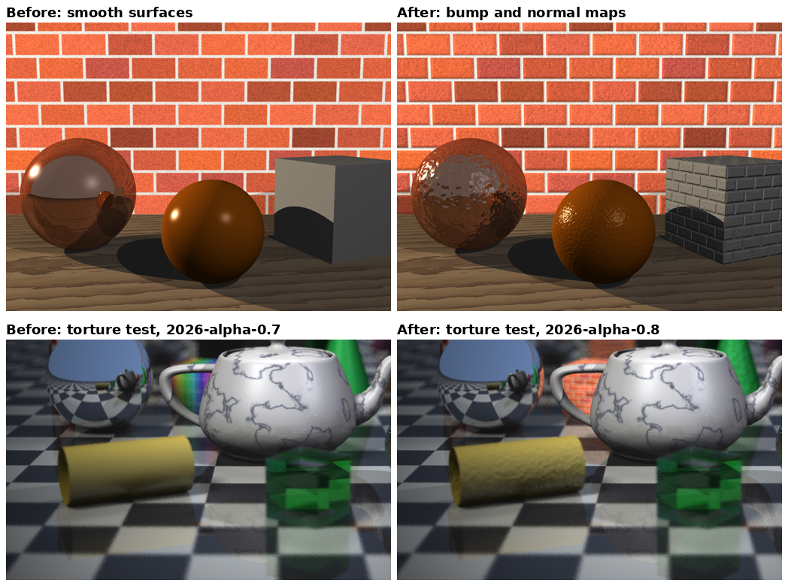

  Above, the new test scene with its bump maps taken out, and as it is: the copper ball is
  hammered, the orange has its peel, the plain box is embossed with bricks, the floor's grain
  stands out, and the bricks' edges catch the side light. Below, the torture test: the gold tube is
  hammered, and the box behind the teapot is now bricks, a PNG texture with a PNG normal map.

### Changed

- **The torture test uses the new features:** the textured box is bricks (`bricks.png` with the
  `bricks_normal.png` normal map), the gold tube and the green cone are hammered by `noise` height
  maps, and the mirror's wooden frame is bumped by its own grain. Its reference render, README
  preview and full-size image are regenerated.

## [2026-alpha-0.7] - 2026-11-20

Softness: frosted glass and brushed mirrors, and area lights that cast soft shadows, all picking
their directions and points from where each ray falls in its pixel, so a stratified sampler
smooths them and every render is the same each time. Scenes without the new fields render byte
for byte as before.

### Added

- **Rough glass and mirrors.** `transparent` and `reflective` take a `roughness` (default `0`, up
  to `1`). Each ray bends or reflects about a microfacet normal drawn from a GGX
  (Trowbridge–Reitz) distribution of that roughness about the surface's normal, so frosted glass
  blurs what is behind it and a brushed or satin mirror blurs its reflection; a microfacet that
  would send the ray the wrong way through the surface is passed over for the smooth direction.
  Smooth materials don't write a `roughness`, so existing scenes save as before.
- **Area lights: `sphereLight` and `rectangleLight`.** A glowing ball (`radius`) or panel (sides
  `edge1` and `edge2`, shining only to the side `edge1` × `edge2` points to), each with `samples`
  (default `1`, up to 256). Each point is shaded from that many points of the light, each with its
  own shadow ray and an even share of its color, so shadows are dark where none of the light can be
  seen and fade through a penumbra where some can. Like point lights they don't fall off with
  distance and the camera doesn't see them; point lights are unchanged.
- **Where the samples come from.** Each ray carries a sample point (where its primary ray fell in
  its pixel) and a key (from its pixel and the bounces since). A rough surface or an area light uses
  that point, shifted, turned and mirrored by a hash of the key, its depth and what it's for, so a
  sampler that spreads its rays evenly over a pixel (`stratified`, `adaptive`) spreads them evenly
  over the blur and the light. A ray made at a surface picks again from a point hashed from its
  parent's: reusing the same point there tied each bounce to the one before in a way fixed for the
  pixel, and frosted glass came out with a speckle that more rays never smoothed. Nothing is random,
  so networked engines match threads byte for byte; nothing new crosses the wire.
- **`scenes/soft_test.ray`**: three glass panes before a striped poster (clear, roughness 0.08 and
  0.3), a mirror ball and a brushed gold one, and soft shadows from a rectangle light and a sphere
  light, with a 6×6 stratified sampler. New tests `render_soft` (with a reference render and a
  README preview), `roundtrip_soft_test` and `network_soft`. `format_test` checks that the new
  fields read, save and read back, that bad values are reported, that GGX microfacets tilt as the
  distribution says (half within atan of the roughness), that a sphere light's points lie on the
  disc it shows, that a rectangle light shines only to its front, that hiding half of one gives half
  its light, and that rough glass is the same every time for the same ray.

  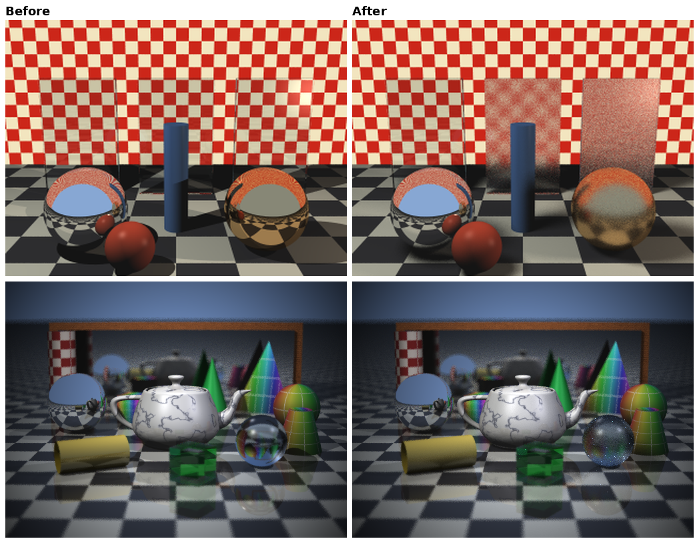

  Above, the new test scene drawn with what the renderer had before (smooth surfaces, point lights
  at the area lights' centers) and as it is now: the middle and right panes blur the stripes behind
  them, the gold ball's reflection is brushed, and the shadows of the post and the red ball are soft
  at their edges. Below, the torture test: the glass ball is frosted, the gold tube brushed, and the
  shadows soften under the new sphere and rectangle lights.

### Changed

- **The torture test uses the new features:** the glass sphere is frosted (roughness 0.12), the
  gold tube brushed (0.15), the key light a sphere light of radius 3 and the overhead fill a 3 × 3
  rectangle light. Its reference render, README preview and full-size image are regenerated; its
  description in `scenes/README.md`, which still had the copper teapot and black frame, is brought
  up to date.
- **`CLAUDE.md`: every new feature goes into the torture test** in the same change, with its
  reference render, README preview and full-size image regenerated; and every release updates the
  release gallery.

## [2026-alpha-0.6] - 2026-11-20

Solid noise textures (marble, wood, and noise for granite and stone) and glass that absorbs light
by how far it travels inside, shown in a new test scene and worked into the torture test.

### Added

- **Solid noise textures: `marble`, `wood` and `noise`.** They fill space rather than lie on a
  surface, so an object looks carved from a block of the material and needs no surface
  coordinates. Each works out a value from Perlin gradient noise (his 2002 form, with a shuffle
  picked by `seed`) and looks it up in a ramp of `colors`. `marble` draws thin veins where bands
  across `axis` meet, bent by `turbulence`. `wood` draws rings about an axis, wobbled by noise.
  `noise` gives smooth layered noise, or sharp-creased turbulence for granite and stone. All take
  `scale`, `origin`, `turbulence`, `octaves` and `seed`; see `scenes/README.md`.
- **Glass that absorbs by the distance light travels inside it.** A `transparent` material's new
  `attenuationColor` and `attenuationDistance` give the color light is left after going that far
  through the object. Twice as far gives that color squared (Beer–Lambert). Thick glass is deeper
  in color than thin, and a glass ball is darker through its middle than at its rim. Each ray
  carries the transparent object it is inside (`CRay::GetInside`), so the surface where it comes
  out knows how far it went. A ray turned back inside past the critical angle keeps absorbing.
  Without the new fields nothing changes, and every existing render is byte for byte the same.

  

  On the left, the old way: a flat tint at each surface, so all three slabs are the same green. On
  the right, absorption: the thin slab is pale and the thick one dark. The amber ball is deepest
  through its middle and lightens toward its rim.
- **The torture test uses them too.** The teapot is polished white marble instead of copper, the
  mirror's frame is wood (and a little wider, 16.2 by 5.6, so the grain shows round the mirror),
  and the glass cube is clear glass that turns green by the distance light goes through it. The
  `torture_test` reference render, its README preview and the full-size README image are
  regenerated.

  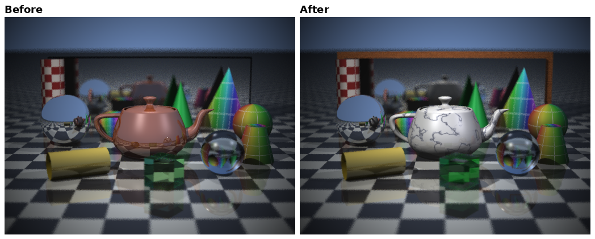

  Look at the teapot's gray veins, the wood grain round the mirror, and the cube: deeper green
  where light crosses more glass.
- **`scenes/solid_textures_test.ray`** shows both: a white marble sphere, a green marble cube, a
  wooden log and floor, a granite wall, the three slabs and the amber ball. New tests:
  `render_solid_textures` (with a reference render and a README preview),
  `roundtrip_solid_textures_test`, and `network_solid_textures`, which must match threads byte for
  byte. `format_test` checks that the noise is smooth, within about −1 to 1 and 0 on its lattice;
  that each seed gives its own noise and always the same one; that the color ramp blends evenly;
  that every texture round-trips through JSON; and that bad settings are reported. It also checks
  that a ray through a glass ball keeps exactly `attenuationColor` to the power of its chord over
  `attenuationDistance`.

## [2026-alpha-0.5] - 2026-11-20

Faster: plain value types for vectors and colors, a bounding volume hierarchy over the scene,
shadow rays that stop at the first hit, and lens tables worked out once and saved with the scene.
Every render is byte for byte what it was; the full-size torture test takes about a minute on a
Release build. Plus the `adaptive` sampler.

### Added

- **The `adaptive` sampler** (`--aa adaptive`, or `{ "type": "adaptive" }` in a scene): each
  pixel gets at least `min` rays (default 9), then more, one at a time, until the standard error of
  its brightness is under `threshold` (default 0.01) or it has `max` (default 64). Rays follow the
  R2 low-discrepancy sequence, shifted for each pixel by a hash, so any number of them is spread
  evenly over the pixel and over a real lens, and the image is reproducible and the same in every
  task. On the torture test at 320×240, measured against a 144-ray render: the scene's 5×5
  stratified sampler (75 rays a pixel with the three channels) has an RMS error of 2.54 levels;
  `adaptive` has 2.23 with 18% fewer rays, and with `min` 16, 1.84 with the same rays. New tests:
  `render_sampler_adaptive` (with a reference render and a README preview) and
  `network_sampler_adaptive`, which must match threads byte for byte. Samplers now get each ray's
  color before making the next, which `CTileTracer` always did.
- **A lens's exit pupil tables are worked out before the scene is sent, and saved with it.** The
  master works them out once, on every core, when the scene is loaded; they go into the lens's
  record (`exitPupil`: the tables as exact base64 doubles, and a fingerprint of the setup they are
  for), so tasks and engines use them instead of working them out each, and a saved scene loads
  without working them out. If the lens, focus, aperture or sensor changes, the fingerprint no
  longer matches and they are worked out again. `lens_test`, `chromatic_test` and `torture_test`
  are re-saved with theirs; renders are byte for byte the same.

### Changed

- **Faster tracing, with every render byte for byte the same.** On a Release build, the torture
  test at 320×240 went from about 13.0 s to 6.7 s, and `scan_test` with 9 random rays a pixel at
  1280×960 from 7.3 s to 5.4 s:
  - `CVector` and `CColor` are plain value types: no virtual functions, and their small members
    are inline, so the compiler can keep them in registers. The biggest single gain.
  - The scene keeps its objects in a bounding volume hierarchy: each object reports a bounding box
    (`CObjects::GetBounds`; planes have none and are tested every time), and a ray tests only the
    objects in boxes it passes through. Of objects hit at exactly the same distance, the first in
    the scene wins, as when every object was tested in order; `format_test` checks that the tree
    and the plain loop find exactly the same hits and shadows.
  - Shadow rays stop at the first thing in the way: a mesh stops at the first face it finds in its
    tree (`CObjects::Occludes`), and the object that blocked the last shadow ray is tried first.
  - A chromatic lens no longer traces the sampler's own ray through the glass, which was only used
    for where the sample falls; it is made again for each color anyway (`CCamera::SetAimOnly`).
  - A lens works out the index of each glass in each color once, instead of in every step of every
    ray.
- `scenes/README.md` no longer says reflected rays keep their parent's influence: they carry it
  times their material's share, so rays off weakly reflective surfaces stop after a few bounces.
- `CLAUDE.md`: time renders with a Release build; bounded objects override `GetBounds`, and objects
  made of parts `Occludes`.

### Fixed

- Release builds warned that parts of a task's events and inbox messages might be used
  uninitialized when copied; they now start at defaults.

## [2026-alpha-0.4.1] - 2026-11-20

Real lenses cast blocked rays again, so lens renders have almost no grain from the lens.

### Changed

- **A real lens casts a blocked ray again instead of letting it go black, so lens renders have
  almost no grain from the lens.** Whether a ray gets through the lens depends only on the lens
  and where it starts on the sensor, never on the scene. So the lens now works out, once, the share
  of rays aimed at its rear element that get through, at each ring of the sensor and in each color.
  A ray the lens blocks is cast again at another point in the exit pupil (up to 64 times, at
  points hashed from the first, so every run and every task makes the same ones) until one gets
  through, and that ray counts for the share. Brightness and vignetting are as before, but how
  many of a pixel's rays happened to be blocked no longer shows as grain.
  - On a plain grey background through the double Gauss, the difference between neighboring
    pixels falls from 0.022 (2026-alpha-0.4) and 0.038 (2026-alpha-0.3) to 0.002. Brightness
    matches a 1,024-ray render of the old sampling within 0.3% (1.2% in the corners, within that
    render's own noise).
  - The share is measured on the same grid as the exposure, so the center of the image is exactly
    as bright as through a pinhole.
  - The `lens_test` and `torture_test` references are regenerated, with their previews in the
    README; `chromatic_test`, whose lens blocks nothing in its frame, is unchanged, as is every
    render without a lens. What grain is left comes from the scene: out-of-focus edges and
    textures blending.

    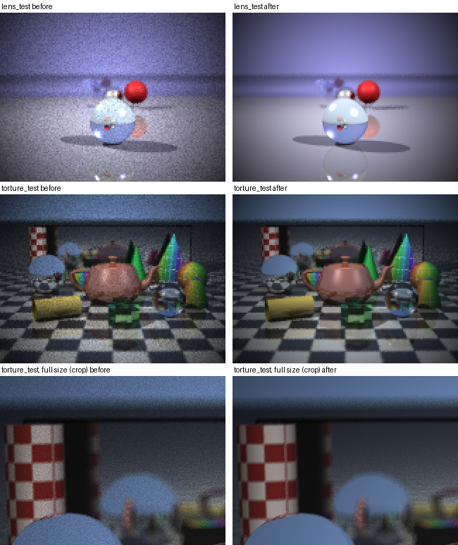

## [2026-alpha-0.4] - 2026-11-19

New shapes and a new way to share out the work: cylinders, cones and boxes; meshes with a bounding
volume hierarchy; a torture test of everything through a real lens; PNG and high dynamic range
output; and tasks that pull tiles of the image, so camera rays are made in parallel and engines can
come and go.

### Added

- **Cylinders, cones and boxes.** Three new object types for scene files (documented in
  `scenes/README.md`):
  - `cylinder`: `base`, `top` and `radius`.
  - `cone`: `base`, `top`, `baseRadius` and `topRadius` (default 0, a point). A cone with a
    `topRadius` is truncated.
  - `box`: `center`, `size` (one number for a cube, or `[x, y, z]`) and `rotation` (degrees about
    x, then y, then z).

  Cylinders and cones point any way, from `base` to `top`. They are capped by default; with
  `"capped": false` they are open shells that can be seen into and shadow and reflect themselves
  inside. All three have their own surface coordinates for textures.

  The new sample scene `scenes/primitives_test.ray` has its own reference render and tests:
  `render_primitives`, `roundtrip_primitives_test`, and `network_primitives`, which must match the
  threaded render byte for byte. Its preview is in the README's expected-output table. Look for:
  - the inside of the open yellow tube, dark except where light falls through its open end;
  - the image texture upright on each face of the cube and wrapped around the truncated cone, with
    the grid filling its top cap;
  - the floor seen through the turned glass box, bent by refraction.

  

  `format_test` checks where rays hit each shape and the normals there, open and capped ends, rays
  from inside, surface coordinates, and the errors for bad sizes and radii. No existing render
  changes. The scene editor shows the new objects in its tree but has no dialogs to add or edit
  them yet.

- **Torture test.** `scenes/torture_test.ray` uses everything at once: every kind of object (sphere,
  plane, cylinder, cone, box, triangle, and the teapot mesh), mirrors, glass, image and checker
  textures, a reflective floor and a black-framed mirror wall, seen through the double Gauss lens with a 5×5
  stratified sampler (25 rays a pixel, each traced in red, green and blue) at 1024×768. The
  `render_torture` test renders it at 160×120 and compares it with a new reference render, which is
  in the README's expected-output table; `roundtrip_torture_test` loads and saves it. The lens
  focuses on the teapot at f/2 with a scene unit of 5 cm, so the depth of field is shallow. Look
  for the teapot and the scene behind the camera in the mirror wall, blurred because their light
  travels farther than the teapot's; the floor bent through the glass sphere and the green glass cube; and the
  nearest checks of the floor out of focus. The grain is the lens's: each of the
  25 rays takes a different path through the glass.

  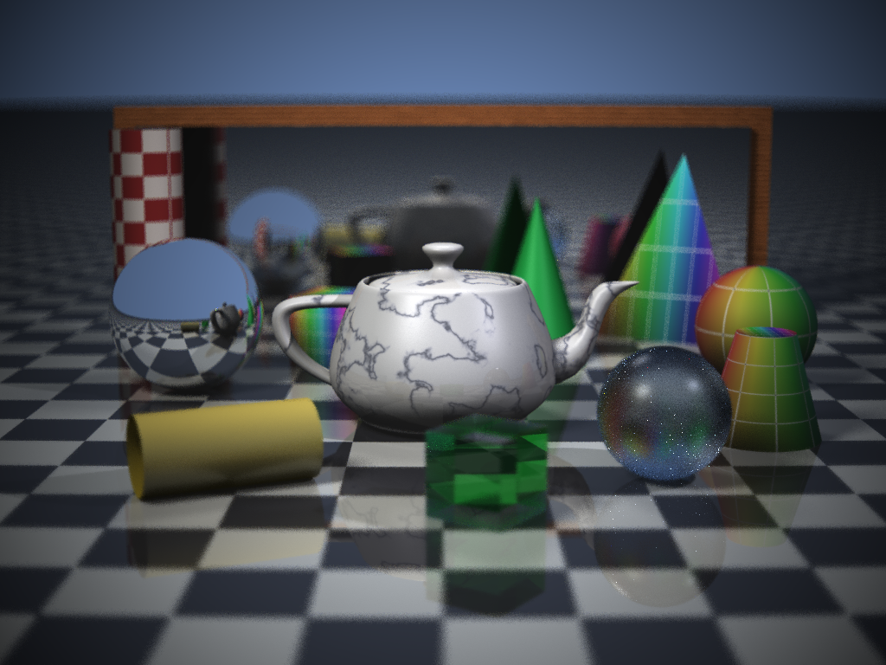

- **PNG and high dynamic range output.** `raythrower --png <file>` writes the image as a PNG, and
  `--hdr <file>` writes every pixel's linear, unclipped color as a Radiance HDR (`.hdr`, RGBE)
  file, so highlights brighter than white survive for image editors, Blender and HDR viewers. Both
  are written by the new `CImageExport`, with a small deflate encoder of its own for PNG, so no
  zlib is needed. The raw format is still what the trace writes.
- **The `hdr` color model** (`--color hdr`, or `{ "type": "hdr", "exposure": 1 }` in a scene):
  colors scaled by `exposure` go unclipped into `--hdr` files, and 8-bit files get them clipped
  and sRGB-encoded. Color models now give the linear color for HDR files (`ToLinear`); `reinhard`'s
  is scaled by its exposure, and the others' is the traced color as it is.
- New tests: `render_color_hdr` (with a reference render, the same as `srgb` at exposure 1), unit
  checks of RGBE encoding and the `hdr` model, and `image_output`, which renders `scan_test` with
  `--png` and `--hdr` and decodes both with `tools/check_image.py`. The PNG must match the raw
  image exactly, and the HDR file within RGBE's precision, with colors above 1. It runs when CMake
  finds Python 3.

### Changed

- **Real lenses aim their rays at the exit pupil, so lens renders are less grainy.** A ray from the
  sensor used to go toward any point of the lens's rear element, and many were blocked by the
  aperture stop, especially toward the edges where the lens vignettes: blocked rays come back
  black, and how many varied from pixel to pixel. Now, for each of 64 rings of the sensor out from
  the center, the lens works out the exit pupil: an ellipse on the rear element around everywhere
  light gets through, found by tracing a grid of rays (in every color, for a chromatic lens). Rays
  are aimed only inside it, and each counts for the ellipse's share of the rear element
  (`CRay::GetWeight`), so the image is exactly as bright as before on average.
  - On a plain grey background through the double Gauss, the pixel-to-pixel noise falls by about a
    quarter at the center and nearly 40% at the edges and corners. `lens_test` is about 37%
    smoother, and the torture test about 27%. Average brightness is unchanged (within 0.3%).
  - When light gets through the whole rear element (as in `chromatic_test`, whose last surface is
    the stop), the lens aims at all of it, as before.
  - The rings are worked out the first time a ray needs them, and shared by every copy of the lens
    in the program, so the worker threads split the work and the master does none.
  - The `lens_test`, `chromatic_test` and `torture_test` references are regenerated, with their
    previews in the README; no other render changes. Look for the finer grain across the frame and
    the cleaner edges:

    
- **Tasks pull tiles of the image instead of being dealt batches of rays.** The master splits the
  image into tiles (32×32 pixels, `raythrower --tile` to change it) and keeps them in a queue. Each
  task, a thread or a networked `rayengine`, asks for a tile and traces it with the new
  `CTileTracer`: it runs the camera's pixel sampler for the tile, makes the camera rays itself
  (through the lens, once a channel for a chromatic one), traces them, and sends back the tile's
  linear pixels, then asks for the next. Faster tasks take more tiles.
  - Making camera rays was the master's job, on one thread. With a real lens that held the torture
    test to about 3 of 16 cores. Now it takes 3 min 46 s at 1024×768 instead of 13 min 44 s,
    using about 10 cores.
  - Renders are byte for byte what they were: all 36 reference renders, and the full-size torture
    test, match. Samplers sum in fixed point, and a ray two tiles share (a corner of the `corners`
    sampler) is traced by both and comes out the same.
  - **Engines can come and go.** With `--listen`, `-N` engines must connect before tracing starts,
    but more can connect at any time, even mid-render: they get the scene and start asking for
    tiles. An engine that drops out has its unfinished tiles handed to the others. A trace fails
    only if every engine is gone and none connects within the `--timeout`. The new `engine_churn`
    test runs one engine that quits after its first tile and another that joins mid-trace, and the
    image must match threads exactly.
  - The wire protocol is version 4: `MESSAGE_REQUEST`, `MESSAGE_TILE`, `MESSAGE_PIXELS` (the
    pixels as doubles) and `MESSAGE_STOP` replace the ray and color batches. Engines and masters
    must come from the same release.
  - `CPixelSampler::Begin` takes a tile (`left, top, width, height`), in image coordinates;
    `BeginImage( width, height )` samples a whole image. `CPixelWriter` is now an interface:
    `CImageWriter` writes the image through the color model, and `CTileTracer` keeps a tile's
    pixels.
- **Meshes are much faster.** A mesh keeps its faces in a bounding volume hierarchy, so a ray tests
  only the faces in boxes it passes through instead of every face. The teapot renders about 30
  times faster (41 s to 1.4 s at 320×240 on 16 cores). Renders are byte for byte the same: of faces
  hit at exactly the same distance, the tree picks the first in the mesh, as testing every face in
  order did. `format_test` checks that the tree and the plain loop find exactly the same hits.
- `.gitignore` ignores `nohup.out`.

### Removed

- `raythrower --batch` (rays per batch), and `CRayArray` and `CColorArray`, which carried the
  batches; `--tile` sets the work unit's size instead.

### Fixed

- `texture_checks` failed on Windows: it wrote the texture's absolute path into the test scene
  with backslashes, which JSON reads as escapes. It now writes the path with forward slashes.

## [2026-alpha-0.3] - 2026-11-19

The ray tracing has resumed: a corrected camera, anti-aliasing, color models, real lenses with
chromatic aberration, meshes and the Utah teapot, textures, corrected materials, and scenes saved
as JSON inside IASLib resource archives.

### Added

- **JSON scene files.** Scenes are saved as human-readable JSON (version 3 of the `.ray` format,
  same extension) that can be written and edited by hand. Only the camera is required; anything
  left out takes its default. Unknown fields are errors, so misspellings are caught, and every error
  says where it is (`objects[0].materials[1]: unknown field "colour"`). The format is documented in
  `scenes/README.md`. It adds the background color, the camera's sampler and color model, and
  triangle and mesh options to what the binary format held, and keeps every 1997 setting, the
  never-implemented ones under `settings.reserved1997`. Saved numbers are rounded to six decimal
  places, and angles are in degrees. Built on IASLib's JSON support, which the build now turns on.
  - Each scene class reads and writes its own fields (`ToJson`/`FromJson`); the object and material
    registries give each class a JSON `type` name and can create one empty.
  - `CScene::GetLoadError` says why a load failed; a binary scene from 1996–1999 is recognized and
    reported as no longer readable.
- **Pixel samplers.** A camera owns a `CPixelSampler` that makes its primary rays and turns their
  colors into pixels, so new anti-aliasing or ray generation schemes are new subclasses attached
  with `CCamera::SetSampler` or named in the scene. `CTaskMaster::TraceScene` just runs the camera's
  sampler. Samplers are listed by name in `PixelSampler.cpp`.
  - `none` (`CCenterSampler`, the default): one ray through each pixel's center, as before.
  - `corners` (`CCornerSampler`): the first anti-aliasing mode. It traces five rays for each pixel,
    one at each corner and one at the center, and averages them. Each corner is traced once and
    shared by the four pixels around it, so it costs about two rays per pixel instead of five.
    Rays are tagged with their position on a doubled sample grid, so `rayengine` needs no change,
    and samples are summed in fixed point, so threads and networked engines produce identical
    images.
  - `box` (`CBoxSampler`): four rays per pixel, each halfway from the center to one of its corners,
    averaged equally.
  - `random` (`CRandomSampler`): a ray through the center worth half the pixel, and N rays at random
    points in the pixel sharing the other half (`samples`, N, from 1 to 1024, default 4). The points
    come from a hash of the pixel, ray number and `seed`, so images are reproducible and threads and
    engines agree.
  - `CPixelAccumulator`: the weighted, fixed-point, order-independent averaging the samplers share.
- **Texture mapping** (`CTexture`): any material can have a `texture` that gives its color at each
  point. Textures: `checker` (two colors, in surface coordinates or `solid` in the scene) and
  `image` (PPM P6/P3 or Ray raw files, bilinear, with `scale`, `offset`, `repeat` and `srgb`).
  Objects give surface coordinates (`CObjects::SurfaceCoords`): spheres by longitude and latitude,
  planes along two axes across them, triangles and meshes from new optional `uvs`. Image pixels
  travel inside the scene when it is copied to a task (`RayJson::CEmbedData`, base64 `pixels`),
  so networked engines need no files and still match threads exactly. Image files are read
  relative to the scene file, and saved relative to wherever the scene is saved (absolute when
  the two share only the root). New `scenes/texture_test.ray` and `scenes/textures/uv_grid.ppm`.
  - UV mapper: a mesh without `uvs` can have a `uvMap` (`planar`, `cylindrical`, `spherical` or
    `box`, about an `axis`, with an optional `center` and `scale`) that works out each face's
    corner coordinates when the mesh is built. Faces across a cylindrical or spherical seam are
    unwrapped, and pole corners take their face's angle. New `scenes/teapot_textured.ray`.
- **Real camera lenses** (`CLens`): a camera can have a lens prescription, spherical glass surfaces
  listed front to back as in lens patents, and rays are traced from the sensor back through each
  surface out into the scene. Rays the barrel or the aperture stop blocks go dark, so depth of
  field, vignetting, and the lens's aberrations and distortion come from the optics. The lens's
  focal length and widest f-number are worked out, the sensor is placed to focus at
  `focusDistance` (default: the look-at point), and exposure is set so the image center is as bright
  as through a pinhole (`CPixelWriter` now takes an exposure). The ray's position in its pixel picks
  where it crosses the lens, with a per-pixel shift, so evenly spread rays sample the lens evenly.
  Built in: `double-gauss-50mm` (50 mm f/2, US 2,673,491, as tabulated by Kolb et al. 1995). The
  example prescription in the design brief this started from turned out to be a diverging lens
  (focal length −16 mm), which can't form an image; such lenses are rejected with that message.
  A camera without a lens is the same pinhole as before, byte for byte. New `scenes/lens_test.ray`.
  - Chromatic aberration: surfaces take an `abbe` number for the glass that follows. Each glass's
    index is fitted to a Cauchy curve through its d-line index and Abbe number, and each sample is
    traced three times, red at the C line (656.3 nm), green at the d line (587.6 nm) and blue at
    the F line (486.1 nm), each keeping only its channel; the task master recombines them. The
    channel travels in the top bits of the ray's tag, so engines and the wire format are
    unchanged and networked images still match threads. Green uses the index as given, so focus
    and exposure are unchanged. `"chromatic": false` turns it off. The built-in double Gauss has
    its Abbe numbers (from Kolb's table; three of its glasses match catalogue SF15, F5 and LaF3),
    and is corrected for color (red and blue focal lengths within 0.06 mm), so its fringes are
    faint; new `scenes/chromatic_test.ray` uses an uncorrected BK7 singlet, whose color focus
    shift (0.75 mm) matches the textbook f/V.
  - `stratified` sampler (`CStratifiedSampler`): an n×n grid of equally weighted rays per pixel,
    each at a random point in its cell (`grid`, n, default 4; `seed`). Equal weights matter with a
    lens, where the `random` sampler's half-weight center ray makes every blocked ray a dark speck.
- **Triangles work out their own normals** from their corners, instead of storing them, by the
  edge traversal in the 1997 code (which had been commented out) with its order reversed:
  (V2 − V1) × (V3 − V2). The 1997 order made faces of standard models such as OBJ files face
  inward. The corner order decides the front; the two 1997 triangle scenes had their corners
  reordered to keep facing the camera, and are double-sided. New `doubleSided` (a single-sided
  triangle can't be hit from behind; a double-sided one is shaded from the side it is seen from)
  and `smooth` flags. Optional `normals` override the corner normals smooth shading blends (and
  make the triangle smooth); `triangle2.ray` keeps its 1997 tilted normals this way, which are what
  light it.
- **Meshes** (`"type": "mesh"`, `CMesh`): a vertex list and faces given as vertex indices. The
  faces are `CTriangle`s that share the mesh's materials. In a smooth mesh each vertex's normal is
  the sum of the normals of the faces around it, and faces blend their corner normals by barycentric
  weights, so shared edges show no seam; optional `normals`, one per vertex, replace the summed
  ones. Rays that miss the mesh's bounding box skip all its faces,
  and rays leaving a face skip only that face (`CObjects::Intersect` now takes the object to
  ignore), so a mesh shadows and reflects itself.
- **The Utah teapot** (`scenes/teapot.ray`, 6,320 triangles), and `tools/obj_to_ray.py`, which turns
  OBJ models into meshes (with options to smooth, weld repeated vertices, and flip the odd model
  wound the other way).
- **Color models.** A camera owns a `CColorModel` that turns each pixel's linear color, of any
  brightness, into the image's bytes; samplers now hand over unclipped colors through a
  `CPixelWriter`. Color models are listed by name in `ColorModel.cpp`:
  - `clip` (the default): clip at 1 and truncate, exactly as the 1997 image writer did;
  - `gamma`: gamma encoding, with a `gamma` setting (default 2.2);
  - `srgb`: the sRGB curve;
  - `reinhard`: Reinhard tone mapping on luminance, with `exposure` and `white` settings, then sRGB.
- `raythrower` options: `--aa <sampler>`, `--color <model>` and `--size <w>x<h>` override the
  scene's choices, and `--aa`/`--color` take settings after a colon (`--aa random:samples=9`); `--save <file>` saves the scene and exits; `--help` lists the samplers and color
  models. It prints the rays traced and the rays per pixel, and says why a scene couldn't be read.
  The scene editor does not offer a sampler or color model yet.
- An "Expected output" section in the README showing every reference render the tests compare
  against, labelled with its test, and `tools/render_previews.py`, which makes those previews
  (`docs/images/tests/`) from `tests/reference/renders.tar.gz`.
- `CRay::CreateRayAt`, which casts a primary ray through any point on the image,
  `CImageFile::PutRGB`, `CVector::Cross`, and `CScene::GetObjectAt`.
- Tests: material checks (Snell's law in and out, total internal reflection, specular edge
  cases and default index, and that shading a plane leaves it unchanged); UV mapper checks (each projection, seam unwrapping, poles, errors) and a textured teapot
  render; a texture render and a networked one (the image must reach the engines), texture checks
  (embedding, loading a copy without the files, errors); lens and chromatic renders (and a networked chromatic render, which must match threads),
  checks of each lens's color focus shifts, a lens render and lens checks (the double Gauss's focal length, f-number and focus, and
  the errors for unusable lenses), the stratified sampler, four scenes rendered with corner
  anti-aliasing, one with `box` and with `random` at 2, 4
  and 9 rays (and networked `random`, which must match threads exactly), one with each color
  model, and the teapot
  (new references in `tests/reference/renders.tar.gz`); networked engines must match threads with
  anti-aliasing on; rays and colors must cross the wire exactly; JSON scenes with mistakes must
  fail with the right message and leave the scene untouched; triangles must cull back faces only
  when single-sided, and smooth mesh faces must agree on the normal along a shared edge.

### Changed

- **Saved scenes are IASLib resource archives** (`CResourceFile`): `scene.json` and every file the
  scene uses (texture images), under the names the scene gives them, so one `.ray` file carries
  the whole scene. Saving writes beside the file and renames it into place, so a failed save
  leaves the old file. Plain JSON `.ray` files still load (the sample scenes stay JSON), and new
  `CScene::SaveJson` / `raythrower --save-json` writes JSON for editing by hand, extracting the
  files beside it. Files a scene names are read from its archive first (`RayJson::ReadSceneFile`)
  and collected into it when saving (`RayJson::SceneFileName`); names outside the scene's
  directory are stored under `files/`. The round-trip tests compare scenes rather than bytes,
  since archives record when they were written.
- The default trace depth is 16 levels (`settings.maximumDepth`; the camera ray is level 1, so 15
  reflections or refractions), up from the 1997 default of 15, and every sample scene uses it.
  The deepest bounces in `reflection_test`, `reflect_me` and `reflect_test2` change their renders;
  their references and the README gallery were regenerated.
- The sample scenes in `scenes/` are now JSON, converted from the 1997 originals and rounded to six
  decimal places. Rounding moves a few pixels by one level, and `triangle2` now blends its corner
  normals by barycentric weights instead of the 1997 inverse-distance weighting; the reference
  renders were regenerated.
- The wire protocol (version 3): the scene is sent as SJSON, IASLib's compact binary JSON; ray
  and color batches are fixed-layout big-endian IEEE-754 doubles (72 bytes a ray, 32 a color),
  which `RayWire::ToReadable` can show as JSON. SJSON was tried for the batches too, in stream,
  stateless and schema modes, but it costs 30–45 µs a ray to encode, more than tracing it.
  Engines and masters must be from the same release.
- IASLib is pinned to commit `de038c0`, which added SJSON, until it tags a release with it. SJSON's
  optional LZ4 and zstd support is left off, so every build is the same.
- `CTaskMaster::ColorsFromTasks` no longer takes the image; colors go to the camera's sampler.
- `CImageFile::PutPoint` writes through the `clip` color model, which also treats negative
  channels as 0 (the 1997 code converted them to a byte without a check, which is undefined).
- `CRay::CreateRay( CScene &, ... )` takes pixel coordinates instead of angles, and the camera
  works out the direction (`CCamera::RayDirection`). `CTaskMaster::TraceScene` and the GUI preview
  loop no longer do their own angle stepping.

### Removed

- The binary scene format of 1996–1999 and `CRayStream`, with every class's stream operators,
  stream constructors and `Serialize`, and the registries' stream factories. The 1997 binary
  sample scenes are gone too (they are in the history); two of them could never be read anyway.

### Fixed

- **Material math** (`CTransparentMaterial`, `CSpecularMaterial`, `CReflectiveMaterial`,
  `CObjects::BaseShade`):
  - Refraction had the wrong sign on the cos θ₁ term of Snell's law in vector form, entering and
    leaving glass, so rays bent far too much (45° into glass of index 1.5 came out at 14.5°
    instead of 28.1°), and past the critical angle it took the square root of a negative number.
    It now follows T = ηV + (η cos θ₁ − cos θ₂)N with the normal facing the ray, and reflects
    inside on total internal reflection (`CTransparentMaterial::Refract`).
  - Materials were handed the surface normal by reference, and the diffuse material turned it
    toward the viewer in place. For a plane that was the plane's own normal, so shading changed
    the scene (and could flip a plane's texture), depending on which side the last ray came from.
    Each material now works on its own copies.
  - The specular (Cook–Torrance) material didn't turn the normal toward the viewer, and divided
    0 by 0 (a NaN, a black pixel) on the shadow line; it now has no highlight for lights behind or
    surfaces edge on. Its default index of refraction was 1.0, which makes the Fresnel term 0 and
    the highlight vanish; it is 1.5 now (the teapot shows its highlight). An index below 1 is
    treated as total reflection rather than a NaN.
  - Reflected and refracted rays now carry their parent's influence times the material's, so
    `depthThreshold` prunes rays that no longer matter; `BaseShade` no longer also multiplies its
    result by the ray's influence, which would have counted it again at every bounce.
  - The reflection direction is computed directly as V − 2(N·V)N (it was right, by way of a
    detour).
  - `scan_test`'s glass sphere had index 1.0, which looked like glass only because of the
    refraction bug; it, `lens_test`, `chromatic_test` and `axis_test`'s partly transparent sphere
    now use 1.5. Every reference render, preview and README image was regenerated.

    

    Before: the 1997 refraction, and (teapot) the old default specular index of 1.0, which left no
    highlight. After: Snell's law, glass at 1.5, and the highlight.

- Camera rays were distorted. The camera was aimed by adding the difference between its view
  direction and +Z to every ray instead of rotating the rays, which sheared the image: spheres came
  out as tilted ellipses, horizons curved, a camera looking straight down saw a smear, and a camera
  turned to face -Z rendered a mirror image. Pixels were also spaced by equal angles rather than
  evenly across a flat image plane, and were not square unless the scene's two angles happened to
  match the image's shape.
  Primary rays now come from a proper camera basis (view direction, right, and up, from the stored
  up vector, with a fallback when looking straight up or down) through the center of each pixel on
  a flat image plane. The vertical angle sets the field of view and the horizontal one follows from
  the image's width and height, so pixels are square.
  The reference renders in `tests/reference/renders.tar.gz` and the README images were regenerated.

  

  Before: the six spheres of `axis_test` sheared into ellipses, `xxx` mirrored, and `reflect_me`
  (a camera looking straight down) smeared. After: round spheres, the right way round, and the
  view down onto two spheres.

## [0.2.0] - 2026-11-19

The code builds again, on Windows, Linux, and macOS, on top of
[IASLib v3.0](https://github.com/jnaujok/IASLib). The ray tracing logic is unchanged.

### Added

- `core/`: one ray tracing library shared by every program. It replaces the separate, drifted
  copies in the MFC application and in `rayengine/`.
- A TCP transport built on IASLib sockets (`CSocketTaskMaster`, `CSocketTaskSlave`, and a framed
  wire protocol in `WireProtocol.h`). It takes the place of PVM.
- `raythrower` options: `--listen [port]` to trace with networked engines, `--spawn` to start
  local `rayengine` processes, `-o` to choose the image file, `--ppm` to also write a viewable
  PPM image, `--batch`, `--timeout`, and `--tasks` (the original `-Nxxx` still works).
  Without `--listen` it traces with threads.
- `CScene::Load` and `CScene::Save`. `Load` reads version-1 and transitional scene files with the
  pre-April-1997 number format, which the 1997 code itself could no longer read.
- Regression tests (`ctest`): every readable sample scene is rendered and compared with a reference
  render, networked engines must produce exactly what threads produce, scene files must survive a
  load and save, and the serialization format is checked byte for byte.
- GitHub Actions CI: Linux (GCC and Clang), macOS, and Windows builds with tests, a Linux
  AddressSanitizer/UBSan job, and a Windows build of the MFC scene editor.
- `scenes/README.md`, describing the sample scenes and the file format history.

### Changed

- Uses IASLib's `CString`, streams, threads, mutexes, semaphores, sockets, and `TArray` instead of
  the project's own early versions of them. `CStream` is now `CRayStream`, a reader and writer of the
  original binary format on top of any IASLib stream.
- `CRayArray`, `CColorArray`, `CObjectsArray`, `CLightArray`, and `CMaterialList` are built on
  IASLib's `TArray`, with the same interfaces and ownership rules.
- `CThreadTaskMaster` uses IASLib threads and in-memory queues instead of named pipes and Win32
  semaphores. It is portable and part of the core.
- `raythrower` reuses `CTaskMaster::TraceScene` instead of its own copy of the ray loop.
- Built with CMake as C++17. IASLib is fetched by CMake at `v3.0.0`.
- The core's GUI code is keyed on `RAY_GUI` instead of `_WINDOWS`, which CMake defines for every
  MSVC build.
- The Visual C++ 6 project files moved to `legacy/msvc6/`; they cannot build the new code.

### Removed

- PVM: the bundled PVM 3 headers and libraries, `CPVMStream`, `CPVMTaskMaster`, `CPVMTaskSlave`.
- `CFileStream`, `CPipeStream`, `CSem`, and the engine's own `CString`, all replaced by IASLib.
- The Unix Makefiles, replaced by CMake.
- Stubs that were never compiled: `TraceEngine.h`, `TraceThread`, `ImageStream.h`, `DynMaterial.h`.

### Fixed

- `CRay` never initialized or copied its reflection depth, so every ray started with a garbage depth.
  Traces were not repeatable, and the reflection scenes overflowed the stack.
- The object class registry existed only in the GUI; every other program crashed on its first object.
- Loading a scene leaked the camera object. An unknown object class now fails the load instead of
  reading the rest of the file as garbage.
- `CObjectsArray::Delete` and `CLightArray::Delete` never reduced the count, leaving a duplicate
  pointer that was later deleted twice. `SetX`, `SetY`, and `SetInfluence` tested their index with
  `||`, so they wrote out of bounds. The arrays freed `new[]` memory with `delete`.
- `CMaterial` had no virtual destructor, though materials are deleted through it.
- `CColorArray( int )` and the other array constructors were implicit, so
  `oStream << COLOR_ARRAY_VERSION` called the array serializer.
- `CImageFile` called `setvbuf` on a file that failed to open, and wrote pixels at any coordinates
  it was given; out-of-range pixels are now refused.
- The ray thrower never sent the last partial batch of rays (so it waited forever), never told the
  engines to stop, dropped pixels after the first reply from each engine, and could divide by zero.
- `CTaskMaster::TraceScene` overflowed its progress value on images over about 200,000 pixels and
  left `IsTracing()` true after a trace.
- Scene files saved over a larger file kept the old file's tail. The GUI ignored load failures, and
  its display thread opened the image for writing while the tracer was writing it.
- Long values are written as 4 bytes on every platform, so scene files from 64-bit Linux and macOS
  match those from Windows.

## [0.1.0] - 2026-11-19

The first public import of the 1997 code base, reorganized into a modern project layout.
The ray tracing code itself is unchanged.

### Added

- `CMakeLists.txt` that builds the MFC scene editor with MSVC, plus the Unix PVM engine and thrower
  behind the `RAY_BUILD_PVM_TOOLS` option.
- Project documentation: `README.md`, `rayengine/README.md`, `raythrower/README.md`,
  `CHANGELOG.md`, `CONTRIBUTING.md`, `CLAUDE.md`.
- Apache License 2.0 (`LICENSE`) and `NOTICE`.
- `.gitignore`, `.gitattributes`, and a pull request template saying outside contributions
  aren't accepted.

### Changed

- Renamed every file from DOS upper case to modern names. Sources and headers are PascalCase after
  their class name (`ADDPLANEDLG.CPP` → `AddPlaneDlg.cpp`, `TRANSFRM.H` → `Transform.h`), and data
  files are snake_case (`INSIDE SPHERE.RAY` → `inside_sphere.ray`).
- Moved the code into `src/` and `include/` directories:
  - the MFC application went to the root `src/` and `include/`,
  - `RAYENGINE/` → `rayengine/{src,include}`,
  - `RAYTHROWER/` → `raythrower/{src,include}`.
- Renamed `.CC` sources to `.cpp`. RayThrower's Unix entry point is now `main_unix.cpp`.
- Moved resources to `res/`, WinHelp sources to `help/`, scenes to `scenes/`, PVM headers and
  libraries to `third_party/pvm3/`, and Visual C++ 4/5 project files to `legacy/`.
- Rewrote `#include` directives to match the new file names exactly, so they work on
  case-sensitive file systems. Replaced the path-relative includes
  (`"rayengine\cstring.h"`, `"..\globals.h"`, `"../pvm3/include/pvm3.h"`) with include paths.
- Pointed `Ray.dsp`, `Ray.clw`, `Ray.rc`, `makehelp.bat`, and the Unix Makefiles at the new paths.
- Converted sources, headers, resource scripts, and docs from CRLF to LF line endings. The Visual
  C++ 6 project files and batch files stay CRLF.

### Known issues

- The Unix sources don't compile cleanly with a modern GCC or Clang, mainly because `TRUE` and
  `FALSE` are expected to come from the platform headers.
- `rayengine/Makefile` doesn't list `src/PVMStream.cpp`. The original Makefile left it out too.
- The project files under `legacy/` still contain the pre-reorganization paths.

## [Historical] - 1996-1999

Original development of the distributed ray tracer: the MFC scene editor, the PVM ray engine, and
the ray thrower, built with Visual C++ 4–6 on Windows and with `make` on Unix.

[Unreleased]: https://github.com/jnaujok/Ray/compare/2026-alpha-0.21...HEAD
[2026-alpha-0.21]: https://github.com/jnaujok/Ray/compare/2026-alpha-0.20.2...2026-alpha-0.21
[2026-alpha-0.20.2]: https://github.com/jnaujok/Ray/compare/2026-alpha-0.20.1...2026-alpha-0.20.2
[2026-alpha-0.20.1]: https://github.com/jnaujok/Ray/compare/2026-alpha-0.20...2026-alpha-0.20.1
[2026-alpha-0.20]: https://github.com/jnaujok/Ray/compare/2026-alpha-0.19...2026-alpha-0.20
[2026-alpha-0.19]: https://github.com/jnaujok/Ray/compare/2026-alpha-0.18...2026-alpha-0.19
[2026-alpha-0.18]: https://github.com/jnaujok/Ray/compare/2026-alpha-0.17...2026-alpha-0.18
[2026-alpha-0.17]: https://github.com/jnaujok/Ray/compare/2026-alpha-0.16...2026-alpha-0.17
[2026-alpha-0.16]: https://github.com/jnaujok/Ray/compare/2026-alpha-0.15...2026-alpha-0.16
[2026-alpha-0.15]: https://github.com/jnaujok/Ray/compare/2026-alpha-0.14.1...2026-alpha-0.15
[2026-alpha-0.14.1]: https://github.com/jnaujok/Ray/compare/2026-alpha-0.14...2026-alpha-0.14.1
[2026-alpha-0.14]: https://github.com/jnaujok/Ray/compare/2026-alpha-0.13...2026-alpha-0.14
[2026-alpha-0.13]: https://github.com/jnaujok/Ray/compare/2026-alpha-0.12.1...2026-alpha-0.13
[2026-alpha-0.12.1]: https://github.com/jnaujok/Ray/compare/2026-alpha-0.12...2026-alpha-0.12.1
[2026-alpha-0.12]: https://github.com/jnaujok/Ray/compare/2026-alpha-0.11.1...2026-alpha-0.12
[2026-alpha-0.11.1]: https://github.com/jnaujok/Ray/compare/2026-alpha-0.11...2026-alpha-0.11.1
[2026-alpha-0.11]: https://github.com/jnaujok/Ray/compare/2026-alpha-0.10...2026-alpha-0.11
[2026-alpha-0.10]: https://github.com/jnaujok/Ray/compare/2026-alpha-0.9...2026-alpha-0.10
[2026-alpha-0.9]: https://github.com/jnaujok/Ray/compare/2026-alpha-0.8...2026-alpha-0.9
[2026-alpha-0.8]: https://github.com/jnaujok/Ray/compare/2026-alpha-0.7...2026-alpha-0.8
[2026-alpha-0.7]: https://github.com/jnaujok/Ray/compare/2026-alpha-0.6...2026-alpha-0.7
[2026-alpha-0.6]: https://github.com/jnaujok/Ray/compare/2026-alpha-0.5...2026-alpha-0.6
[2026-alpha-0.5]: https://github.com/jnaujok/Ray/compare/2026-alpha-0.4.1...2026-alpha-0.5
[2026-alpha-0.4.1]: https://github.com/jnaujok/Ray/compare/2026-alpha-0.4...2026-alpha-0.4.1
[2026-alpha-0.4]: https://github.com/jnaujok/Ray/compare/2026-alpha-0.3...2026-alpha-0.4
[2026-alpha-0.3]: https://github.com/jnaujok/Ray/compare/v0.2.0...2026-alpha-0.3
[0.2.0]: https://github.com/jnaujok/Ray/compare/v0.1.0...v0.2.0
[0.1.0]: https://github.com/jnaujok/Ray/releases/tag/v0.1.0
