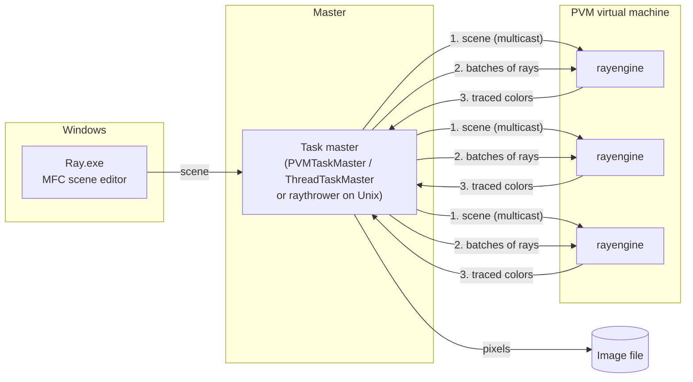

<div align="center">

# Ray

**A distributed ray tracer from 1997: an MFC scene editor on the front end and a farm of PVM render engines on the back end.**

[](LICENSE)
[](#)
[](#building)
[](#building)
[](https://www.netlib.org/pvm3/)
[](#project-status)
[](CONTRIBUTING.md)
[](https://github.com/jnaujok/Ray/commits/main)

</div>

---

## Table of contents

- [About](#about)
- [Features](#features)
- [How it works](#how-it-works)
- [Repository layout](#repository-layout)
- [Building](#building)
- [Usage](#usage)
- [Scene files](#scene-files)
- [Project status](#project-status)
- [Changelog](#changelog)
- [Contributing](#contributing)
- [License](#license)

## About

Ray is a ray tracer written in 1996–1997 that splits rendering across a network of machines.
You build and edit scenes in a Windows MFC application, and the image is traced in parallel by
engine processes running under [PVM](https://www.netlib.org/pvm3/) (Parallel Virtual Machine) on
a cluster of Unix workstations, or locally by worker threads.

The code is kept here as it was written, reorganized into a modern project layout. It is a
snapshot of a mid-90s C++ code base: MFC document/view, hand-rolled container and string
classes, and message-passing parallelism from before MPI was widespread.

## Features

- **Primitives:** spheres, planes, and triangles, each with its own transform.
- **Lights:** point lights.
- **Materials:** ambient, diffuse, specular, reflective, and transparent, stacked in a material list
  per object.
- **Camera:** position, orientation, and field of view, editable from a properties dialog.
- **Scene editor:** MFC MDI application with a scene tree view, property dialogs for every object
  type, and a material editor.
- **Distributed rendering:** a master hands out batches of rays to PVM engine tasks and collects
  the traced colors.
- **Local rendering:** a threaded task master traces on the local machine when no PVM cluster
  is available.
- **Pluggable transport:** one `CStream` serialization interface with file, pipe, and PVM backends,
  so scenes go to disk and across the network with the same code.
- **Render settings:** gamma correction, adaptive depth, and antialiasing options, plus placeholders
  for focal blur, caustics, and radiosity in `RaySettings.h`.

## How it works



1. The master spawns `rayengine` tasks with `pvm_spawn` and multicasts the serialized scene to them.
2. It splits the image into batches of primary rays (`CRayArray`) and sends a batch to each engine.
3. Each engine traces its batch and sends the colors back. The master writes them into the image
   and sends that engine its next batch.
4. An empty batch tells an engine to shut down.

Message tags are defined in [`include/MsgTag.h`](include/MsgTag.h). Serialization goes through
[`include/Stream.h`](include/Stream.h).

## Repository layout

| Path | Contents |
|------|----------|
| [`src/`](src), [`include/`](include) | Windows MFC scene editor / front end (`Ray.exe`) |
| [`res/`](res) | Resource scripts (`Ray.rc`), icons, and bitmaps |
| [`help/`](help) | WinHelp project (`Ray.hpj`) and `makehelp.bat` |
| [`rayengine/`](rayengine) | Unix PVM ray tracing engine: the worker process |
| [`raythrower/`](raythrower) | Unix PVM ray thrower: a command-line master |
| [`third_party/pvm3/`](third_party/pvm3) | Bundled PVM 3 headers and Win32 import libraries |
| [`scenes/`](scenes) | Sample `.ray` scenes; [`scenes/renders/`](scenes/renders) holds rendered output |
| [`docs/`](docs) | MFC AppWizard notes |
| [`legacy/`](legacy) | Superseded Visual C++ 4/5 project files, kept for history (paths inside are stale) |
| `Ray.dsw`, `Ray.dsp` | Visual C++ 6 workspace and project |
| `CMakeLists.txt` | CMake build for all three programs |

## Building

### Windows scene editor

You need Visual C++ with MFC. In current Visual Studio versions, also install the
*MFC (MBCS)* component, because the code uses multibyte strings.

```sh
# CMake (Visual Studio generator)
cmake -S . -B build
cmake --build build --config Release
```

Or open `Ray.dsw` in Visual C++ 6.

### Unix engine and thrower

You need a PVM 3 installation (`pvm3.h` and `libpvm3`).

```sh
# Make
make -C rayengine PVM_INCLUDE=/path/to/pvm3/include PVM_LIB=/path/to/pvm3/lib/ARCH
make -C raythrower PVM_INCLUDE=/path/to/pvm3/include PVM_LIB=/path/to/pvm3/lib/ARCH

# or CMake
cmake -S . -B build -DRAY_BUILD_PVM_TOOLS=ON -DPVM3_INCLUDE_DIR=/path/to/pvm3/include
cmake --build build
```

> [!NOTE]
> The Unix sources were written for 1997 Unix compilers (the engine Makefile targets DEC Alpha) and don't
> compile cleanly with a modern GCC or Clang without some porting. For example, `TRUE` and `FALSE`
> are expected to come from the platform headers. The Unix CMake targets are off by default for
> that reason.

## Usage

**Scene editor:** run `Ray.exe`, open a scene from [`scenes/`](scenes) or build one with the
*Add* menu, adjust the render settings, and start a trace.

**Command-line master:** start PVM, add your hosts, put `rayengine` where PVM can find it,
and run:

```sh
raythrower <FileToTrace> [-N<tasks>]
```

`-N` sets how many `rayengine` tasks to spawn. When the trace finishes, the thrower prints the
pixel count, elapsed time, and pixels per second.

`rayengine` is a PVM worker. It exits if started outside PVM.

## Scene files

`.ray` files are binary scenes serialized through `CStream`: camera, render settings, objects,
materials, and lights. The samples in [`scenes/`](scenes) are the test scenes used during
development, such as `reflection_test.ray`, `inside_sphere.ray`, `triangle.ray`, and
`spec_test.ray`.

## Project status

This is a historical project, published as a record of the original work. It isn't actively
developed, and the build isn't maintained against current toolchains.

## Changelog

See [CHANGELOG.md](CHANGELOG.md) for the history of changes.

## Contributing

This repository is **not accepting outside contributions**. Please don't open pull requests.
See [CONTRIBUTING.md](CONTRIBUTING.md).

## License

Licensed under the [Apache License, Version 2.0](LICENSE). See [NOTICE](NOTICE) for attribution.
The bundled PVM 3 headers and libraries in [`third_party/pvm3/`](third_party/pvm3) are covered by
their own license terms.

Copyright © 1997–2026 Jeffrey Naujok.
