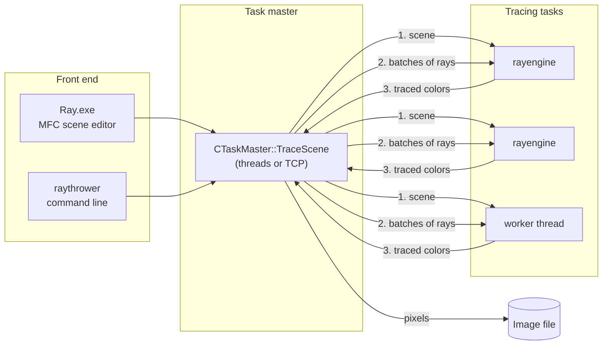

<div align="center">

# Ray

**A distributed ray tracer from 1997: an MFC scene editor on the front end and a farm of tracing engines on the back end.**

[](https://github.com/jnaujok/Ray/actions/workflows/build.yml)
[](LICENSE)
[](#building)
[](#building)
[](https://github.com/jnaujok/IASLib)
[](#about)

[](#platforms)
[](#platforms)
[](#platforms)
[](#testing)
[](CONTRIBUTING.md)
[](https://github.com/jnaujok/Ray/commits/main)


</div>

---

## Table of contents

- [About](#about)
- [Features](#features)
- [How it works](#how-it-works)
- [Platforms](#platforms)
- [Building](#building)
- [Usage](#usage)
- [Testing](#testing)
- [Repository layout](#repository-layout)
- [Scene files](#scene-files)
- [Project status](#project-status)
- [Changelog](#changelog)
- [Contributing](#contributing)
- [License](#license)

## About

Ray is a ray tracer written in 1996–1997 that splits rendering across a network of machines.
You build and edit scenes in a Windows MFC application, and the image is traced in parallel by
engine processes on any number of machines, or by worker threads on one.

It was originally written for [PVM](https://www.netlib.org/pvm3/) (Parallel Virtual Machine) on
a cluster of Unix workstations. The cross-platform library written for it grew into
[IASLib](https://github.com/jnaujok/IASLib), and the ray tracer now runs on IASLib v3.0: PVM is
replaced by plain TCP, and the command-line programs build on Windows, Linux, and macOS.
The ray tracing itself is the 1997 code.

<div align="center">

</div>

## Features

- **Primitives:** spheres, planes, and triangles, each with its own transform.
- **Lights:** point lights.
- **Materials:** ambient, diffuse, specular, reflective, and transparent, mixed per object by influence.
- **Camera:** position, orientation, and field of view.
- **Scene editor:** MFC MDI application with a scene tree, property dialogs for every object type,
  and a material editor.
- **Distributed rendering:** a master hands out batches of rays to `rayengine` processes over TCP and
  collects the traced colors. Engines can run anywhere that can reach the master.
- **Local rendering:** the same master can trace with one thread per CPU instead.
- **Old scenes load:** every readable scene file from 1997 loads, including ones from before the
  file format's number encoding changed.

## How it works



1. The master sends each task its own copy of the serialized scene.
2. It walks the image, builds batches of primary rays (`CRayArray`), and deals them out in turn.
3. Each task traces its batch and sends back the colors, which the master writes into the image.
4. An empty batch tells a task to stop.

Over TCP every message is framed as a tag, a length, and a payload in the scene file's own binary
format; see [`core/include/WireProtocol.h`](core/include/WireProtocol.h). An engine opens the
connection with a hello carrying the protocol version.

## Platforms

| Part | Linux | macOS | Windows |
|------|:-----:|:-----:|:-------:|
| `raythrower`, `rayengine`, core | ✅ GCC, Clang | ✅ Apple Clang | ✅ MSVC |
| `Ray.exe` scene editor | | | ✅ MSVC with MFC |

All of them are built by CI on every push.

## Building

You need CMake 3.18 or later and a C++17 compiler. CMake downloads
[IASLib v3.0](https://github.com/jnaujok/IASLib) itself, and nothing else is required.

```sh
cmake -S . -B build -DCMAKE_BUILD_TYPE=Release
cmake --build build --parallel
```

This builds `raythrower` and `rayengine`. To build the scene editor, use Visual Studio with the
*C++ MFC* component, which includes the MBCS libraries the code needs:

```sh
cmake -S . -B build -DRAY_BUILD_GUI=ON
cmake --build build --config Release --target Ray
```

| Option | Default | What it does |
|--------|:-------:|--------------|
| `RAY_BUILD_GUI` | `OFF` | Build the MFC scene editor (MSVC only) |
| `RAY_BUILD_TESTS` | `ON` | Build the regression tests |
| `FETCHCONTENT_SOURCE_DIR_IASLIB` | | Use a local IASLib checkout instead of downloading it |

## Usage

**Trace with threads on this machine:**

```sh
raythrower scenes/scan_test.ray -o scan_test.raw --ppm scan_test.ppm
```

**Trace with engines on this machine**, started for you:

```sh
raythrower scenes/scan_test.ray --listen --spawn -N8
```

**Trace across machines.** Start the master, then an engine on each machine:

```sh
raythrower scenes/scan_test.ray --listen 7997 -N3      # on the master
rayengine master.example.com 7997                       # on each of three machines
```

| `raythrower` option | Meaning |
|--------|---------|
| `-N<count>`, `--tasks <count>` | Number of tracing tasks (default: one per CPU) |
| `-o`, `--output <file>` | Image file (default: the one named in the scene) |
| `--ppm <file>` | Also write the image as a PPM file |
| `--listen [port]` | Use engines over TCP on this port (default 7997; 0 picks a free one) |
| `--spawn` | Start the engines on this machine |
| `--engine <path>` | The `rayengine` to start (default: the one next to `raythrower`) |
| `--timeout <seconds>` | How long to wait for engines to connect (default 60) |
| `--batch <rays>` | Rays per batch (default 127) |

Images are written in the original raw format: a 2-byte width, a 2-byte height (both big-endian),
then RGB bytes. `--ppm` gives a copy any image viewer can open.

**Scene editor:** run `Ray.exe`, open a scene from [`scenes/`](scenes) or build one with the *Add*
menu, and choose *Render*.

## Testing

```sh
ctest --test-dir build --output-on-failure
```

The tests render every readable sample scene and compare it with a reference render, check that
networked engines produce exactly the same bytes as threads, check that scene files survive a load
and save, and check the serialization format byte for byte against the 1997 encoding. CI runs them
on every platform, and again on Linux under AddressSanitizer and UndefinedBehaviorSanitizer.

## Repository layout

| Path | Contents |
|------|----------|
| [`core/`](core) | The ray tracer: scene, objects, materials, serialization, task masters, TCP transport |
| [`raythrower/`](raythrower) | Command-line master |
| [`rayengine/`](rayengine) | Networked tracing task |
| [`src/`](src), [`include/`](include) | MFC scene editor |
| [`res/`](res) | Resource scripts, icons, and bitmaps for the scene editor |
| [`help/`](help) | WinHelp project for the scene editor |
| [`scenes/`](scenes) | Sample `.ray` scenes from 1997 |
| [`tests/`](tests) | Regression tests and reference renders |
| [`cmake/`](cmake) | The scene editor's build |
| [`docs/`](docs) | MFC AppWizard notes and README images |
| [`legacy/`](legacy) | Visual C++ 4, 5, and 6 project files, kept for history |

## Scene files

`.ray` files are binary scenes: camera, render settings, objects with their materials, and lights.
The format is unchanged since 1997, so files from then and now are interchangeable.
[`scenes/README.md`](scenes/README.md) lists the sample scenes and the format's history.

## Project status

The code builds and runs again on current compilers, with the 1997 ray tracing unchanged apart from
bug fixes. Work on the ray tracing itself has not resumed yet.

## Changelog

See [CHANGELOG.md](CHANGELOG.md).

## Contributing

This repository is **not accepting outside contributions**. Please don't open pull requests.
See [CONTRIBUTING.md](CONTRIBUTING.md).

## License

Licensed under the [Apache License, Version 2.0](LICENSE). See [NOTICE](NOTICE) for attribution.
The build uses [IASLib](https://github.com/jnaujok/IASLib), which is licensed under the LGPL-3.0.

Copyright © 1997–2026 Jeffrey Naujok.
