<div align="center">

# Ray

**A distributed ray tracer from 1997: a scene editor on the front end and a farm of tracing engines on the back end.**

[](https://github.com/jnaujok/Ray/actions/workflows/build.yml)
[](LICENSE)
[](#building)
[](#building)
[](https://github.com/jnaujok/IASLib)
[](#about)

[](#platforms)
[](#platforms)
[](#platforms)
[](#testing)
[](CONTRIBUTING.md)
[](https://github.com/jnaujok/Ray/commits/main)

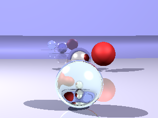

</div>

---

## Table of contents

- [About](#about)
- [Features](#features)
- [How it works](#how-it-works)
- [Platforms](#platforms)
- [Downloads](#downloads)
- [Building](#building)
- [Usage](#usage)
- [Testing](#testing)
  - [Expected output](#expected-output)
- [Repository layout](#repository-layout)
- [Scene files](#scene-files)
- [Project status](#project-status)
- [Changelog](#changelog)
- [Contributing](#contributing)
- [License](#license)

## About

Ray is a ray tracer written in 1996–1997 that splits rendering across a network of machines.
You build and edit scenes in the cross-platform scene editor, `ray-editor` (the original Windows
MFC editor was retired in 2026-alpha-0.21.2; its last version is the `mfc-editor-final` tag),
and the image is traced in parallel by engine processes on any number of machines, or by worker
threads on one.

It was originally written for [PVM](https://www.netlib.org/pvm3/) (Parallel Virtual Machine) on
a cluster of Unix workstations. The cross-platform library written for it grew into
[IASLib](https://github.com/jnaujok/IASLib), and the ray tracer now runs on IASLib 3: PVM is
replaced by plain TCP, and the command-line programs build on Windows, Linux, and macOS.
The ray tracing itself is the 1997 code.

<div align="center">

</div>

## Features

- **Primitives:** spheres, planes, cylinders, cones, boxes, tori, discs and annuli, paraboloids,
  hyperboloids, superquadrics, rounded boxes, triangles, and triangle meshes, typed into the scene
  or loaded from STL (binary, ASCII, or colored) and OBJ model files. A torus is found by a quartic
  set up close to it, so it keeps its precision far from the origin; a superquadric (from a sphere
  through a rounded cube to a pinched star) by golden-section search and bisection, grazing rays
  too; a rounded box exactly, as a smaller box grown by its radius.

  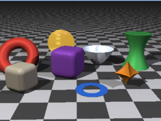
- **Text:** a `text` object sets a string in a TrueType font, its glyphs' curves flattened, holes
  found from how the outlines nest, and the faces cut into triangles, then extruded into a closed
  solid with smooth curved sides, sharp corners and an optional beveled front: any material, a
  csg (letters carved out of a slab), shadows. Lines can be set left, centered or right, and
  kerned with the font's own kerning (the `kern` table or OpenType GPOS pairs). The font goes into
  a saved scene's archive and to networked engines inside the scene.

  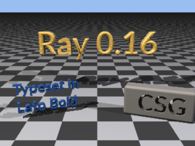
- **Bézier patches and B-spline surfaces:** a `bezier` object is made of Bézier patches of any
  degree, rational ones too, listed in the scene or read from a `.bpt` file; a `bspline` object is
  a B-spline or NURBS surface (so circles, spheres and tori come out exact), cut into Bézier
  patches by knot insertion. They are traced exactly, not as triangles: each patch is split into
  nearly flat pieces kept in a tree of boxes, and Newton's method finds where a ray meets the
  surface itself, with nothing slipping through the seams. The Utah teapot comes as Martin
  Newell's 32 bicubic patches (`scenes/models/teapot.bpt`), smooth at any size.

  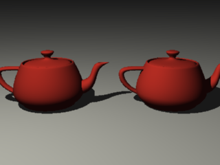 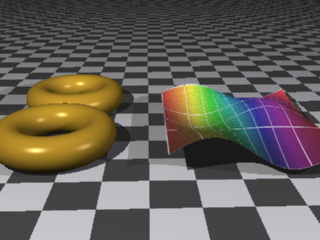
- **Lathes, extrusions and sweeps:** a `lathe` spins a profile of lines and curves (or a smooth
  curve through points) around its axis, for vases, goblets, bottles and chess pieces. It is traced
  exactly, not as triangles: each piece of the profile meets a ray where a polynomial of degree 2 to
  6 is zero. A profile that closes against the axis (or `capped`) is a solid, and `sweep` turns it
  only part way round, closing the cut with flat faces. An `extrusion` pushes outlines (holes
  worked out from how they nest) back into a solid with beveled edges, or tapered and twisted; a
  `sweep` carries a circle or any outline along a path through the scene without twisting, for
  springs, pipes, rails and neon tubes. Extrusions and sweeps are built into meshes when loaded, as
  text is (text now shares the extrusion code).

  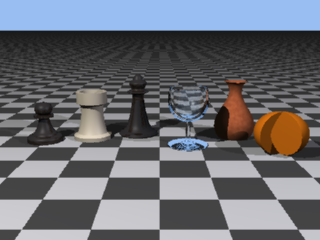 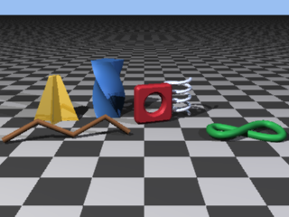
- **Implicit surfaces, blobs and fractals:** an `implicit` surface is where a formula in x, y and z
  is zero (`"x^2 + y^2 + z^2 - 1"`, a gyroid, a heart), written in a small built-in language with
  parameters, functions and exact gradients for its normals; a ray finds it by stepping and
  bisection, faster with a Lipschitz bound. A `blob` is metaballs that melt together (negative
  strength dents), found exactly as a polynomial along the ray. A `fractal` is a mandelbulb, a
  Menger sponge or a Sierpinski tetrahedron, found by sphere tracing a distance estimate. Implicit
  surfaces and blobs are solids a csg can use.

  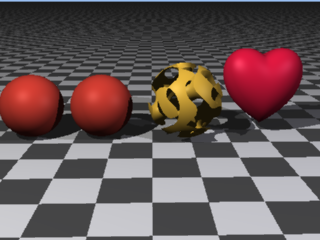 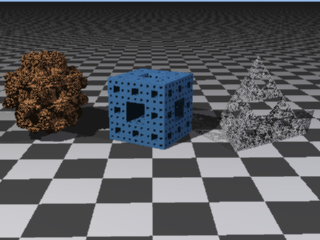
- **More about the primitives:**
  Cylinders and cones run between any two points, capped or open (an open one can be seen into and
  shadows itself inside); a cone can be cut off flat at the top, and a box can be any size along
  each axis and turned any way. A triangle's normal comes from
  its corner order; it can be single- or double-sided, and flat or smooth, with corner normals that
  can be given to override the computed ones. A mesh shares vertices
  between faces, gives each vertex the sum of its faces' normals, and keeps its faces in a bounding
  volume hierarchy built by the surface area heuristic, so a ray tests only the few faces near its
  path, nearest first. Its faces are just three vertex indices each (about 50 bytes a face with the
  tree), and every thread's copy of a scene shares one copy of each mesh's shape, built once. The scene keeps its objects
  in one too (planes, which are infinite, are tested every time), and shadow rays stop at the
  first thing in the way.
- **Constructive solid geometry:** a `csg` object combines closed shapes (spheres, boxes, tori,
  superquadrics, rounded boxes, capped cylinders, cones and quadrics, text, closed patches, closed meshes, and other
  csgs) by union, intersection or difference: a lens
  blank from two balls, a bowl from a ball with a ball taken out, a die with drilled pips. It shades
  as one object with its own materials, or with each shape's own (`childMaterials`), shadows and
  reflects itself, and takes bump maps and textures like any object.

  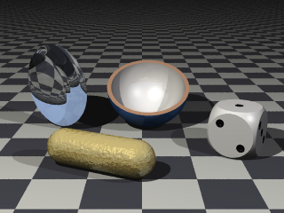

  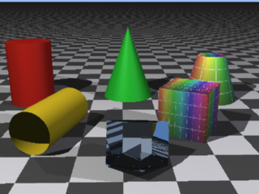
- **Lights:** point lights; spot lights, whose cone fades over a soft edge; directional lights
  (sunlight), the same everywhere; and area lights that cast soft shadows: a glowing ball
  (`sphereLight`), a glowing panel (`rectangleLight`), a spot light with a radius, and a sun with
  an angular size, whose shadows blur the farther they fall, each shaded from points spread over it.
  A spot light's beam (and a rectangle light's, given an angle) can take a profile like a real
  fixture's: linear, cosine, gaussian, a stage Fresnel's hot center, or a table of measured
  brightnesses. Lights can fall off with distance (`attenuation`), and any light can shine through
  a `filter`, an image or pattern it projects like a slide projector or a gobo: with haze and the
  `caustics` pattern from the sun, a scene looks under water.

   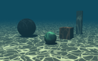

  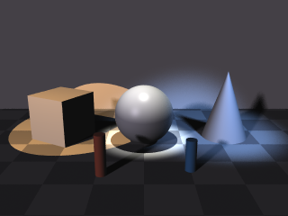
- **Environment maps:** rays that leave the scene see a sky gradient or an HDR (or PNG) picture of
  the surroundings instead of a flat background, behind the scene, in mirrors and through glass,
  and it can light diffuse surfaces too (image-based lighting), smooth from a map of the sky's
  light worked out once, darker wherever shadow rays find the sky hidden. `tools/make_textures.py`
  makes an HDR sky for the tests.

  
- **Indirect light:** light bounced between surfaces (`settings.indirect`), a "poor man's
  radiosity", so a red wall tints the white floor beside it pink and shadows and ceilings get fill
  light. Each matte point treats the objects near it (found through the scene's tree) as lights
  and aims a few rays at each, or gathers over the whole half above it (`"hemisphere"`). The rays
  come from each sample's point in its pixel, so a stratified sampler smooths it, and every thread
  and engine gives the same image; there is no cache.

  
- **Haze:** an atmosphere (`haze`) that far things fade into and that dims light on its way to a
  surface, the same everywhere or thinning with height into ground mist.

  
- **Materials:** ambient, diffuse, specular, reflective, and transparent, mixed per object by
  influence. Transparent materials can absorb light by how far it travels inside (Beer–Lambert),
  so thick glass is deeper in color than thin, and a glass ball darker through its middle than at
  its rim. Glass and mirrors can be rough: frosted glass blurs what is behind it, and a brushed or
  satin mirror blurs its reflection (GGX microfacets), best with a sampler that traces many rays
  a pixel. Glass with an Abbe number disperses: a ray splits into red, green and blue at it, each
  bent by its own index, so a flint glass prism or ball fringes what is seen through it with color.
  With the camera's `"dispersion": "spectral"` it splits instead into four single wavelengths,
  weighed by the CIE color matching functions and spread over the range by a per-pixel shuffle of
  wavelength strata, so over a pixel's samples the colors smear into a continuous rainbow (yellows
  and cyans too) instead of three bars.
  An optional sample clamp on the camera keeps a rare very bright ray (a "firefly") from showing
  as a lone speck.

  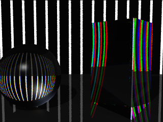

  
- **Textures:** any material's color can come from a texture instead: a checkerboard, on the
  surface or solid (carved from a checkered block), an image file (PNG of any kind, JPEG baseline
  or progressive, WebP lossless or lossy, PPM, or Ray raw, told apart by their contents and read by
  Ray's own integer-only decoders, which match libjpeg-turbo and libwebp pixel for pixel on the test
  images) laid over the surface, or a solid noise texture: marble, wood, or plain noise and turbulence (granite, stone,
  clouds), made from Perlin gradient noise and a ramp of colors. Spheres, planes, cylinders, cones, and boxes have surface coordinates of their own; triangles and meshes take
  `uvs`, and a mesh without them can use a UV map (planar, cylindrical, spherical, or box
  projection) to work them out. Networked engines get the images inside the scene, so they need no
  files.

   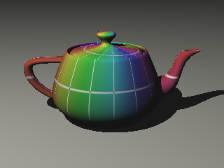

  

  Solid textures also include cellular noise (`cells`: granite flecks, spots, cracks) and the web of
  light under water (`caustics`), and any of them can be stretched along an axis (brushed metal).
- **Texture maps for every setting:** any number or color of a material can be a texture instead of
  a constant (`"roughness": { "type": "cells", ... }`, or `{ "texture": ..., "scale", "offset",
  "channel" }`): a mirror polished in patches, glass frosted in places, an index of refraction
  that wanders, a lace of glass and paint by each material's `influence`, bumps whose depth
  varies. A light's `tint` and `intensity` can be textures read at the point it lights, so what
  light arrives depends on where (cloud shadows from a noise texture on sunlight). And when glass's
  absorption is a texture, it is added up along the path inside, a step at a time, so a solid
  texture colors the glass from within: art glass swirls, smoky quartz, amber with inclusions,
  veins floating in a clear block.

  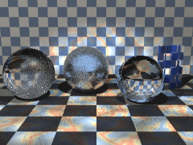 
- **Natural materials by name:** a library of 31 presets (marbles, granites, slate, sandstone and
  other stones; oak, pine, walnut, cherry, mahogany, ebony and birch; jade, amber, obsidian,
  malachite and lapis lazuli; brushed steel, gold and copper, and rust) that a scene names as a
  texture (`{ "preset": "oak", "scale": 0.03 }`) or as a whole finish in an object's materials
  (`{ "preset": "carrara-marble", "specular": { "power": 0.3 } }`), changing any field. Saved
  scenes keep the name and the changes.

  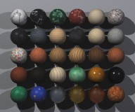
- **Model files and printed plastic:** a mesh can load an STL, OBJ, glTF 2.0 (`.gltf` or
  `.glb`, Draco-compressed or not) or Blender `.blend` `file` and place it with a
  `scale` (or `fitSize`), `rotation`, `align` and `translation`; the file goes into the saved scene
  and, inside the scene, to networked engines. Colored STL files (the VisCAM/SolidView and
  Materialise Magics conventions) give each face its color through the `faceColors` texture. The
  `layers` texture draws the rounded 0.1 mm layer lines of a 3D print, as a color and as a bump map;
  a model's textures are looked up in its file's own coordinates (millimeters for a printable
  model), so the layers follow its print axis however it is turned. glTF models bring their node
  transforms, their UVs (so an `image` texture can lay the model's own picture over it, as the chess
  set's JPEGs are) and their materials' base colors, times a PNG, JPEG or WebP base color image
  (through `faceColors`), and a mesh can pick one `node`
  (a chess piece from a whole set) or one material's primitives (`gltfMaterial`: a visor apart from
  its suit). Draco-compressed glTF (`KHR_draco_mesh_compression`, as most of NASA's 3D Resources
  are) is decoded by Ray's own decoder. Blender `.blend` files from 2.8 to 4.x are read directly,
  gzip- or Zstandard-compressed or not: every mesh object (or one, by its `node` name) with its world
  placement, active UV map and material colors. The sample scenes include
  [#3DBenchy](https://3dbenchy.com) (225,706 triangles), Poly Haven's chess set and NASA's lunar
  module and astronaut.

   
- **Bump and normal maps:** an object's `bump` tilts the normal it is shaded with, so it looks
  dented, grooved or rough while its shape stays smooth. A height map reads any texture as heights
  (a little noise makes hammered metal or orange peel; a wood or marble texture makes its grain
  stand out), and a normal map reads a tangent-space normal image in the common OpenGL convention.
  Every material on the object follows the bumps, highlights and reflections included.

  
- **Anti-aliasing:** the camera's primary rays come from a pluggable pixel sampler: `corners`
  (five rays per pixel, four of them corners shared with the neighbors, about two rays a pixel),
  `box` (four rays halfway from the center to each corner), `random` (a center ray worth half
  the pixel plus N random rays), `stratified` (an n×n grid of equally weighted rays, each at a
  random point in its cell; best for real lenses), or `adaptive` (at least 9 rays a pixel, then
  more only where they disagree: on the torture test, 28% less error than a 5×5 grid for the same
  rays; with `confidence` it trusts agreeing rays only once Student's t says they really agree, which
  halves the torture test's error (for about three times the rays), and with `"channels": "rgb"` it watches color as well as brightness). Random points
  are reproducible, so every run gives the same image. `raythrower --ray-count heat.png` draws how
  many rays each pixel took.
- **Camera:** pinhole camera with position, look-at point, up vector, and vertical field of view;
  square pixels at any image size.
- **Real lenses:** give the camera a lens prescription (spherical glass surfaces, front to back, as
  in lens patents) and rays are traced from the sensor back through each element. Rays the barrel or
  aperture stop blocks go dark, so depth of field, vignetting, and the lens's own aberrations and
  distortion come out of the optics. Give the glasses Abbe numbers and red, green and blue are
  traced at their own wavelengths, for chromatic aberration (or, with spectral dispersion, four
  single wavelengths a sample, so the fringes smear into a rainbow). Focus and exposure are worked out
  automatically; a 50 mm f/2 double Gauss is built in. Rays are aimed only at the part of the
  rear element light gets through to each point of the sensor (the exit pupil), and a ray the lens
  blocks is cast again, so no ray is wasted on the aperture stop and the lens adds almost no grain;
  vignetting comes from the measured share of rays that get through.

  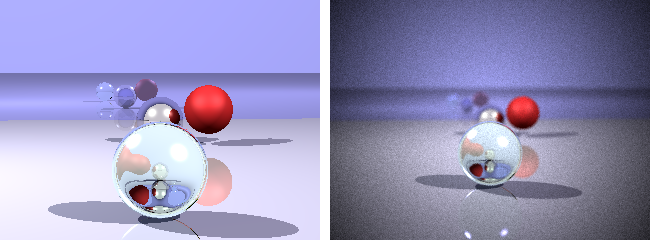

  Depth of field through the double Gauss wide open: the Najdorf Sicilian (English Attack, after
  11...b5) on a full board, Poly Haven's chess set, focused on Black's e5 pawn, with lights behind
  the board blurring into bokeh discs (`scenes/chess_dof_test.ray` at 1024×768 with `--aa
  adaptive:min=16,max=100,threshold=0.004,confidence=0.95,channels=rgb`):

  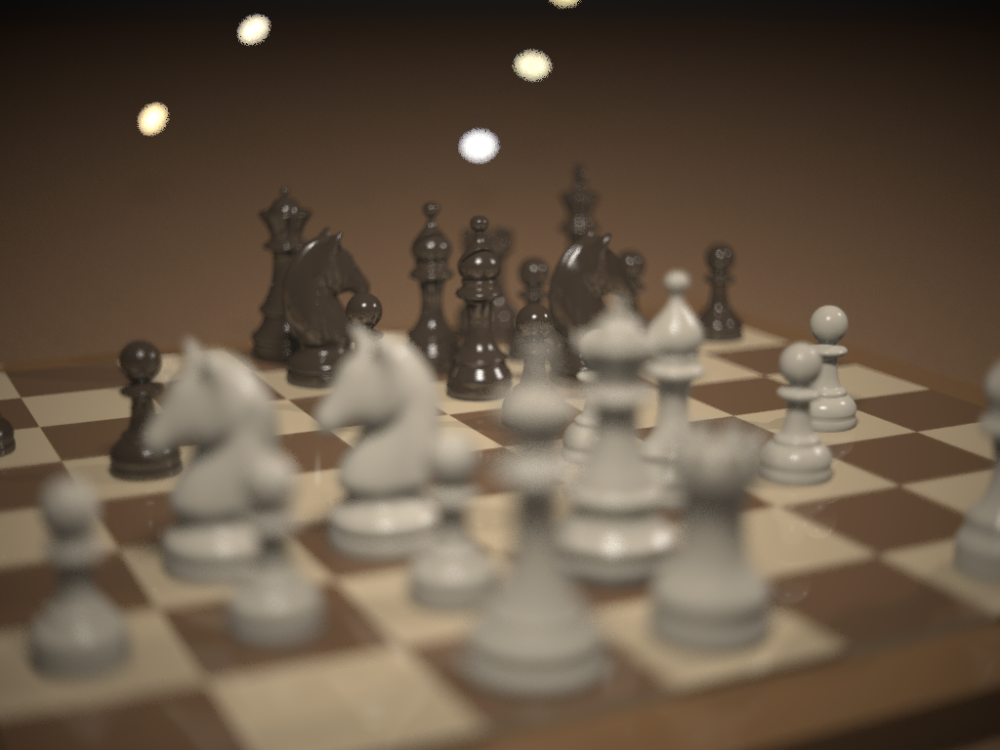

  Every built-in lens can also be built as glass in a scene (`lensElements`): its elements cut away
  to show their cross-sections, with fans of rays traced through the actual prescription to the
  film (on axis in red, green and blue, off axis in orange). One scene for each lens is in
  `scenes/cutaways/` (`tools/make_lens_cutaways.py`):

  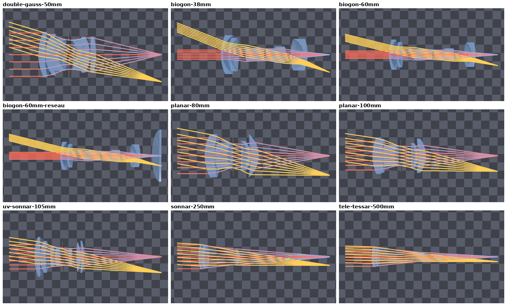
- **Color models:** the last step from pixel color to bytes is pluggable too: `clip` (the 1997
  look, and the default), `gamma`, `srgb`, `reinhard` tone mapping, `hdr`, and `film`.
- **The Apollo cameras:** the Hasselblads flown to the Moon, as camera `body` presets: the Electric
  Camera (80 mm Planar), the Data Camera (60 mm Biogon and its Réseau plate) and the
  Super-Wide-Angle Camera (38 mm Biogon). Seven Carl Zeiss lenses are built in, from the Biogon
  38 mm to the Tele-Tessar 500 mm: patent examples where Zeiss published one (US 2,721,499 for the
  Biogon, US 2,724,994 for the Planar) and labelled reconstructions where it didn't, including the
  UV-Sonnar's fused silica and calcium fluoride, traced with their Sellmeier formulas
  (`tools/apollo_lenses.py` measures every one). The `film` color model develops the image as a
  Kodak stock (Ektachrome MS and EF, Panatomic-X, High Speed Recording 2485): its characteristic
  curve, color response, grain, and the spread of light in the emulsion (irradiation and
  halation), with exposure from ISO, shutter and f-stop. The Data Camera's Réseau plate prints its
  5 × 5 crosses on every frame, and overexposed subjects bloom over them as on the real frames. A
  `regolith` material (Lommel-Seeliger with Hapke's opposition surge) lights lunar soil, and
  `tranquility_test.ray` shoots a lunar module on it with the Data Camera. `as11_40_5903_test.ray`
  recreates NASA photograph AS11-40-5903, Aldrin with Armstrong and the lunar module in his gold
  visor, from NASA's own astronaut and lunar module models.
- **Metals:** the `metal` material reflects by a conductor's exact Fresnel equations from its complex
  index n + ik in red, green and blue, so gold, copper, silver, aluminum, iron, chromium, titanium
  and platinum (presets, or your own n and k) shift color toward grazing as real metals do.

  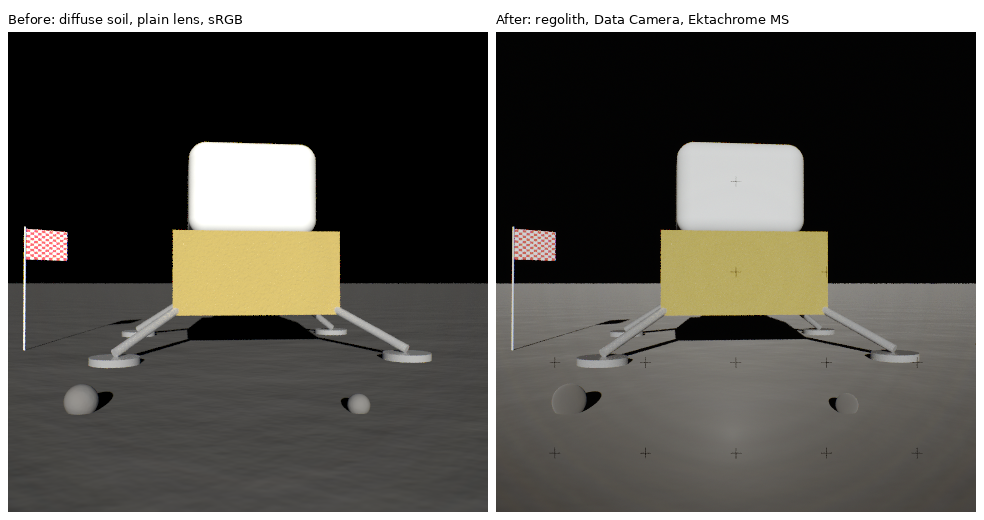
- **Image output:** PNG (`--png`) and PPM (`--ppm`) beside the original raw format, and high
  dynamic range: `--hdr` writes every pixel's linear color, unclipped, as a Radiance HDR file
  that image editors, Blender and HDR viewers open. With the `hdr` color model, its `exposure`
  scales the colors first.
- **Readable scene files:** scenes are JSON that you can write and edit by hand, with clear errors
  that say where a mistake is.
- **Cross-platform scene editor:** `ray-editor`, built on wxWidgets for Windows, Linux and macOS:
  a scene tree, a property grid (and the JSON text) for every part of the scene, checked by the
  scene's own reader, a shaded OpenGL view with a wireframe overlay that you orbit, pan, zoom and
  click to select in, a *Render* button that ray-traces the view progressively over it, undo and
  redo, and STL and OBJ import. See [`editor/README.md`](editor/README.md).
- **Distributed rendering:** `rayengine` processes connect to the master over TCP and pull tiles of
  the image from its queue, trace them (camera rays, lens and sampling included) and send back the
  pixels; faster machines simply take more tiles. Engines can run anywhere that can reach the
  master, can join in the middle of a render, and if one drops out its unfinished tiles go to the
  others.
- **Local rendering:** the same master can trace with one thread per CPU instead, pulling tiles the
  same way.
- **Models:** meshes load STL and OBJ files directly; [`tools/obj_to_ray.py`](tools/obj_to_ray.py)
  can still turn an OBJ model into an inline mesh. The sample scenes include the Utah teapot and
  3DBenchy.

## How it works

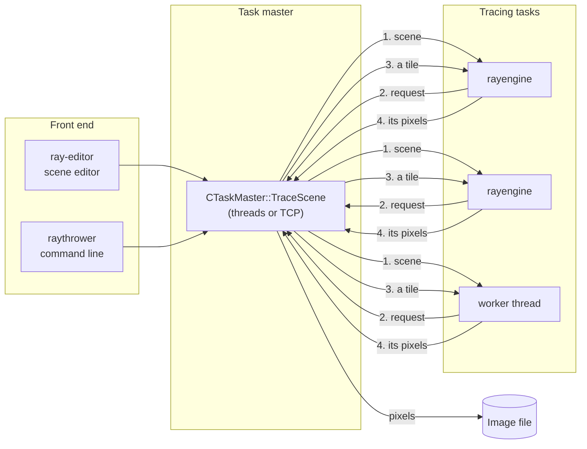

1. The master splits the image into tiles (32×32 pixels; `--tile` changes it) and sends each task
   its own copy of the scene, as JSON.
2. Each task asks for work, and the master hands it the next tile.
3. The task traces the tile with `CTileTracer`: the camera's pixel sampler picks the rays, the
   camera (and its lens) makes them, and the sampler turns their colors into the tile's pixels,
   which go back to the master as linear colors. The task asks for another tile.
4. The master writes each tile's pixels through the camera's color model into the image. A task
   that goes away has its unfinished tiles handed to the others; when the image is done the master
   tells the tasks to stop.

Which primary rays are made for each pixel, and how their colors become the pixel, is up to the
camera's pixel sampler ([`core/include/PixelSampler.h`](core/include/PixelSampler.h)). The default
casts one ray through each pixel's center; `--aa corners` attaches the anti-aliasing sampler.
The color model ([`core/include/ColorModel.h`](core/include/ColorModel.h)) then turns each pixel's
linear color into bytes. Both are set in the scene's camera, or with `--aa` and `--color`. The
sampler runs in the tasks, one tile at a time; the color model runs on the master.

Over TCP every message is framed as a tag, a length, and a payload. The scene is sent as an SJSON
packet (IASLib's compact binary JSON) of the scene file's JSON. Requests, tiles and pixels are
small fixed-layout binary messages, the pixels as IEEE-754 doubles, so they cross exactly and
networked engines make the same image as threads; `RayWire::ToReadable` turns a tile or its pixels
into JSON for reading. See [`core/include/WireProtocol.h`](core/include/WireProtocol.h). An engine
opens the connection with a hello carrying the protocol version (4).

## Platforms

| Part | Linux | macOS | Windows |
|------|:-----:|:-----:|:-------:|
| `raythrower`, `rayengine`, core | ✅ GCC, Clang | ✅ Apple Clang | ✅ MSVC |
| `ray-editor` scene editor (wxWidgets) | ✅ GTK 3 | ✅ Cocoa | ✅ MSVC |

All of them are built by CI on every push.

## Downloads

Ready-built programs for each release are on the
[Releases page](https://github.com/jnaujok/Ray/releases), as prereleases (these are alphas), from
2026-alpha-0.21.1 on: an archive for each system, and for Linux also a `.deb`, an `.rpm` and a
Flatpak bundle (from 2026-alpha-0.21.2). Each archive holds the programs, the sample scenes
(`scenes/`, with their models, fonts and textures, so they render as they are), `README.md`,
`CHANGELOG.md`, `LICENSE` and `NOTICE`; the packages put the scenes in `/usr/share/ray/scenes`:

| File | What it is |
|------|------------|
| `ray-<tag>-linux-x86_64.tar.gz` | `raythrower`, `rayengine`, `ray-editor` (a launcher for `bin/ray-editor-bin`) |
| `ray-<tag>-amd64.deb` | Ubuntu 22.04 and later, Debian 12 and later: `sudo apt install ./ray-<tag>-amd64.deb` |
| `ray-<tag>.x86_64.rpm` | RHEL, Rocky and Alma 9 and later, Fedora: `sudo dnf install ./ray-<tag>.x86_64.rpm` |
| `ray-<tag>.flatpak` | Any Linux with Flatpak: `flatpak install ray-<tag>.flatpak` (the GNOME runtime comes from Flathub) |
| `ray-<tag>-macos-arm64.tar.gz` | `raythrower`, `rayengine`, `ray-editor.app` (Apple silicon) |
| `ray-<tag>-windows-x86_64.zip` | `raythrower.exe`, `rayengine.exe`, `ray-editor.exe` |

`SHA256SUMS.txt` (and a `.sha256` beside each file) has their checksums: `sha256sum -c
SHA256SUMS.txt`. Try one with `raythrower scenes/scan_test.ray --png scan_test.png`.

- **Linux archive:** built on Ubuntu (x86-64). `raythrower` and `rayengine` need only the C and C++
  runtime. `ray-editor` needs GTK 3 and OpenGL; it's a small script that checks for them (and for a
  display) before it starts the editor, and if any are missing it names them and prints the command
  to install them: `sudo apt install libgtk-3-0 libgl1 libglu1-mesa` (Debian, Ubuntu, Mint),
  `sudo dnf install gtk3 mesa-libGL mesa-libGLU` (Fedora, RHEL 8 and later) or
  `sudo yum install gtk3 mesa-libGL mesa-libGLU` (RHEL and CentOS 7). Most desktops have them.
- **`.deb` and `.rpm`:** made with CPack (`cmake/RayPackaging.cmake`), and installed and tried in
  clean containers (Ubuntu 22.04, Debian 12, Rocky Linux 9, Fedora) before each release. They
  name GTK 3 and OpenGL as dependencies, so the package manager installs them. The editor appears
  in the desktop's menu as *Ray Editor*.
- **Flatpak:** `io.github.jnaujok.Ray`, on the GNOME 50 runtime, with access to the home folder
  (for scenes and renders), the network (for `rayengine`) and the GPU. `flatpak run
  io.github.jnaujok.Ray` starts the editor; `flatpak run --command=raythrower io.github.jnaujok.Ray
  scene.ray --png out.png` renders. It isn't on Flathub.
- **macOS:** built for Apple silicon (arm64), and not signed or notarized, so Gatekeeper stops the
  programs at first: clear the quarantine flag on the unpacked folder with
  `xattr -dr com.apple.quarantine ray-<tag>-macos-arm64` (or `xattr -d com.apple.quarantine` on
  each program), or right-click a program and choose Open.
- **Windows:** x86-64. `raythrower` and `rayengine` are built with the static Visual C++ runtime
  and need nothing installed; `ray-editor.exe` needs the
  [Microsoft Visual C++ Redistributable](https://learn.microsoft.com/cpp/windows/latest-supported-vc-redist)
  (x64), which most Windows machines already have. The programs aren't signed, so SmartScreen may
  warn: choose "More info", then "Run anyway". (The 1997 MFC editor, `Ray.exe`, was in the
  2026-alpha-0.21.1 archive, its last.)

Everything is made by `.github/workflows/release.yml` when a `2026-alpha-*` tag is pushed; an
older tag can be built by hand from the Actions page (Release, Run workflow) or with
`gh workflow run release.yml -f tag=<tag>`. The release notes are that tag's section of the
changelog (`tools/changelog_section.py`). To build the packages yourself, see
[Packages](#packages) below.

## Building

You need CMake 3.18 or later and a C++17 compiler. CMake downloads
[IASLib](https://github.com/jnaujok/IASLib) itself (pinned to the commit that added SJSON, until
IASLib tags a release with it), and nothing else is required. SJSON's optional LZ4 and zstd
support is left off, so every build is the same.

```sh
cmake -S . -B build -DCMAKE_BUILD_TYPE=Release
cmake --build build --parallel
```

This builds `raythrower` and `rayengine`. To build the cross-platform scene editor too, turn on
`RAY_BUILD_EDITOR`. CMake uses an installed wxWidgets if it finds one, and otherwise downloads
wxWidgets 3.2.9 and builds it (a few minutes, the first time). On Linux install the GTK 3 and
OpenGL development packages first (`sudo apt-get install libgtk-3-dev libgl1-mesa-dev`):

```sh
cmake -S . -B build -DCMAKE_BUILD_TYPE=Release -DRAY_BUILD_EDITOR=ON
cmake --build build --target ray-editor --parallel
```

| Option | Default | What it does |
|--------|:-------:|--------------|
| `RAY_BUILD_EDITOR` | `OFF` | Build `ray-editor`, the cross-platform scene editor (wxWidgets) |
| `RAY_USE_SYSTEM_WXWIDGETS` | `ON` | Use an installed wxWidgets if CMake finds one, instead of downloading it |
| `RAY_BUILD_TESTS` | `ON` | Build the regression tests |
| `FETCHCONTENT_SOURCE_DIR_IASLIB` | | Use a local IASLib checkout instead of downloading it |
| `RAY_PACKAGE_VERSION`, `RAY_PACKAGE_STAGE` | `0.0.0`, empty | The version the `.deb` and `.rpm` carry (`0.21.2` and `alpha` for 2026-alpha-0.21.2) |

### Packages

On Linux, `cmake --install` puts the programs in `bin/`, the sample scenes in `share/ray/scenes`,
the docs in `share/doc/ray`, and (with the editor) a desktop entry, an icon and AppStream metadata
under `share/`. CPack makes a `.deb` or an `.rpm` from that:

```sh
cmake -S . -B build -DCMAKE_BUILD_TYPE=Release -DRAY_BUILD_EDITOR=ON -DCMAKE_INSTALL_PREFIX=/usr \
      -DRAY_PACKAGE_VERSION=0.21.2 -DRAY_PACKAGE_STAGE=alpha
cmake --build build --parallel
cd build && cpack -G DEB      # or: cpack -G RPM (needs rpmbuild)
```

The Flatpak is built from [`packaging/flatpak/io.github.jnaujok.Ray.yml`](packaging/flatpak/io.github.jnaujok.Ray.yml)
with `flatpak-builder` (the commands are at the top of that file).

## Usage

**Trace with threads on this machine:**

```sh
raythrower scenes/scan_test.ray -o scan_test.raw --png scan_test.png
```

**Keep the highlights** in a high dynamic range file, as well as a PNG:

```sh
raythrower scenes/scan_test.ray --color hdr:exposure=1.5 --png scan_test.png --hdr scan_test.hdr
```

**Smooth the edges** with five rays per pixel:

```sh
raythrower scenes/scan_test.ray --aa corners --ppm scan_test.ppm
```

**Tone map** instead of clipping highlights:

```sh
raythrower scenes/scan_test.ray --color reinhard --ppm scan_test.ppm
```

**Shoot through a real lens** (the camera's `lens` in the scene; see
[`scenes/lens_test.ray`](scenes/lens_test.ray)):

```sh
raythrower scenes/lens_test.ray --aa stratified:grid=8 --ppm lens.ppm
```

**Shoot with an Apollo Hasselblad** (a camera `body`; see
[`scenes/tranquility_test.ray`](scenes/tranquility_test.ray)):

```sh
raythrower scenes/tranquility_test.ray --size 1024x1024 --png tranquility.png
```

**Render the Utah teapot** (6,320 triangles):

```sh
raythrower scenes/teapot.ray --aa corners --ppm teapot.ppm
```

**Render the torture test**, every kind of object (the teapot too, in marble, traced from its 32 Bézier patches, and a layer-lined
3DBenchy, a colored-STL puzzle cube, an OBJ ring, a gold torus that reflects as gold does (the `metal` material), "RAY" in beveled letters set in
Lato Bold on top of the mirror frame, a glass goblet and a black queen turned on a lathe, a twisted, tapered star, a steel spring
and a purple cluster of metaballs), mirrors, glass
(the cube with green swirls inside, the ball frosted, the mirror frosted in patches, a flint prism fanning colors into a spectrum), a die with drilled
pips (constructive solid geometry), textures and presets (a walnut mirror frame, a malachite cone), a brushed
gold tube, soft shadows from a sphere light, a rectangle light, a spot light with a Fresnel beam
that projects dappled caustics onto the teapot, and a low sun under drifting cloud shadows (its intensity a noise texture), and an
HDR sky in the mirrors and glass that lights the scene too, light bounced between surfaces, and a
light haze, through the double Gauss lens stopped down to f/8 so it is sharp from front to back, each ray traced at four wavelengths (spectral
dispersion) and clamped at 1.5. With the scene's own 5×5 stratified sampler (25 rays a pixel), its
full 1024×768 takes about eight and a half minutes on an idle 16-core machine with a Release build:

```sh
raythrower scenes/torture_test.ray --png torture.png --hdr torture.hdr
```

The image below is rendered with the adaptive sampler instead (at least 16 rays a pixel, up to 100
where Student's t says they don't yet agree, watching red, green and blue apart), which is much
cleaner: 69 rays a pixel on average, about 25 minutes on an idle 16-core machine (24,137
CPU-seconds in 2026-alpha-0.21, which spends more rays on bounce light around large objects):

```sh
raythrower scenes/torture_test.ray --aa adaptive:min=16,max=100,threshold=0.004,confidence=0.95,channels=rgb --png torture.png
```

raythrower prints how many rays a render cast, by kind, at the end (`--stats` prints it even with
`--quiet`, and `--stats-json <file>` writes it as JSON). The torture test at 240×180 with the
adaptive command above (2026-alpha-0.21.1; 1,389 CPU-seconds, 110 s on 16 threads):

| Kind | Rays | Share | Per pixel |
|------|-----:|------:|----------:|
| camera | 12,363,096 | 5.3% | 286 |
| shadow (point light) | 28,490,826 | 12.2% | 660 |
| shadow (spot light) | 28,490,826 | 12.2% | 660 |
| shadow (sphere and rectangle lights) | 56,981,652 | 24.4% | 1,319 |
| shadow (sun) | 28,490,826 | 12.2% | 660 |
| shadow (sky) | 28,490,826 | 12.2% | 660 |
| indirect (bounce) | 33,402,215 | 14.3% | 773 |
| reflection | 12,910,932 | 5.5% | 299 |
| refraction | 4,229,247 | 1.8% | 98 |
| total | 233,850,446 | | 5,413 |

Seven rays in ten are shadow rays: every point shaded casts one at each of the six lights, sky
included, whether or not the light reaches it (a point outside the spot's cone still asks), which
is where the next optimizations should look.

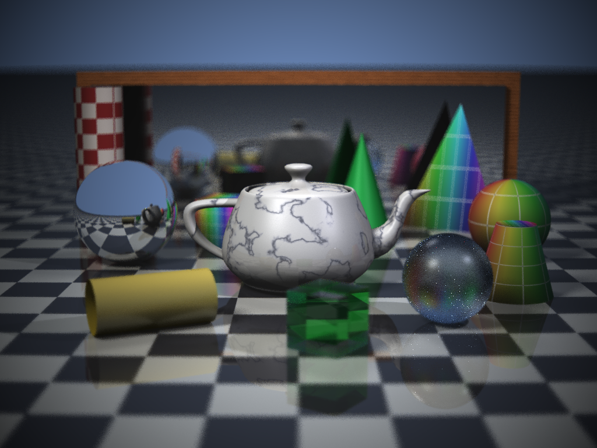

**Bring in a model**: name an STL or OBJ file in a mesh, and place it (here a printable model,
which stands on z, turned to stand on y, 2 units across, on the floor):

```json
{ "type": "mesh", "file": "models/3DBenchy.stl", "fitSize": 2, "rotation": [-90, 0, 0], "align": "bottom",
  "materials": [ { "type": "diffuse", "color": [1, 1, 1], "texture": { "type": "layers" } } ] }
```

Or turn an OBJ model into an inline mesh (`--weld` joins repeated vertices so the surface is smooth
across seams):

```sh
tools/obj_to_ray.py model.obj --smooth --weld > model_mesh.json
```

**Trace with engines on this machine**, started for you:

```sh
raythrower scenes/scan_test.ray --listen --spawn -N8
```

**Trace across machines.** Start the master, then an engine on each machine:

```sh
raythrower scenes/scan_test.ray --listen 7997 -N3      # on the master
rayengine master.example.com 7997                       # on each of three machines
```

| `raythrower` option | Meaning |
|--------|---------|
| `-N<count>`, `--tasks <count>` | Number of tracing tasks (default: one per CPU) |
| `-o`, `--output <file>` | Image file (default: the one named in the scene) |
| `--ppm <file>` | Also write the image as a PPM file |
| `--png <file>` | Also write the image as a PNG file |
| `--hdr <file>` | Also write the linear, unclipped colors as a Radiance HDR (`.hdr`) file, for high dynamic range |
| `--listen [port]` | Use engines over TCP on this port (default 7997; 0 picks a free one) |
| `--spawn` | Start the engines on this machine |
| `--engine <path>` | The `rayengine` to start (default: the one next to `raythrower`) |
| `--timeout <seconds>` | How long to wait for engines to connect (default 60) |
| `--tile <pixels>` | Size of the square tiles tasks ask for (default 32) |
| `--aa <sampler>` | Pixel sampler, instead of the scene's: `none`, `corners`, `box`, `random`, `stratified`, or `adaptive`; settings after a colon, as in `random:samples=9` or `adaptive:min=16,threshold=0.005` |
| `--color <model>` | Color model, instead of the scene's: `clip`, `gamma`, `srgb`, `reinhard`, or `hdr`; settings as for `--aa`, as in `reinhard:exposure=1.5` |
| `--size <w>x<h>` | Image size, instead of the scene's |
| `--save <file>` | Save the scene (with any `--aa`/`--color`/`--size`) as a scene archive, textures inside, and exit |
| `--save-json <file>` | Save it as plain JSON, with the files it uses beside it, and exit |

Images are written in the original raw format: a 2-byte width, a 2-byte height (both big-endian),
then RGB bytes. `--png` and `--ppm` give copies any image viewer can open. `--hdr` keeps what the
8-bit formats lose: colors brighter than white, at floating-point precision (Radiance RGBE: a byte
each for red, green and blue and a shared exponent). It holds the color model's linear colors:
the traced colors as they are, or scaled by the `hdr` or `reinhard` model's `exposure`.

**Cross-platform scene editor:** run `ray-editor` (or `ray-editor scenes/torture_test.ray`). The
tree on the left lists the settings, camera, environment, objects (with their materials) and
lights; the panel on the right edits the selected one as a property grid or as JSON; the view in
the middle shows the scene shaded with OpenGL. Drag to orbit, right-drag to pan, use the wheel to
zoom and click an object to select it. *View > Wireframe Overlay* draws the triangles' edges,
*View > Look Through Scene Camera* shows what the camera sees, and *Render > Render View* (F5)
ray-traces the view over it, a quick pass first. *Edit* adds objects, lights and a sky, and
*File > Import Model* brings in an STL or OBJ file. See [`editor/README.md`](editor/README.md).

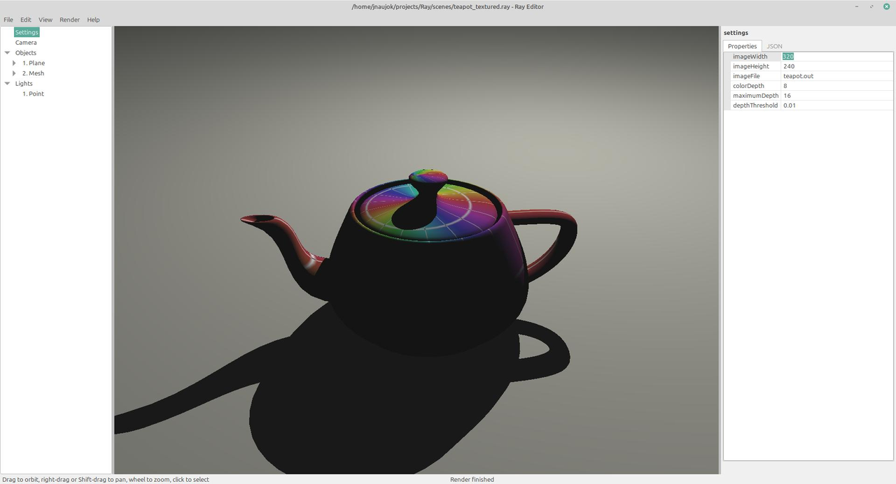

## Testing

```sh
cmake --preset release && cmake --build --preset release
ctest --preset fast        # every test but the three slow renders: about 35 to 55 s on 16 cores
ctest --preset full        # every test: about 45 to 80 s (the range is a busy machine)
```

The presets (`CMakePresets.json`) build optimized, as CI does, and run 8 tests at a time; `ctest
--test-dir build -j 8 [-LE slow]` does the same without them. The torture test, the Benchy close-up
and the prism are labelled `slow`. `cmake --preset asan` and `ctest --preset asan-fast` run the fast
tests under AddressSanitizer and UndefinedBehaviorSanitizer (about 4 minutes). A Debug build runs
the suite about three times slower; use it for the debugger. CI runs every test on every system, and
every test under the sanitizers, except the torture test (labelled `torture`), which is too heavy
for the runners: CI runs `ctest -LE torture`, and the `full` preset runs it locally before every
merge.

`tools/bench.py` times six fixed renders and checks their images' MD5s, for performance work; what
it found is in [`docs/performance.md`](docs/performance.md) (2026-alpha-0.21).
`tools/bounce_sweep.py` measures indirect light's noise and render time against its number of rays
(see the 2026-alpha-0.14.1 changelog; the scenes in `scenes/studies/` compare the two methods), and
`tools/adaptive_sweep.py` the adaptive sampler's noise against its cost (2026-alpha-0.20.1); they
are measurements, not tests.

The tests render every sample scene and compare it with a reference render (four of them again with
corner anti-aliasing, one with each other sampler and color model, the teapot, two real lenses,
textures, solid textures and absorbing glass, rough glass and mirrors with area lights, bump and normal maps with PNG textures, spot and
directional lights, an HDR environment map, cylinders, cones, and boxes, constructive solid geometry, a dispersive prism, models from colored STL and OBJ files,
3DBenchy with printed layer lines, light bounced between surfaces, haze and ground mist, every material preset, beam profiles, a projected slide and attenuation, underwater caustics, texture maps on every material setting and on a light, textures inside glass, every new shape, text set in a TrueType font and carved with a csg, lathes, extrusions and sweeps, implicit surfaces, metaballs and fractals, the Apollo cameras (a Hasselblad and its lens, Kodak film with grain and halation, the Réseau crosses blooming over, and Tranquility Base on regolith), a chessboard in depth of field from glTF pieces, the AS11-40-5903 recreation with a gold metal visor, models read from Blender .blend files, textures from JPEG and WebP files beside their PNG original, and a torture test of all of them through a real lens).
They also check the scene editor's logic without a display (`editor_logic`): editing parts as
JSON with undo and redo, the new-object templates, tessellation, that the view aims rays exactly as
the tracer's camera does, picking, model import, saving, and the progressive render.
They check that a lens has the focal length, f-number, focus and color dispersion its
prescription should, that
networked engines produce exactly the same bytes as threads (even when an engine drops out mid-render
and another joins), and that tiles and pixels cross the wire
exactly (including texture images embedded in the scene), that scene files survive a load and save, that mistakes in JSON scenes are reported where
they are, triangle sidedness and that smooth mesh faces agree along shared edges, where rays hit
cylinders, cones, and boxes and the normals there, and that a mesh's bounding volume hierarchy finds
exactly the hits testing every face does (on the teapot and on 3DBenchy), and that the scene's tree finds exactly the hits and
shadows testing every object does. They check that gradient noise is smooth, bounded and set by its
seed, and that glass absorbs exactly as Beer–Lambert says for the distance through it. They check
that rough surfaces draw their microfacets from the GGX distribution, that rough glass is the same
every time for the same ray, that a sphere light's points lie on the disc it shows, that a
rectangle light shines only to its front, and that hiding half of one gives half its light. They
check that PNG images of every color type and bit depth, interlaced or not, decode exactly, that
damaged or truncated ones are refused, that JPEGs (baseline, progressive, every common
subsampling, grayscale, restart markers, Exif orientations) decode as libjpeg-turbo decodes them
and lossy WebPs (alpha, the simple filter, several partitions, one segment) as libwebp does, that
lossless WebPs (every transform, palettes of 2 to 100 colors, alpha) decode exactly, that what isn't
read (CMYK, arithmetic coding, 12-bit, lossless JPEG, animated WebP) is reported, and that cut-off
or damaged images fail cleanly, that the rays a render casts, by kind, are the same with 4
threads, 2 threads and 3 networked engines (`ray_counts_*`), and that height and normal maps tilt the normal the way
and by the amount they should. They check that a spot light's cone fades along a smoothstep, that
sunlight is the same everywhere and casts shadows the size of what casts them (soft with an angle),
that HDR images decode exactly, flat or run-length encoded, that an environment shows each pixel
along its own direction and wraps around, and that the sky's light is right for a uniform sky, a
half sky and the foot of a wall. They check where rays hit a union, an intersection, a difference
and a nested csg and the normals there (inside out on a subtracted shape), from outside, inside and
leaving the surface, that each surface takes its own shape's materials with `childMaterials`, that
dispersive glass bends each color by the index a lens's glass would have, that a ray in every color
splits into exactly what rays traced in each color alone see, that spectral weights add up to
white over the visible range, that a wavelength bends as its line's index says and is picked the
same way every time, that a camera without dispersive glass sees the same in spectral mode, that
every thread's copy of a scene shares a mesh's geometry and lets it go with the last one, and that
the sample clamp caps each channel. With Python 3 installed, they also decode the PNG and
HDR output (with Python's own zlib) and check it against the raw image. CI runs them
on every platform, and again on Linux under AddressSanitizer and UndefinedBehaviorSanitizer.

### Expected output

These are the reference renders the tests compare against, from
[`tests/reference/renders.tar.gz`](tests/reference/renders.tar.gz), each labelled with its test.
They are shown at up to 320 pixels wide; `tools/render_previews.py` makes these previews from the
archive, so run it whenever the references are regenerated. The networked tests (`network_*`)
render their scenes small with engines and with threads and must get exactly the same bytes, so they
have no images of their own. `render_bounce_hemisphere` is `render_bounce`'s room gathered with the
`"hemisphere"` method at the same 54 rays a point, for contrast.

**Sample scenes**, with each scene's own sampler and color model (one ray a pixel, `clip`).
`huh` and `ser_test2` have nothing in view. `triangle2`'s corners are given tilted normals that fake
a curve; they are what light it, since its lights lie in the triangle's own plane.

<table>
<tr><td align="center"><br><code>render_axis_test</code></td><td align="center"><br><code>render_huh (blank by design)</code></td><td align="center"><br><code>render_inside_sphere</code></td></tr>
<tr><td align="center"><br><code>render_mat_test</code></td><td align="center">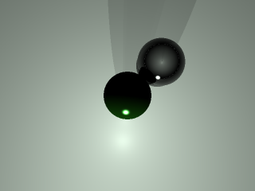<br><code>render_reflect_me</code></td><td align="center"><br><code>render_reflect_test2</code></td></tr>
<tr><td align="center"><br><code>render_reflect_test3</code></td><td align="center">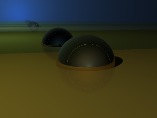<br><code>render_reflection_test</code></td><td align="center"><br><code>render_scan_test</code></td></tr>
<tr><td align="center"><br><code>render_ser_test</code></td><td align="center"><br><code>render_ser_test2 (blank by design)</code></td><td align="center">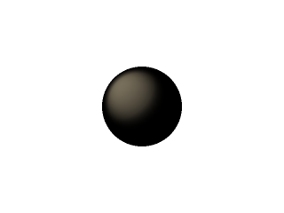<br><code>render_spec_test</code></td></tr>
<tr><td align="center">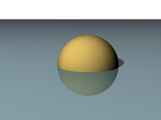<br><code>render_test</code></td><td align="center">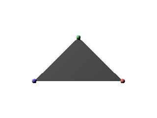<br><code>render_triangle</code></td><td align="center"><br><code>render_triangle2</code></td></tr>
<tr><td align="center"><br><code>render_xxx</code></td><td align="center"><br><code>render_teapot (160x120)</code></td><td align="center"><br><code>render_lens (160x120)</code></td><td align="center"><br><code>render_chromatic (160x120)</code></td><td align="center"><br><code>render_texture</code></td><td align="center">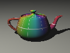<br><code>render_teapot_textured (120x90)</code></td></tr>
<tr><td align="center"><br><code>render_primitives</code></td><td align="center"><br><code>render_torture (160x120)</code></td><td align="center"><br><code>render_solid_textures</code></td></tr>
<tr><td align="center"><br><code>render_soft (160x120)</code></td><td align="center"><br><code>render_bump</code></td><td align="center"><br><code>render_lights (160x120)</code></td></tr>
<tr><td align="center"><br><code>render_environment (160x120)</code></td><td align="center"><br><code>render_csg</code></td><td align="center"><br><code>render_prism</code></td></tr>
<tr><td align="center"><br><code>render_models</code></td><td align="center"><br><code>render_benchy</code></td><td align="center"><br><code>render_bounce (160x120)</code></td></tr>
<tr><td align="center"><br><code>render_haze (160x120)</code></td><td align="center"><br><code>render_materials</code></td><td align="center"><br><code>render_projector</code></td></tr>
<tr><td align="center"><br><code>render_underwater</code></td><td align="center">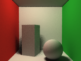<br><code>render_bounce_hemisphere (160x120)</code></td><td align="center"><br><code>render_maps</code></td></tr>
<tr><td align="center"><br><code>render_volume</code></td><td align="center"><br><code>render_shapes</code></td><td align="center"><br><code>render_text</code></td></tr>
<tr><td align="center"><br><code>render_patches</code></td><td align="center"><br><code>render_nurbs</code></td><td align="center"><br><code>render_lathe</code></td></tr>
<tr><td align="center"><br><code>render_extrusion</code></td><td align="center"><br><code>render_implicit</code></td><td align="center">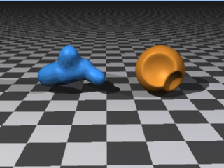<br><code>render_blob</code></td></tr>
<tr><td align="center"><br><code>render_fractal</code></td><td align="center">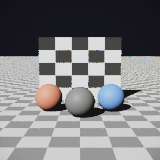<br><code>render_apollo_lenses</code></td><td align="center">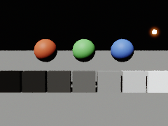<br><code>render_film</code></td></tr>
<tr><td align="center">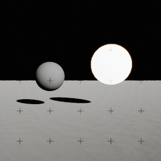<br><code>render_reseau</code></td><td align="center">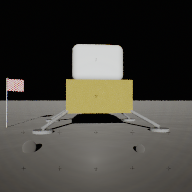<br><code>render_tranquility</code></td></tr>
<tr><td align="center">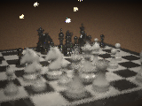<br><code>render_chess_dof</code></td><td align="center">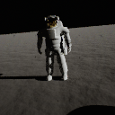<br><code>render_as11_40_5903</code></td><td align="center">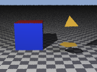<br><code>render_blend</code></td></tr>
<tr><td align="center">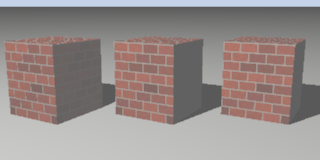<br><code>render_images</code></td><td align="center">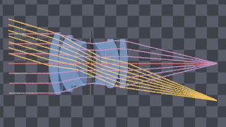<br><code>render_lens_cutaway</code></td></tr>
</table>

**Samplers** (`--aa`): corner anti-aliasing on four scenes, and the `box`, `random`,
`stratified` (3×3) and `adaptive` samplers on `scan_test` (compare with `render_scan_test` above).

<table>
<tr><td align="center"><br><code>render_aa_scan_test (corners)</code></td><td align="center">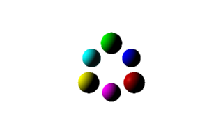<br><code>render_aa_axis_test (corners)</code></td><td align="center">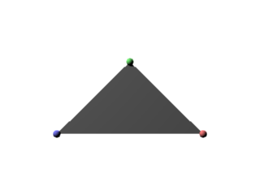<br><code>render_aa_triangle (corners)</code></td></tr>
<tr><td align="center"><br><code>render_aa_xxx (corners)</code></td><td align="center"><br><code>render_sampler_box</code></td><td align="center"><br><code>render_sampler_random2</code></td></tr>
<tr><td align="center"><br><code>render_sampler_random4</code></td><td align="center"><br><code>render_sampler_random9</code></td><td align="center">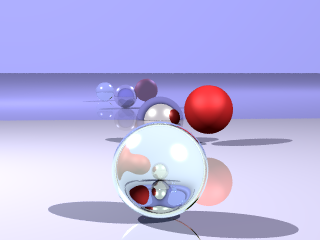<br><code>render_sampler_stratified</code></td></tr>
<tr><td align="center"><br><code>render_sampler_adaptive</code></td></tr>
</table>

**Color models** (`--color`) on `scan_test`. The 1997 scenes were lit for screens without gamma
encoding, so `gamma` and `srgb` look washed out; `reinhard` brings back clipped highlights. `hdr`
at its default exposure looks like `srgb` here: what it adds is the `--hdr` file.

<table>
<tr><td align="center"><br><code>clip (the default)</code></td><td align="center">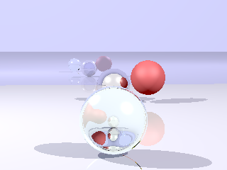<br><code>render_color_gamma</code></td></tr>
<tr><td align="center">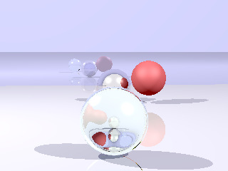<br><code>render_color_srgb</code></td><td align="center">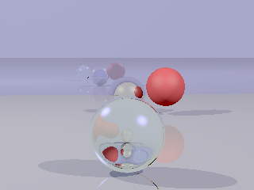<br><code>render_color_reinhard</code></td></tr>
<tr><td align="center"><br><code>render_color_hdr</code></td></tr>
</table>

## Repository layout

| Path | Contents |
|------|----------|
| [`core/`](core) | The ray tracer: scene, objects, materials, serialization, task masters, TCP transport |
| [`raythrower/`](raythrower) | Command-line master |
| [`rayengine/`](rayengine) | Networked tracing task |
| [`editor/`](editor) | `ray-editor`, the cross-platform scene editor: `logic/` (no toolkit: the document, tessellation, the view's camera, the progressive render) and `gui/` (wxWidgets) |
| [`scenes/`](scenes) | Sample `.ray` scenes: the 1997 test scenes, as JSON, and newer ones (the Utah teapot, lenses, textures, models); `scenes/textures/` holds texture images, `scenes/models/` model files, among them 3DBenchy (CC0), and `scenes/fonts/` fonts, Lato Bold (SIL Open Font License; see [NOTICE](NOTICE)) |
| [`tools/`](tools) | `obj_to_ray.py`, which turns OBJ models into meshes; `render_previews.py`, which makes the README's expected-output images; `check_image.py`, which checks PNG and HDR output; `make_textures.py`, which makes the brick textures and the sky; `make_models.py`, which makes the small model files; `make_lens_cutaways.py`, which writes the lens cutaway scenes; `make_icon.py`, which draws the icon's PNG (see [`tools/README.md`](tools/README.md)) |
| [`packaging/`](packaging) | The desktop entry, icon and AppStream metadata, the Linux archive's `ray-editor` launcher and Debian `copyright` (`linux/`), and the Flatpak manifest (`flatpak/`) |
| [`tests/`](tests) | Regression tests and reference renders |
| [`cmake/`](cmake) | The scene editor's build, `RayEditor.cmake` (wxWidgets) |
| [`docs/`](docs) | README images, the changelog's before and after images, and the performance notes (`performance.md`) |
| [`legacy/`](legacy) | Visual C++ 4, 5, and 6 project files, kept for history |

## Scene files

A saved `.ray` file is an [IASLib](https://github.com/jnaujok/IASLib) resource archive holding the
scene and every file it uses, such as texture images, so one file carries the whole scene. The
scene inside is JSON: render settings, the camera with its sampler and color model, objects with
their materials, and lights. Plain JSON `.ray` files load too (the sample scenes are kept that way),
and `raythrower --save-json` writes one, with the files it uses beside it, for editing by hand.
Only the camera is required; anything else left out takes its default.

```json
{
    "format": "Ray scene",
    "version": 3,
    "settings": { "imageWidth": 640, "imageHeight": 480, "imageFile": "ball.out" },
    "camera": {
        "position": [0, 1, -10],
        "lookAt": [0, 0, 0],
        "verticalAngle": 30,
        "sampler": "corners",
        "colorModel": { "type": "reinhard", "exposure": 1.5 }
    },
    "objects": [
        { "type": "plane", "position": [0, -1, 0], "normal": [0, 1, 0] },
        {
            "type": "sphere", "center": [0, 0, 0], "radius": 1,
            "materials": [
                { "type": "diffuse", "influence": 0.6, "color": [0.8, 0.2, 0.2] },
                { "type": "reflective", "influence": 0.4, "color": [1, 1, 1] }
            ]
        }
    ],
    "lights": [ { "type": "point", "position": [5, 8, -6], "color": [1, 1, 1] } ]
}
```

Numbers are written rounded to six decimal places. The binary files of 1996–1999 are no longer
read; the sample scenes were converted before that format was dropped.
[`scenes/README.md`](scenes/README.md) describes every field, lists the sample scenes, and gives
the format's history.

## Project status

The code builds and runs on current compilers, and work on the ray tracing has resumed: a corrected
camera, anti-aliasing, color models, meshes (with a bounding volume hierarchy), cylinders, cones
and boxes, solid marble, wood and stone textures, glass that absorbs by thickness, frosted glass
and brushed mirrors, area lights with soft shadows, bump and normal maps, PNG textures, spot and
directional lights, environment maps with image-based lighting, constructive solid geometry,
dispersive glass with spectral dispersion, STL and OBJ model files with printed layer lines and
lean, shared meshes, light bounced between surfaces, haze, a library of natural material presets,
beam profiles, attenuation and projected light filters, texture maps for every material and
light setting, textures inside glass, tori, discs, quadrics, superquadrics and rounded boxes, 3D text
from TrueType fonts, Bézier patches and B-spline and NURBS surfaces traced exactly, solids turned on a lathe, extrusions
and sweeps along a path, implicit surfaces from formulas, metaballs and fractals, and JSON scenes
so far, and a cross-platform scene editor with a shaded OpenGL view and progressive rendering, which
reaches every feature through JSON editing. The Apollo cameras are in: the Hasselblad bodies,
seven Zeiss lenses, Kodak film with grain and halation, the Réseau plate, and lunar regolith,
and a recreation of AS11-40-5903. Models load from glTF (Draco-compressed too) and Blender
`.blend` files as well as STL and OBJ. 2026-alpha-0.21 was a tuning release: frames split their last
tiles, scene copies share the files they carry, and networked engines share one encoding of the
scene (see [`docs/performance.md`](docs/performance.md)). 2026-alpha-0.21.1 reads JPEG and WebP images
with Ray's own decoders and counts every ray a render casts, by kind.

## Changelog

See [CHANGELOG.md](CHANGELOG.md).

## Contributing

This repository is **not accepting outside contributions**. Please don't open pull requests.
See [CONTRIBUTING.md](CONTRIBUTING.md).

## License

Licensed under the [Apache License, Version 2.0](LICENSE). See [NOTICE](NOTICE) for attribution.
The build uses [IASLib](https://github.com/jnaujok/IASLib), which is licensed under the LGPL-3.0.

Copyright © 1997–2026 Jeffrey Naujok.
