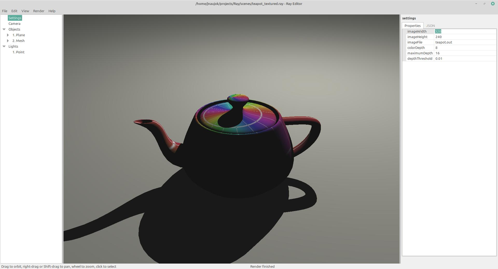

# ray-editor: the cross-platform scene editor

`ray-editor` edits Ray scenes on Windows, Linux and macOS. It's built on
[wxWidgets](https://www.wxwidgets.org/) 3.2 (native controls on each system: Win32, GTK 3,
Cocoa). It replaced the Windows-only MFC editor, `Ray.exe`, which was retired in 2026-alpha-0.21.2
(its last version is the `mfc-editor-final` tag).



## Building

```sh
cmake -S . -B build -DCMAKE_BUILD_TYPE=Release -DRAY_BUILD_EDITOR=ON
cmake --build build --target ray-editor --parallel
build/editor/ray-editor scenes/torture_test.ray     # macOS: build/editor/ray-editor.app
```

- CMake uses an installed wxWidgets (3.1 or later, with `core`, `base`, `gl` and `propgrid`) if
  `find_package` finds one. Otherwise it fetches wxWidgets 3.2.9 and builds it as static
  libraries with only what the editor needs, which takes a few minutes the first time.
  `-DRAY_USE_SYSTEM_WXWIDGETS=OFF` always fetches it, and `-DRAY_WXWIDGETS_URL=file:///…`
  fetches from a local copy of the release tarball.
- Linux needs the GTK 3 and OpenGL development packages
  (`sudo apt-get install libgtk-3-dev libgl1-mesa-dev`). Windows needs MSVC, macOS Xcode's
  command-line tools.
- Without `RAY_BUILD_EDITOR`, the editor's toolkit-free logic still builds, and the
  `editor_logic` test checks it.

## Using it

The window has the scene tree on the left, the view in the middle and the selected part's
properties on the right.

- **Scene tree:** the settings, the camera, the environment (if there is one), the objects (each
  with its materials under it) and the lights. Selecting one shows its properties; selecting a
  material shows its object with that material in view.
- **Properties:** a grid of the part's fields: numbers, switches, text, and x, y, z (or red,
  green, blue) for vectors and colors, with its materials, texture, bump map, sampler, lens and
  so on as sections. The **JSON** page shows the part as the scene file holds it, for anything
  the grid doesn't show (a mesh's vertices, a long color ramp) or a new `type`. Either way the
  scene's own reader checks the change, and if it refuses it, the reason shows under the panel
  and nothing changes.
- **View:** the scene shaded with OpenGL, lit by its lights (or a lamp at the eye if it has
  none), with icons for the lights (a star; a ring for a sphere light, the panel for a rectangle
  light, the cone for a spot, arrows for the sun) and the camera's frustum. Glass is drawn
  see-through, and a csg's parts are drawn faintly rather than the solid they make. Textures show
  as one color: this is a preview, not the render.
  - Drag to orbit, right-drag (or Shift-drag) to pan, and use the wheel to zoom. Click an object
    to select it: the tracer's own hit test picks what a render would show there.
  - **View > Wireframe Overlay** (W) draws every triangle's edges over the shading.
  - **View > Look Through Scene Camera** (C) shows what the scene's camera sees. With a real lens
    the field of view comes from its focal length and sensor, so it's close but not exact.
    Dragging leaves it.
  - **View > Frame All** (F) and **View > Set Scene Camera to This View**.
- **Render > Render View** (F5) ray-traces exactly what the view shows, at the view's size,
  over it: a quick pass first (a ray a pixel, a quarter of the size), then the scene's own
  sampler. It uses all the processors, through the same tile queue and worker threads as
  `raythrower`. Moving the view or changing the scene stops it (or press Esc). **Save Render as
  PNG** saves the finished image.
- **Edit:** undo and redo (every change, back to the last open), add objects (sphere, box, plane,
  cylinder, cone, triangle, torus, disc, annulus, paraboloid, hyperboloid, superquadric, rounded box)
  and lights (point, spot, directional, sphere, rectangle), add a sky,
  duplicate and delete.
- **File:** new, open (scene archives and JSON), save (a `.ray` archive with every file the scene
  uses, or plain `.json` with the files beside it), and **Import Model** (STL or OBJ), which adds
  a mesh fitted to two units and standing on the floor.

## Not yet

- Moving objects by dragging them in the view: positions are edited in the properties.
- Textures, reflections and soft shadows in the shaded view (use Render).
- Adding csgs, meshes and text from the menus: add another object and change its JSON.

## How it's built

| Part | Files | Toolkit |
|------|-------|---------|
| Document: loading, saving, editing parts as JSON, undo, templates | `logic/EditorDocument` | none |
| Tessellation of objects, light and camera icons | `logic/Tessellator` | none |
| The view's camera: orbit, pan, zoom, OpenGL matrices, the ray through a pixel | `logic/ViewCamera` | none |
| The progressive render and picking | `logic/RenderJob` | none |
| Window, tree, menus | `gui/MainFrame` | wxWidgets |
| Property grid and JSON page | `gui/PropertyPanel` | wxWidgets (`wxPropertyGrid`) |
| Shaded view | `gui/SceneCanvas` | wxWidgets (`wxGLCanvas`), OpenGL 1.x |

The view uses only OpenGL 1.x fixed-function calls (display lists, GL lighting, client arrays),
which every platform's OpenGL still has: Windows' `opengl32`, macOS's legacy 2.1 profile and
Mesa. The scene's coordinates are left-handed, as the tracer's camera takes them, and the view's
matrices match the tracer's camera exactly, so a render lines up with the view; `editor_logic`
checks this against `CCamera::RayDirection`.

The editor's logic files include no wxWidgets headers; only `gui/` does.
